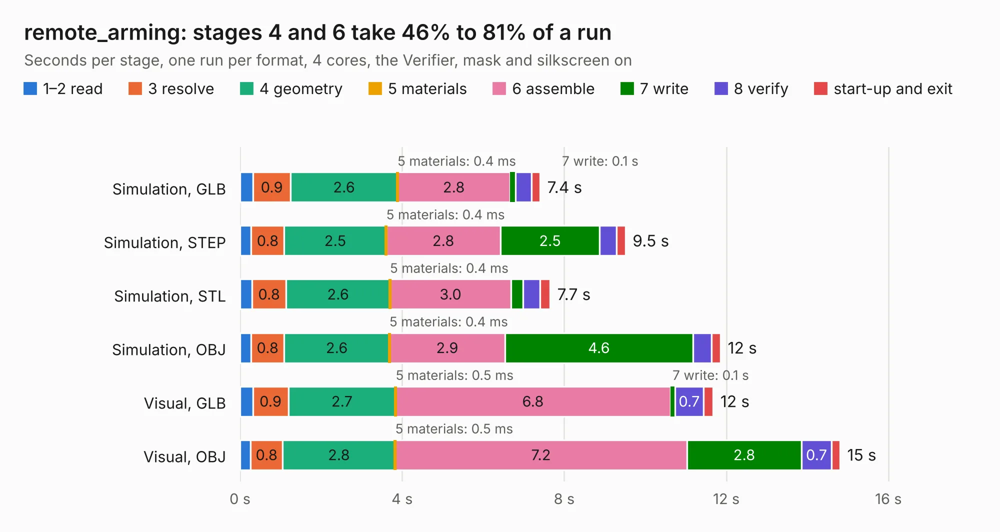

# 3011. remote_arming

Board 3,011 of the 3,138 of [Corpus Testing](../Corpus-Testing.md), on [Corpus Page 28](../CorpusTestingPages/Corpus-Testing-28.md#3011-remote_arming).

| Mode and format | 1–2 read | 3 resolve | 4 geometry | 5 materials | 6 assemble | 7 write | 8 verify | start-up and exit | Total |
|---|---:|---:|---:|---:|---:|---:|---:|---:|---:|
| Simulation, GLB | 0.3 | 0.9 | 2.6 | 0.4&nbsp;ms | 2.8 | 0.1 | 0.4 | 0.2 | 7.4 |
| Simulation, STEP | 0.3 | 0.8 | 2.5 | 0.4&nbsp;ms | 2.8 | 2.5 | 0.4 | 0.2 | 9.5 |
| Simulation, STL | 0.3 | 0.8 | 2.6 | 0.4&nbsp;ms | 3.0 | 0.3 | 0.4 | 0.2 | 7.7 |
| Simulation, OBJ | 0.3 | 0.8 | 2.6 | 0.4&nbsp;ms | 2.9 | 4.6 | 0.5 | 0.2 | 11.9 |
| Visual, GLB | 0.3 | 0.9 | 2.7 | 0.5&nbsp;ms | 6.8 | 0.1 | 0.7 | 0.2 | 11.7 |
| Visual, OBJ | 0.3 | 0.8 | 2.8 | 0.5&nbsp;ms | 7.2 | 2.8 | 0.7 | 0.2 | 14.8 |

<table align="center"><tr><td valign="top">

| Board | Repo: [waterloo-rocketry/canhw](https://github.com/waterloo-rocketry/canhw) Board: `remote_arming.kicad_pcb` |
|---|---|
| Folder | remote_arming |
| Complexity | 300&nbsp;/&nbsp;1000 (size&nbsp;190, features&nbsp;110) |
| KESE&nbsp;features | through vias, custom pads, rounded, trapezoid or chamfered pads, filled zones, copper drawings, curved board outline, stack-up, dielectric εr and tanδ |
| Tested | 9th November 2026 |
| Copper&nbsp;layers | 4 |
| File&nbsp;format | KiCad 9 (20241229) |
| Parts,&nbsp;tracks,&nbsp;vias | 65, 441, 140 |
| Triangles,&nbsp;simulation | 1,057,408 in 71 parts |
| Verifier | PASS in all six runs |

</td><td valign="top">

<table>
<tr><th>File type</th><th>File size</th><th>Peak memory used</th></tr>
<tr><th colspan="3" align="left">Simulation</th></tr>
<tr><td>GLB</td><td align="right">36&nbsp;MB</td><td align="right">461&nbsp;MB</td></tr>
<tr><td>STEP</td><td align="right">138&nbsp;MB</td><td align="right">531&nbsp;MB</td></tr>
<tr><td>STL</td><td align="right">53&nbsp;MB</td><td align="right">468&nbsp;MB</td></tr>
<tr><td>OBJ</td><td align="right">107&nbsp;MB</td><td align="right">719&nbsp;MB</td></tr>
<tr><th colspan="3" align="left">Visual</th></tr>
<tr><td>GLB</td><td align="right">23&nbsp;MB</td><td align="right">519&nbsp;MB</td></tr>
<tr><td>OBJ</td><td align="right">69&nbsp;MB</td><td align="right">576&nbsp;MB</td></tr>
</table>

</td></tr></table>

| Previous | Next |
|:---|---:|
| [3010. PropulsionBoard](b3010b_canhw_PropulsionBoard.md) | [3012. rocket_power_board](b3012b_canhw_rocket-power-board.md) |
