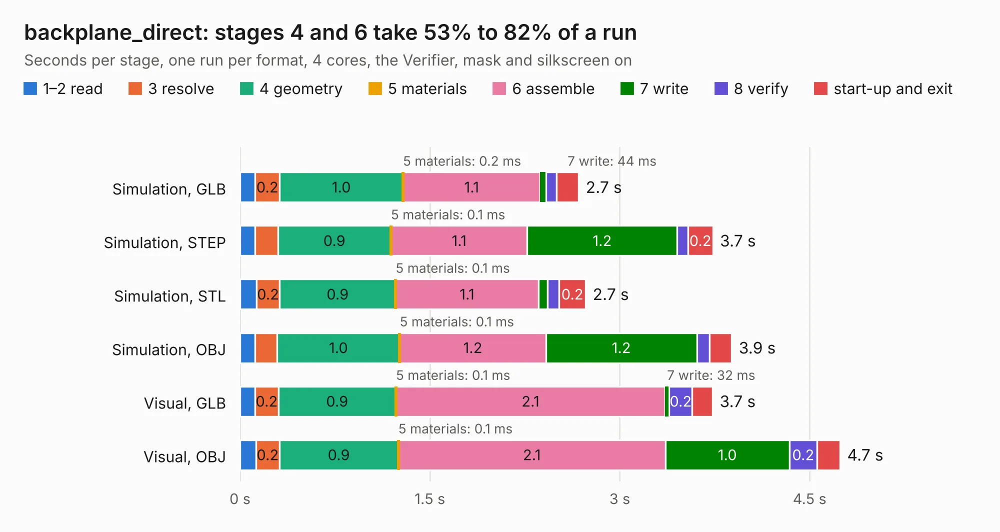

# 3011. backplane_direct

Board 3,011 of the 3,120 of [Corpus Testing](../Corpus-Testing.md), on [Corpus Page 28](../CorpusTestingPages/Corpus-Testing-28.md#3011-backplane_direct).

| Mode and format | 1–2 read | 3 resolve | 4 geometry | 5 materials | 6 assemble | 7 write | 8 verify | start-up and exit | Total |
|---|---:|---:|---:|---:|---:|---:|---:|---:|---:|
| Simulation, GLB | 0.1 | 0.2 | 1.0 | 0.2&nbsp;ms | 1.1 | 44&nbsp;ms | 86&nbsp;ms | 0.2 | 2.7 |
| Simulation, STEP | 0.1 | 0.2 | 0.9 | 0.1&nbsp;ms | 1.1 | 1.2 | 85&nbsp;ms | 0.2 | 3.7 |
| Simulation, STL | 0.1 | 0.2 | 0.9 | 0.1&nbsp;ms | 1.1 | 71&nbsp;ms | 93&nbsp;ms | 0.2 | 2.7 |
| Simulation, OBJ | 0.1 | 0.2 | 1.0 | 0.1&nbsp;ms | 1.2 | 1.2 | 0.1 | 0.2 | 3.9 |
| Visual, GLB | 0.1 | 0.2 | 0.9 | 0.1&nbsp;ms | 2.1 | 32&nbsp;ms | 0.2 | 0.2 | 3.7 |
| Visual, OBJ | 0.1 | 0.2 | 0.9 | 0.1&nbsp;ms | 2.1 | 1.0 | 0.2 | 0.2 | 4.7 |

<table align="center"><tr><td valign="top">

| Board | Repo: [winkleplex10-bit/the-mac-pro-project](https://github.com/winkleplex10-bit/the-mac-pro-project) Board: `backplane_direct.kicad_pcb` |
|---|---|
| Folder | kicad / macpro62-backplane |
| Complexity | 171&nbsp;/&nbsp;1000 (size&nbsp;106, features&nbsp;65) |
| KESE&nbsp;features | rounded, trapezoid or chamfered pads, curved board outline, stack-up, dielectric εr and tanδ, copper finish |
| Tested | 9th November 2026 |
| Copper&nbsp;layers | 4 |
| File&nbsp;format | KiCad 9 (20241229) |
| Parts,&nbsp;tracks,&nbsp;vias | 19, 0, 0 |
| Triangles,&nbsp;simulation | 280,020 in 13 parts |
| Verifier | PASS in all six runs |

</td><td valign="top">

<table>
<tr><th>File type</th><th>File size</th><th>Peak memory used</th></tr>
<tr><th colspan="3" align="left">Simulation</th></tr>
<tr><td>GLB</td><td align="right">10.0&nbsp;MB</td><td align="right">255&nbsp;MB</td></tr>
<tr><td>STEP</td><td align="right">42&nbsp;MB</td><td align="right">293&nbsp;MB</td></tr>
<tr><td>STL</td><td align="right">14&nbsp;MB</td><td align="right">257&nbsp;MB</td></tr>
<tr><td>OBJ</td><td align="right">29&nbsp;MB</td><td align="right">258&nbsp;MB</td></tr>
<tr><th colspan="3" align="left">Visual</th></tr>
<tr><td>GLB</td><td align="right">8.1&nbsp;MB</td><td align="right">268&nbsp;MB</td></tr>
<tr><td>OBJ</td><td align="right">24&nbsp;MB</td><td align="right">276&nbsp;MB</td></tr>
</table>

</td></tr></table>

| Previous | Next |
|:---|---:|
| [3010. backplane](b3010b_the-mac-pro-project_kicad-macpro62-backplane_backplane.md) | [3012. hub_fitcheck](b3012b_the-mac-pro-project_hub-fitcheck.md) |
