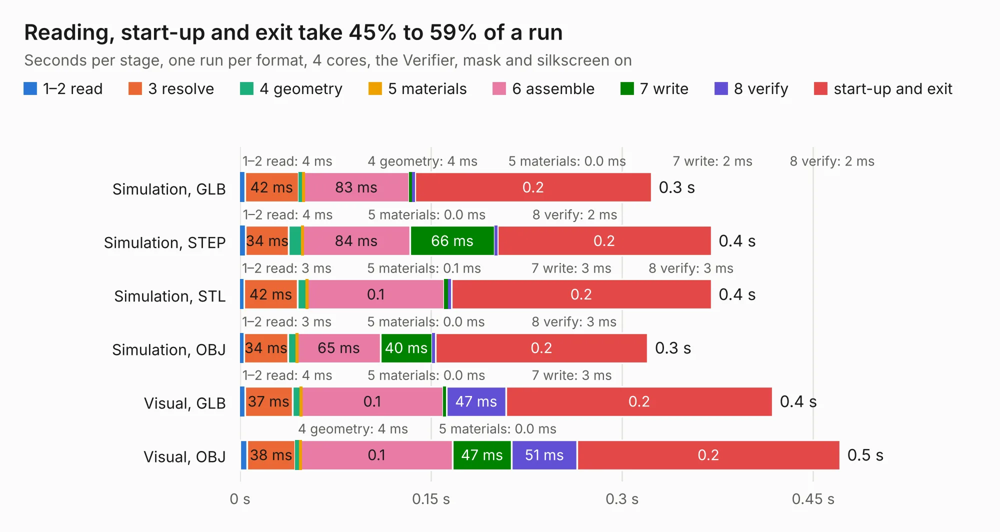

# 3012. 2019-07-02_12:26:12_fpga_hat

Board 3,012 of the 3,102 of [Corpus Testing](../Corpus-Testing.md), on [Corpus Page 28](../CorpusTestingPages/Corpus-Testing-28.md#3012-2019-07-02_122612_fpga_hat).

| Mode and format | 1–2 read | 3 resolve | 4 geometry | 5 materials | 6 assemble | 7 write | 8 verify | start-up and exit | Total |
|---|---:|---:|---:|---:|---:|---:|---:|---:|---:|
| Simulation, GLB | 4&nbsp;ms | 42&nbsp;ms | 4&nbsp;ms | 0.0&nbsp;ms | 83&nbsp;ms | 2&nbsp;ms | 2&nbsp;ms | 0.2 | 0.3 |
| Simulation, STEP | 4&nbsp;ms | 34&nbsp;ms | 11&nbsp;ms | 0.0&nbsp;ms | 84&nbsp;ms | 66&nbsp;ms | 2&nbsp;ms | 0.2 | 0.4 |
| Simulation, STL | 3&nbsp;ms | 42&nbsp;ms | 8&nbsp;ms | 0.1&nbsp;ms | 0.1 | 3&nbsp;ms | 3&nbsp;ms | 0.2 | 0.4 |
| Simulation, OBJ | 3&nbsp;ms | 34&nbsp;ms | 7&nbsp;ms | 0.0&nbsp;ms | 65&nbsp;ms | 40&nbsp;ms | 3&nbsp;ms | 0.2 | 0.3 |
| Visual, GLB | 4&nbsp;ms | 37&nbsp;ms | 7&nbsp;ms | 0.0&nbsp;ms | 0.1 | 3&nbsp;ms | 47&nbsp;ms | 0.2 | 0.4 |
| Visual, OBJ | 5&nbsp;ms | 38&nbsp;ms | 4&nbsp;ms | 0.0&nbsp;ms | 0.1 | 47&nbsp;ms | 51&nbsp;ms | 0.2 | 0.5 |

<table align="center"><tr><td valign="top">

| Board | Repo: [Wren6991/Snowflake-FPGA](https://github.com/Wren6991/Snowflake-FPGA) Board: `2019-07-02_12:26:12_fpga_hat.kicad_pcb` |
|---|---|
| Folder | timelapse |
| Complexity | 27&nbsp;/&nbsp;1000 (size&nbsp;17, features&nbsp;10) |
| KESE&nbsp;features | curved board outline |
| Tested | 9th November 2026 |
| Copper&nbsp;layers | 2 |
| File&nbsp;format | KiCad 5 (20171130) |
| Parts,&nbsp;tracks,&nbsp;vias | 0, 0, 0 |
| Triangles,&nbsp;simulation | 10,440 in 3 parts |
| Note | no components |
| Verifier | PASS in all six runs |

</td><td valign="top">

<table>
<tr><th>File type</th><th>File size</th><th>Peak memory used</th></tr>
<tr><th colspan="3" align="left">Simulation</th></tr>
<tr><td>GLB</td><td align="right">278&nbsp;kB</td><td align="right">41&nbsp;MB</td></tr>
<tr><td>STEP</td><td align="right">1.7&nbsp;MB</td><td align="right">42&nbsp;MB</td></tr>
<tr><td>STL</td><td align="right">522&nbsp;kB</td><td align="right">41&nbsp;MB</td></tr>
<tr><td>OBJ</td><td align="right">984&nbsp;kB</td><td align="right">43&nbsp;MB</td></tr>
<tr><th colspan="3" align="left">Visual</th></tr>
<tr><td>GLB</td><td align="right">378&nbsp;kB</td><td align="right">61&nbsp;MB</td></tr>
<tr><td>OBJ</td><td align="right">984&nbsp;kB</td><td align="right">77&nbsp;MB</td></tr>
</table>

</td></tr></table>

| Previous | Next |
|:---|---:|
| [3011. fpga_hat](b3011b_Snowflake-FPGA_fpga-hat.md) | [3013. 2019-07-02_12:31:57_fpga_hat](b3013b_Snowflake-FPGA_2019-07-02-12-31-57-fpga-hat.md) |
