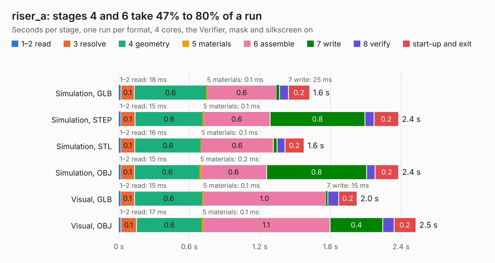

# 3012. riser_a

Board 3,012 of the 3,109 of [Corpus Testing](../Corpus-Testing.md), on [Corpus Page 28](../CorpusTestingPages/Corpus-Testing-28.md#3012-riser_a).

| Mode and format | 1–2 read | 3 resolve | 4 geometry | 5 materials | 6 assemble | 7 write | 8 verify | start-up and exit | Total |
|---|---:|---:|---:|---:|---:|---:|---:|---:|---:|
| Simulation, GLB | 18&nbsp;ms | 0.1 | 0.6 | 0.1&nbsp;ms | 0.6 | 25&nbsp;ms | 77&nbsp;ms | 0.2 | 1.6 |
| Simulation, STEP | 15&nbsp;ms | 0.1 | 0.6 | 0.1&nbsp;ms | 0.6 | 0.8 | 78&nbsp;ms | 0.2 | 2.4 |
| Simulation, STL | 16&nbsp;ms | 0.1 | 0.6 | 0.1&nbsp;ms | 0.6 | 32&nbsp;ms | 66&nbsp;ms | 0.2 | 1.6 |
| Simulation, OBJ | 15&nbsp;ms | 0.1 | 0.6 | 0.2&nbsp;ms | 0.6 | 0.8 | 72&nbsp;ms | 0.2 | 2.4 |
| Visual, GLB | 15&nbsp;ms | 0.1 | 0.6 | 0.1&nbsp;ms | 1.0 | 15&nbsp;ms | 92&nbsp;ms | 0.2 | 2.0 |
| Visual, OBJ | 17&nbsp;ms | 0.1 | 0.6 | 0.1&nbsp;ms | 1.1 | 0.4 | 96&nbsp;ms | 0.2 | 2.5 |

<table align="center"><tr><td valign="top">

| Board | Repo: [winkleplex10-bit/the-mac-pro-project](https://github.com/winkleplex10-bit/the-mac-pro-project) Board: `riser_a.kicad_pcb` |
|---|---|
| Folder | kicad / macpro62-io-risers / riser_a |
| Complexity | 68&nbsp;/&nbsp;1000 (size&nbsp;48, features&nbsp;20) |
| KESE&nbsp;features | slotted holes, rounded, trapezoid or chamfered pads |
| Tested | 9th November 2026 |
| Copper&nbsp;layers | 4 |
| File&nbsp;format | KiCad 9 (20241229) |
| Parts,&nbsp;tracks,&nbsp;vias | 3, 0, 0 |
| Triangles,&nbsp;simulation | 175,292 in 12 parts |
| Verifier | PASS in all six runs |

</td><td valign="top">

<table>
<tr><th>File type</th><th>File size</th><th>Peak memory used</th></tr>
<tr><th colspan="3" align="left">Simulation</th></tr>
<tr><td>GLB</td><td align="right">5.8&nbsp;MB</td><td align="right">190&nbsp;MB</td></tr>
<tr><td>STEP</td><td align="right">18&nbsp;MB</td><td align="right">193&nbsp;MB</td></tr>
<tr><td>STL</td><td align="right">8.8&nbsp;MB</td><td align="right">195&nbsp;MB</td></tr>
<tr><td>OBJ</td><td align="right">17&nbsp;MB</td><td align="right">197&nbsp;MB</td></tr>
<tr><th colspan="3" align="left">Visual</th></tr>
<tr><td>GLB</td><td align="right">3.2&nbsp;MB</td><td align="right">138&nbsp;MB</td></tr>
<tr><td>OBJ</td><td align="right">8.9&nbsp;MB</td><td align="right">140&nbsp;MB</td></tr>
</table>

</td></tr></table>

| Previous | Next |
|:---|---:|
| [3011. tdr_coupon_c50](b3011b_the-mac-pro-project_tdr-coupon-c50.md) | [3013. riser_c](b3013b_the-mac-pro-project_riser-c.md) |
