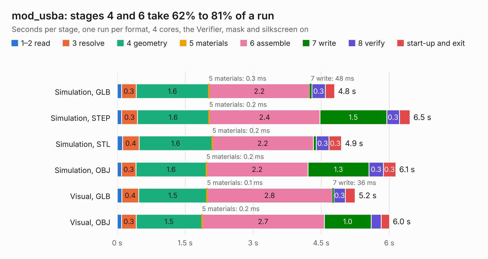

# 3013. mod_usba

Board 3,013 of the 3,116 of [Corpus Testing](../Corpus-Testing.md), on [Corpus Page 28](../CorpusTestingPages/Corpus-Testing-28.md#3013-mod_usba).

| Mode and format | 1–2 read | 3 resolve | 4 geometry | 5 materials | 6 assemble | 7 write | 8 verify | start-up and exit | Total |
|---|---:|---:|---:|---:|---:|---:|---:|---:|---:|
| Simulation, GLB | 99&nbsp;ms | 0.3 | 1.6 | 0.3&nbsp;ms | 2.2 | 48&nbsp;ms | 0.3 | 0.2 | 4.8 |
| Simulation, STEP | 98&nbsp;ms | 0.3 | 1.6 | 0.2&nbsp;ms | 2.4 | 1.5 | 0.3 | 0.2 | 6.5 |
| Simulation, STL | 0.1 | 0.4 | 1.6 | 0.2&nbsp;ms | 2.2 | 69&nbsp;ms | 0.3 | 0.3 | 4.9 |
| Simulation, OBJ | 94&nbsp;ms | 0.3 | 1.6 | 0.2&nbsp;ms | 2.2 | 1.3 | 0.3 | 0.3 | 6.1 |
| Visual, GLB | 0.1 | 0.4 | 1.5 | 0.1&nbsp;ms | 2.8 | 36&nbsp;ms | 0.3 | 0.2 | 5.2 |
| Visual, OBJ | 96&nbsp;ms | 0.3 | 1.5 | 0.2&nbsp;ms | 2.7 | 1.0 | 0.2 | 0.2 | 6.0 |

<table align="center"><tr><td valign="top">

| Board | Repo: [winkleplex10-bit/the-mac-pro-project](https://github.com/winkleplex10-bit/the-mac-pro-project) Board: `mod_usba.kicad_pcb` |
|---|---|
| Folder | kicad / macpro62-io-modules / mod_usba |
| Complexity | 190&nbsp;/&nbsp;1000 (size&nbsp;125, features&nbsp;65) |
| KESE&nbsp;features | through vias, rounded, trapezoid or chamfered pads, filled zones, copper drawings, curved board outline |
| Tested | 9th November 2026 |
| Copper&nbsp;layers | 2 |
| File&nbsp;format | KiCad 9 (20241229) |
| Parts,&nbsp;tracks,&nbsp;vias | 4, 198, 19 |
| Triangles,&nbsp;simulation | 264,738 in 22 parts |
| Verifier | PASS in all six runs |

</td><td valign="top">

<table>
<tr><th>File type</th><th>File size</th><th>Peak memory used</th></tr>
<tr><th colspan="3" align="left">Simulation</th></tr>
<tr><td>GLB</td><td align="right">10&nbsp;MB</td><td align="right">263&nbsp;MB</td></tr>
<tr><td>STEP</td><td align="right">57&nbsp;MB</td><td align="right">273&nbsp;MB</td></tr>
<tr><td>STL</td><td align="right">13&nbsp;MB</td><td align="right">262&nbsp;MB</td></tr>
<tr><td>OBJ</td><td align="right">29&nbsp;MB</td><td align="right">257&nbsp;MB</td></tr>
<tr><th colspan="3" align="left">Visual</th></tr>
<tr><td>GLB</td><td align="right">7.1&nbsp;MB</td><td align="right">236&nbsp;MB</td></tr>
<tr><td>OBJ</td><td align="right">20&nbsp;MB</td><td align="right">237&nbsp;MB</td></tr>
</table>

</td></tr></table>

| Previous | Next |
|:---|---:|
| [3012. mod_hdmi](b3012b_the-mac-pro-project_mod-hdmi.md) | [3014. mod_usbc](b3014b_the-mac-pro-project_mod-usbc.md) |
