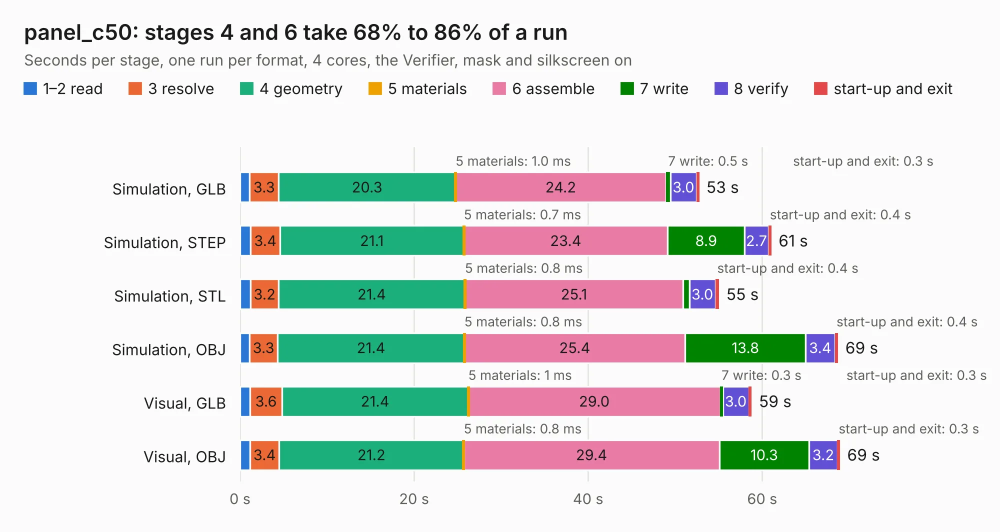

# 3019. panel_c50

Board 3,019 of the 3,119 of [Corpus Testing](../Corpus-Testing.md), on [Corpus Page 28](../CorpusTestingPages/Corpus-Testing-28.md#3019-panel_c50).

| Mode and format | 1–2 read | 3 resolve | 4 geometry | 5 materials | 6 assemble | 7 write | 8 verify | start-up and exit | Total |
|---|---:|---:|---:|---:|---:|---:|---:|---:|---:|
| Simulation, GLB | 1.1 | 3.3 | 20.3 | 1.0&nbsp;ms | 24.2 | 0.5 | 3.0 | 0.3 | 52.8 |
| Simulation, STEP | 1.2 | 3.4 | 21.1 | 0.7&nbsp;ms | 23.4 | 8.9 | 2.7 | 0.4 | 61.1 |
| Simulation, STL | 1.2 | 3.2 | 21.4 | 0.8&nbsp;ms | 25.1 | 0.7 | 3.0 | 0.4 | 55.1 |
| Simulation, OBJ | 1.1 | 3.3 | 21.4 | 0.8&nbsp;ms | 25.4 | 13.8 | 3.4 | 0.4 | 68.7 |
| Visual, GLB | 1.2 | 3.6 | 21.4 | 1&nbsp;ms | 29.0 | 0.3 | 3.0 | 0.3 | 58.8 |
| Visual, OBJ | 1.1 | 3.4 | 21.2 | 0.8&nbsp;ms | 29.4 | 10.3 | 3.2 | 0.3 | 68.9 |

<table align="center"><tr><td valign="top">

| Board | Repo: [winkleplex10-bit/the-mac-pro-project](https://github.com/winkleplex10-bit/the-mac-pro-project) Board: `panel_c50.kicad_pcb` |
|---|---|
| Folder | kicad / macpro62-io-modules / panel / panel_c50 |
| Complexity | 254&nbsp;/&nbsp;1000 (size&nbsp;189, features&nbsp;65) |
| KESE&nbsp;features | through vias, slotted holes, rounded, trapezoid or chamfered pads, filled zones, copper drawings |
| Tested | 9th November 2026 |
| Copper&nbsp;layers | 2 |
| File&nbsp;format | KiCad 9 (20241229) |
| Parts,&nbsp;tracks,&nbsp;vias | 40, 2,532, 222 |
| Triangles,&nbsp;simulation | 2,001,402 in 153 parts |
| Note | panel |
| Verifier | PASS in all six runs |

</td><td valign="top">

<table>
<tr><th>File type</th><th>File size</th><th>Peak memory used</th></tr>
<tr><th colspan="3" align="left">Simulation</th></tr>
<tr><td>GLB</td><td align="right">76&nbsp;MB</td><td align="right">985&nbsp;MB</td></tr>
<tr><td>STEP</td><td align="right">471&nbsp;MB</td><td align="right">1.1&nbsp;GB</td></tr>
<tr><td>STL</td><td align="right">100&nbsp;MB</td><td align="right">960&nbsp;MB</td></tr>
<tr><td>OBJ</td><td align="right">228&nbsp;MB</td><td align="right">1.5&nbsp;GB</td></tr>
<tr><th colspan="3" align="left">Visual</th></tr>
<tr><td>GLB</td><td align="right">58&nbsp;MB</td><td align="right">1.2&nbsp;GB</td></tr>
<tr><td>OBJ</td><td align="right">177&nbsp;MB</td><td align="right">1.3&nbsp;GB</td></tr>
</table>

</td></tr></table>

| Previous | Next |
|:---|---:|
| [3018. panel_a25](b3018b_the-mac-pro-project_panel-a25.md) | [3020. tdr_coupon_a25](b3020b_the-mac-pro-project_tdr-coupon-a25.md) |
