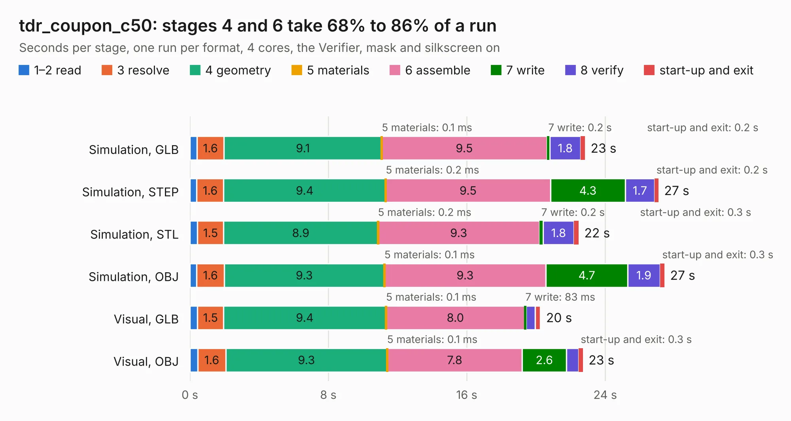

# 3019. tdr_coupon_c50

Board 3,019 of the 3,117 of [Corpus Testing](../Corpus-Testing.md), on [Corpus Page 28](../CorpusTestingPages/Corpus-Testing-28.md#3019-tdr_coupon_c50).

| Mode and format | 1–2 read | 3 resolve | 4 geometry | 5 materials | 6 assemble | 7 write | 8 verify | start-up and exit | Total |
|---|---:|---:|---:|---:|---:|---:|---:|---:|---:|
| Simulation, GLB | 0.4 | 1.6 | 9.1 | 0.1&nbsp;ms | 9.5 | 0.2 | 1.8 | 0.2 | 22.8 |
| Simulation, STEP | 0.4 | 1.6 | 9.4 | 0.2&nbsp;ms | 9.5 | 4.3 | 1.7 | 0.2 | 27.1 |
| Simulation, STL | 0.4 | 1.5 | 8.9 | 0.2&nbsp;ms | 9.3 | 0.2 | 1.8 | 0.3 | 22.5 |
| Simulation, OBJ | 0.4 | 1.6 | 9.3 | 0.1&nbsp;ms | 9.3 | 4.7 | 1.9 | 0.3 | 27.4 |
| Visual, GLB | 0.4 | 1.5 | 9.4 | 0.1&nbsp;ms | 8.0 | 83&nbsp;ms | 0.5 | 0.3 | 20.3 |
| Visual, OBJ | 0.5 | 1.6 | 9.3 | 0.1&nbsp;ms | 7.8 | 2.6 | 0.7 | 0.3 | 22.7 |

<table align="center"><tr><td valign="top">

| Board | Repo: [winkleplex10-bit/the-mac-pro-project](https://github.com/winkleplex10-bit/the-mac-pro-project) Board: `tdr_coupon_c50.kicad_pcb` |
|---|---|
| Folder | kicad / macpro62-io-modules / tdr / tdr_coupon_c50 |
| Complexity | 161&nbsp;/&nbsp;1000 (size&nbsp;126, features&nbsp;35) |
| KESE&nbsp;features | through vias, filled zones |
| Tested | 9th November 2026 |
| Copper&nbsp;layers | 2 |
| File&nbsp;format | KiCad 9 (20241229) |
| Parts,&nbsp;tracks,&nbsp;vias | 12, 75, 24 |
| Triangles,&nbsp;simulation | 639,392 in 18 parts |
| Verifier | PASS in all six runs |

</td><td valign="top">

<table>
<tr><th>File type</th><th>File size</th><th>Peak memory used</th></tr>
<tr><th colspan="3" align="left">Simulation</th></tr>
<tr><td>GLB</td><td align="right">27&nbsp;MB</td><td align="right">543&nbsp;MB</td></tr>
<tr><td>STEP</td><td align="right">167&nbsp;MB</td><td align="right">550&nbsp;MB</td></tr>
<tr><td>STL</td><td align="right">32&nbsp;MB</td><td align="right">556&nbsp;MB</td></tr>
<tr><td>OBJ</td><td align="right">76&nbsp;MB</td><td align="right">599&nbsp;MB</td></tr>
<tr><th colspan="3" align="left">Visual</th></tr>
<tr><td>GLB</td><td align="right">15&nbsp;MB</td><td align="right">435&nbsp;MB</td></tr>
<tr><td>OBJ</td><td align="right">41&nbsp;MB</td><td align="right">418&nbsp;MB</td></tr>
</table>

</td></tr></table>

| Previous | Next |
|:---|---:|
| [3018. tdr_coupon_a25](b3018b_the-mac-pro-project_tdr-coupon-a25.md) | [3020. riser_a](b3020b_the-mac-pro-project_riser-a.md) |
