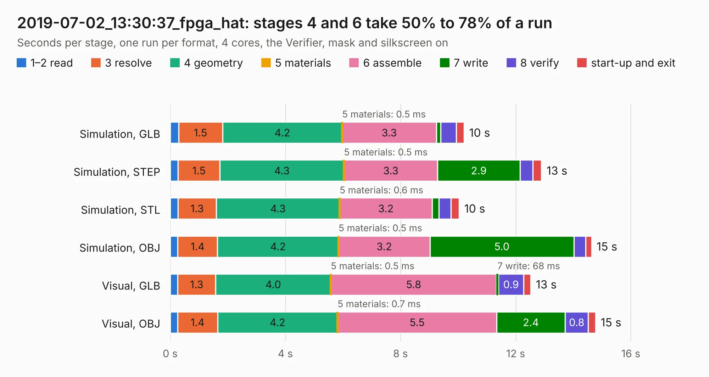

# 3020. 2019-07-02_13:30:37_fpga_hat

Board 3,020 of the 3,103 of [Corpus Testing](../Corpus-Testing.md), on [Corpus Page 28](../CorpusTestingPages/Corpus-Testing-28.md#3020-2019-07-02_133037_fpga_hat).

| Mode and format | 1–2 read | 3 resolve | 4 geometry | 5 materials | 6 assemble | 7 write | 8 verify | start-up and exit | Total |
|---|---:|---:|---:|---:|---:|---:|---:|---:|---:|
| Simulation, GLB | 0.3 | 1.5 | 4.2 | 0.5&nbsp;ms | 3.3 | 0.1 | 0.5 | 0.3 | 10.2 |
| Simulation, STEP | 0.3 | 1.5 | 4.3 | 0.5&nbsp;ms | 3.3 | 2.9 | 0.5 | 0.3 | 12.9 |
| Simulation, STL | 0.3 | 1.3 | 4.3 | 0.6&nbsp;ms | 3.2 | 0.2 | 0.4 | 0.3 | 10.0 |
| Simulation, OBJ | 0.3 | 1.4 | 4.2 | 0.5&nbsp;ms | 3.2 | 5.0 | 0.4 | 0.2 | 14.6 |
| Visual, GLB | 0.3 | 1.3 | 4.0 | 0.5&nbsp;ms | 5.8 | 68&nbsp;ms | 0.9 | 0.2 | 12.5 |
| Visual, OBJ | 0.3 | 1.4 | 4.2 | 0.7&nbsp;ms | 5.5 | 2.4 | 0.8 | 0.3 | 14.8 |

<table align="center"><tr><td valign="top">

| Board | Repo: [Wren6991/Snowflake-FPGA](https://github.com/Wren6991/Snowflake-FPGA) Board: `2019-07-02_13:30:37_fpga_hat.kicad_pcb` |
|---|---|
| Folder | timelapse |
| Complexity | 160&nbsp;/&nbsp;1000 (size&nbsp;140, features&nbsp;20) |
| KESE&nbsp;features | rounded, trapezoid or chamfered pads, curved board outline |
| Tested | 9th November 2026 |
| Copper&nbsp;layers | 4 |
| File&nbsp;format | KiCad 5 (20171130) |
| Parts,&nbsp;tracks,&nbsp;vias | 81, 0, 0 |
| Triangles,&nbsp;simulation | 853,966 in 148 parts |
| Note | mostly unrouted |
| Verifier | PASS in all six runs |

</td><td valign="top">

<table>
<tr><th>File type</th><th>File size</th><th>Peak memory used</th></tr>
<tr><th colspan="3" align="left">Simulation</th></tr>
<tr><td>GLB</td><td align="right">28&nbsp;MB</td><td align="right">355&nbsp;MB</td></tr>
<tr><td>STEP</td><td align="right">128&nbsp;MB</td><td align="right">474&nbsp;MB</td></tr>
<tr><td>STL</td><td align="right">43&nbsp;MB</td><td align="right">363&nbsp;MB</td></tr>
<tr><td>OBJ</td><td align="right">87&nbsp;MB</td><td align="right">617&nbsp;MB</td></tr>
<tr><th colspan="3" align="left">Visual</th></tr>
<tr><td>GLB</td><td align="right">14&nbsp;MB</td><td align="right">422&nbsp;MB</td></tr>
<tr><td>OBJ</td><td align="right">42&nbsp;MB</td><td align="right">427&nbsp;MB</td></tr>
</table>

</td></tr></table>

| Previous | Next |
|:---|---:|
| [3019. 2019-07-02_13:19:55_fpga_hat](b3019b_Snowflake-FPGA_2019-07-02-13-19-55-fpga-hat.md) | [3021. 2019-07-02_13:46:31_fpga_hat](b3021b_Snowflake-FPGA_2019-07-02-13-46-31-fpga-hat.md) |
