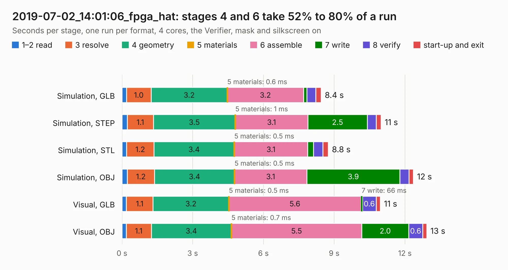

# 3020. 2019-07-02_14:01:06_fpga_hat

Board 3,020 of the 3,100 of [Corpus Testing](../Corpus-Testing.md), on [Corpus Page 28](../CorpusTestingPages/Corpus-Testing-28.md#3020-2019-07-02_140106_fpga_hat).

| Mode and format | 1–2 read | 3 resolve | 4 geometry | 5 materials | 6 assemble | 7 write | 8 verify | start-up and exit | Total |
|---|---:|---:|---:|---:|---:|---:|---:|---:|---:|
| Simulation, GLB | 0.2 | 1.0 | 3.2 | 0.6&nbsp;ms | 3.2 | 0.1 | 0.4 | 0.2 | 8.4 |
| Simulation, STEP | 0.2 | 1.1 | 3.5 | 1&nbsp;ms | 3.1 | 2.5 | 0.4 | 0.2 | 11.0 |
| Simulation, STL | 0.2 | 1.2 | 3.4 | 0.5&nbsp;ms | 3.1 | 0.2 | 0.4 | 0.2 | 8.8 |
| Simulation, OBJ | 0.2 | 1.2 | 3.4 | 0.5&nbsp;ms | 3.1 | 3.9 | 0.4 | 0.2 | 12.4 |
| Visual, GLB | 0.2 | 1.1 | 3.2 | 0.5&nbsp;ms | 5.6 | 66&nbsp;ms | 0.6 | 0.2 | 11.0 |
| Visual, OBJ | 0.2 | 1.1 | 3.4 | 0.7&nbsp;ms | 5.5 | 2.0 | 0.6 | 0.2 | 12.9 |

<table align="center"><tr><td valign="top">

| Board | Repo: [Wren6991/Snowflake-FPGA](https://github.com/Wren6991/Snowflake-FPGA) Board: `2019-07-02_14:01:06_fpga_hat.kicad_pcb` |
|---|---|
| Folder | timelapse |
| Complexity | 160&nbsp;/&nbsp;1000 (size&nbsp;140, features&nbsp;20) |
| KESE&nbsp;features | rounded, trapezoid or chamfered pads, curved board outline |
| Tested | 9th November 2026 |
| Copper&nbsp;layers | 4 |
| File&nbsp;format | KiCad 5 (20171130) |
| Parts,&nbsp;tracks,&nbsp;vias | 81, 0, 0 |
| Triangles,&nbsp;simulation | 957,960 in 150 parts |
| Note | mostly unrouted |
| Verifier | PASS in all six runs |

</td><td valign="top">

<table>
<tr><th>File type</th><th>File size</th><th>Peak memory used</th></tr>
<tr><th colspan="3" align="left">Simulation</th></tr>
<tr><td>GLB</td><td align="right">32&nbsp;MB</td><td align="right">395&nbsp;MB</td></tr>
<tr><td>STEP</td><td align="right">150&nbsp;MB</td><td align="right">497&nbsp;MB</td></tr>
<tr><td>STL</td><td align="right">48&nbsp;MB</td><td align="right">398&nbsp;MB</td></tr>
<tr><td>OBJ</td><td align="right">97&nbsp;MB</td><td align="right">695&nbsp;MB</td></tr>
<tr><th colspan="3" align="left">Visual</th></tr>
<tr><td>GLB</td><td align="right">17&nbsp;MB</td><td align="right">483&nbsp;MB</td></tr>
<tr><td>OBJ</td><td align="right">49&nbsp;MB</td><td align="right">458&nbsp;MB</td></tr>
</table>

</td></tr></table>

| Previous | Next |
|:---|---:|
| [3019. 2019-07-02_13:56:17_fpga_hat](b3019b_Snowflake-FPGA_2019-07-02-13-56-17-fpga-hat.md) | [3021. 2019-07-02_14:14:35_fpga_hat](b3021b_Snowflake-FPGA_2019-07-02-14-14-35-fpga-hat.md) |
