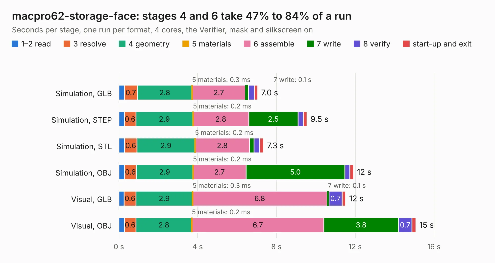

# 3020. macpro62-storage-face

Board 3,020 of the 3,112 of [Corpus Testing](../Corpus-Testing.md), on [Corpus Page 28](../CorpusTestingPages/Corpus-Testing-28.md#3020-macpro62-storage-face).

| Mode and format | 1–2 read | 3 resolve | 4 geometry | 5 materials | 6 assemble | 7 write | 8 verify | start-up and exit | Total |
|---|---:|---:|---:|---:|---:|---:|---:|---:|---:|
| Simulation, GLB | 0.3 | 0.7 | 2.8 | 0.3&nbsp;ms | 2.7 | 0.1 | 0.3 | 0.2 | 7.0 |
| Simulation, STEP | 0.3 | 0.6 | 2.9 | 0.2&nbsp;ms | 2.8 | 2.5 | 0.3 | 0.2 | 9.5 |
| Simulation, STL | 0.3 | 0.6 | 2.9 | 0.2&nbsp;ms | 2.8 | 0.2 | 0.3 | 0.2 | 7.3 |
| Simulation, OBJ | 0.3 | 0.6 | 2.9 | 0.2&nbsp;ms | 2.7 | 5.0 | 0.3 | 0.2 | 11.9 |
| Visual, GLB | 0.3 | 0.6 | 2.9 | 0.3&nbsp;ms | 6.8 | 0.1 | 0.7 | 0.2 | 11.5 |
| Visual, OBJ | 0.3 | 0.6 | 2.8 | 0.2&nbsp;ms | 6.7 | 3.8 | 0.7 | 0.2 | 15.1 |

<table align="center"><tr><td valign="top">

| Board | Repo: [winkleplex10-bit/the-mac-pro-project](https://github.com/winkleplex10-bit/the-mac-pro-project) Board: `macpro62-storage-face.kicad_pcb` |
|---|---|
| Folder | kicad / macpro62-storage-face |
| Complexity | 261&nbsp;/&nbsp;1000 (size&nbsp;171, features&nbsp;90) |
| KESE&nbsp;features | slotted holes, custom pads, rounded, trapezoid or chamfered pads, curved board outline, stack-up, dielectric εr and tanδ, copper finish |
| Tested | 9th November 2026 |
| Copper&nbsp;layers | 6 |
| File&nbsp;format | KiCad 9 (20241229) |
| Parts,&nbsp;tracks,&nbsp;vias | 58, 6, 0 |
| Triangles,&nbsp;simulation | 1,066,172 in 18 parts |
| Note | mostly unrouted |
| Verifier | PASS in all six runs |

</td><td valign="top">

<table>
<tr><th>File type</th><th>File size</th><th>Peak memory used</th></tr>
<tr><th colspan="3" align="left">Simulation</th></tr>
<tr><td>GLB</td><td align="right">37&nbsp;MB</td><td align="right">545&nbsp;MB</td></tr>
<tr><td>STEP</td><td align="right">166&nbsp;MB</td><td align="right">603&nbsp;MB</td></tr>
<tr><td>STL</td><td align="right">53&nbsp;MB</td><td align="right">533&nbsp;MB</td></tr>
<tr><td>OBJ</td><td align="right">111&nbsp;MB</td><td align="right">734&nbsp;MB</td></tr>
<tr><th colspan="3" align="left">Visual</th></tr>
<tr><td>GLB</td><td align="right">28&nbsp;MB</td><td align="right">824&nbsp;MB</td></tr>
<tr><td>OBJ</td><td align="right">84&nbsp;MB</td><td align="right">744&nbsp;MB</td></tr>
</table>

</td></tr></table>

| Previous | Next |
|:---|---:|
| [3019. macpro62-storage-face-2x](b3019b_the-mac-pro-project_macpro62-storage-face-2x.md) | [3021. fpga_hat](b3021b_Snowflake-FPGA_fpga-hat.md) |
