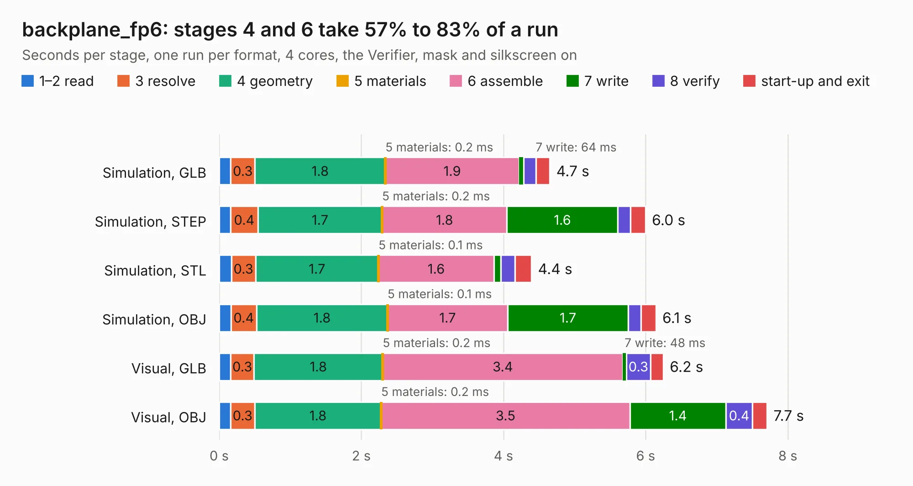

# 3021. backplane_fp6

Board 3,021 of the 3,128 of [Corpus Testing](../Corpus-Testing.md), on [Corpus Page 28](../CorpusTestingPages/Corpus-Testing-28.md#3021-backplane_fp6).

| Mode and format | 1–2 read | 3 resolve | 4 geometry | 5 materials | 6 assemble | 7 write | 8 verify | start-up and exit | Total |
|---|---:|---:|---:|---:|---:|---:|---:|---:|---:|
| Simulation, GLB | 0.2 | 0.3 | 1.8 | 0.2&nbsp;ms | 1.9 | 64&nbsp;ms | 0.2 | 0.2 | 4.7 |
| Simulation, STEP | 0.2 | 0.4 | 1.7 | 0.2&nbsp;ms | 1.8 | 1.6 | 0.2 | 0.2 | 6.0 |
| Simulation, STL | 0.2 | 0.3 | 1.7 | 0.1&nbsp;ms | 1.6 | 0.1 | 0.2 | 0.2 | 4.4 |
| Simulation, OBJ | 0.2 | 0.4 | 1.8 | 0.1&nbsp;ms | 1.7 | 1.7 | 0.2 | 0.2 | 6.1 |
| Visual, GLB | 0.2 | 0.3 | 1.8 | 0.2&nbsp;ms | 3.4 | 48&nbsp;ms | 0.3 | 0.2 | 6.2 |
| Visual, OBJ | 0.2 | 0.3 | 1.8 | 0.2&nbsp;ms | 3.5 | 1.4 | 0.4 | 0.2 | 7.7 |

<table align="center"><tr><td valign="top">

| Board | Repo: [winkleplex10-bit/the-mac-pro-project](https://github.com/winkleplex10-bit/the-mac-pro-project) Board: `backplane_fp6.kicad_pcb` |
|---|---|
| Folder | kicad / macpro62-backplane / variants / fp6_floorplan_6L |
| Complexity | 191&nbsp;/&nbsp;1000 (size&nbsp;116, features&nbsp;75) |
| KESE&nbsp;features | slotted holes, rounded, trapezoid or chamfered pads, curved board outline, stack-up, dielectric εr and tanδ, copper finish |
| Tested | 9th November 2026 |
| Copper&nbsp;layers | 6 |
| File&nbsp;format | KiCad 9 (20241229) |
| Parts,&nbsp;tracks,&nbsp;vias | 20, 0, 0 |
| Triangles,&nbsp;simulation | 418,448 in 15 parts |
| Verifier | PASS in all six runs |

</td><td valign="top">

<table>
<tr><th>File type</th><th>File size</th><th>Peak memory used</th></tr>
<tr><th colspan="3" align="left">Simulation</th></tr>
<tr><td>GLB</td><td align="right">15&nbsp;MB</td><td align="right">307&nbsp;MB</td></tr>
<tr><td>STEP</td><td align="right">61&nbsp;MB</td><td align="right">355&nbsp;MB</td></tr>
<tr><td>STL</td><td align="right">21&nbsp;MB</td><td align="right">306&nbsp;MB</td></tr>
<tr><td>OBJ</td><td align="right">44&nbsp;MB</td><td align="right">357&nbsp;MB</td></tr>
<tr><th colspan="3" align="left">Visual</th></tr>
<tr><td>GLB</td><td align="right">12&nbsp;MB</td><td align="right">363&nbsp;MB</td></tr>
<tr><td>OBJ</td><td align="right">36&nbsp;MB</td><td align="right">411&nbsp;MB</td></tr>
</table>

</td></tr></table>

| Previous | Next |
|:---|---:|
| [3020. hub_fitcheck](b3020b_the-mac-pro-project_hub-fitcheck.md) | [3022. backplane_hub_fp2](b3022b_the-mac-pro-project_backplane-hub-fp2.md) |
