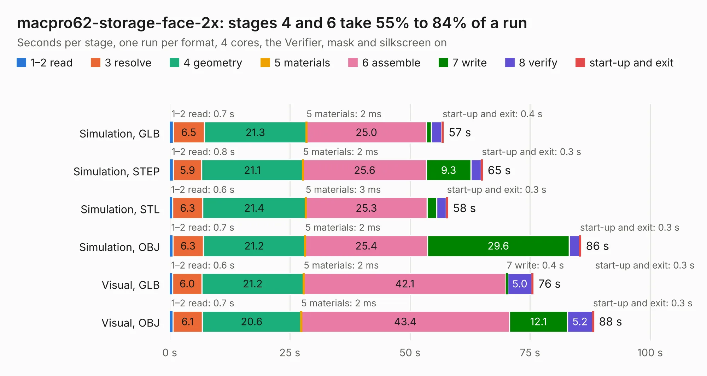

# 3024. macpro62-storage-face-2x

Board 3,024 of the 3,117 of [Corpus Testing](../Corpus-Testing.md), on [Corpus Page 28](../CorpusTestingPages/Corpus-Testing-28.md#3024-macpro62-storage-face-2x).

| Mode and format | 1–2 read | 3 resolve | 4 geometry | 5 materials | 6 assemble | 7 write | 8 verify | start-up and exit | Total |
|---|---:|---:|---:|---:|---:|---:|---:|---:|---:|
| Simulation, GLB | 0.7 | 6.5 | 21.3 | 2&nbsp;ms | 25.0 | 1.0 | 2.2 | 0.4 | 57.0 |
| Simulation, STEP | 0.8 | 5.9 | 21.1 | 2&nbsp;ms | 25.6 | 9.3 | 2.1 | 0.3 | 65.1 |
| Simulation, STL | 0.6 | 6.3 | 21.4 | 3&nbsp;ms | 25.3 | 2.0 | 2.0 | 0.3 | 57.9 |
| Simulation, OBJ | 0.7 | 6.3 | 21.2 | 2&nbsp;ms | 25.4 | 29.6 | 2.1 | 0.3 | 85.6 |
| Visual, GLB | 0.6 | 6.0 | 21.2 | 2&nbsp;ms | 42.1 | 0.4 | 5.0 | 0.3 | 75.7 |
| Visual, OBJ | 0.7 | 6.1 | 20.6 | 2&nbsp;ms | 43.4 | 12.1 | 5.2 | 0.3 | 88.3 |

<table align="center"><tr><td valign="top">

| Board | Repo: [winkleplex10-bit/the-mac-pro-project](https://github.com/winkleplex10-bit/the-mac-pro-project) Board: `macpro62-storage-face-2x.kicad_pcb` |
|---|---|
| Folder | kicad / macpro62-storage-face-2x |
| Complexity | 363&nbsp;/&nbsp;1000 (size&nbsp;228, features&nbsp;135) |
| KESE&nbsp;features | through vias, slotted holes, custom pads, rounded, trapezoid or chamfered pads, filled zones, copper drawings, curved board outline, stack-up, dielectric εr and tanδ, copper finish |
| Tested | 9th November 2026 |
| Copper&nbsp;layers | 4 |
| File&nbsp;format | KiCad 9 (20241229) |
| Parts,&nbsp;tracks,&nbsp;vias | 85, 1,215, 2,048 |
| Triangles,&nbsp;simulation | 5,621,626 in 180 parts |
| Verifier | PASS in all six runs |

</td><td valign="top">

<table>
<tr><th>File type</th><th>File size</th><th>Peak memory used</th></tr>
<tr><th colspan="3" align="left">Simulation</th></tr>
<tr><td>GLB</td><td align="right">186&nbsp;MB</td><td align="right">1.8&nbsp;GB</td></tr>
<tr><td>STEP</td><td align="right">439&nbsp;MB</td><td align="right">2.4&nbsp;GB</td></tr>
<tr><td>STL</td><td align="right">281&nbsp;MB</td><td align="right">1.8&nbsp;GB</td></tr>
<tr><td>OBJ</td><td align="right">593&nbsp;MB</td><td align="right">3.6&nbsp;GB</td></tr>
<tr><th colspan="3" align="left">Visual</th></tr>
<tr><td>GLB</td><td align="right">85&nbsp;MB</td><td align="right">1.6&nbsp;GB</td></tr>
<tr><td>OBJ</td><td align="right">274&nbsp;MB</td><td align="right">1.8&nbsp;GB</td></tr>
</table>

</td></tr></table>

| Previous | Next |
|:---|---:|
| [3023. macpro62_lga1700](b3023b_the-mac-pro-project_macpro62-lga1700.md) | [3025. macpro62-storage-face](b3025b_the-mac-pro-project_macpro62-storage-face.md) |
