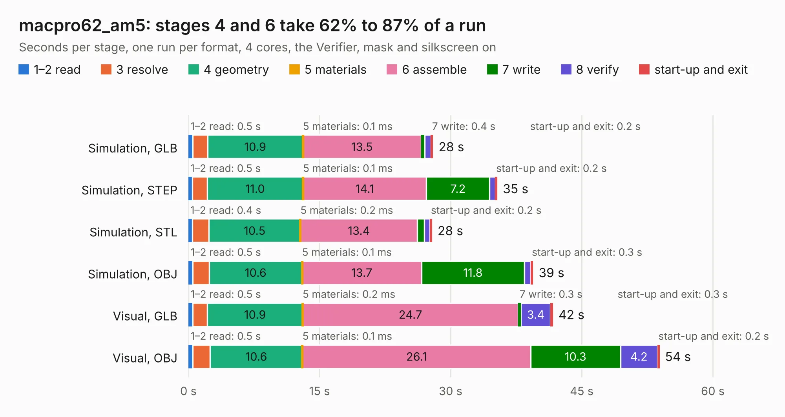

# 3025. macpro62_am5

Board 3,025 of the 3,139 of [Corpus Testing](../Corpus-Testing.md), on [Corpus Page 29](../CorpusTestingPages/Corpus-Testing-29.md#3025-macpro62_am5).

| Mode and format | 1–2 read | 3 resolve | 4 geometry | 5 materials | 6 assemble | 7 write | 8 verify | start-up and exit | Total |
|---|---:|---:|---:|---:|---:|---:|---:|---:|---:|
| Simulation, GLB | 0.5 | 1.7 | 10.9 | 0.1&nbsp;ms | 13.5 | 0.4 | 0.7 | 0.2 | 28.0 |
| Simulation, STEP | 0.5 | 1.7 | 11.0 | 0.1&nbsp;ms | 14.1 | 7.2 | 0.7 | 0.2 | 35.3 |
| Simulation, STL | 0.4 | 1.9 | 10.5 | 0.2&nbsp;ms | 13.4 | 0.8 | 0.6 | 0.2 | 27.9 |
| Simulation, OBJ | 0.5 | 1.9 | 10.6 | 0.1&nbsp;ms | 13.7 | 11.8 | 0.7 | 0.3 | 39.4 |
| Visual, GLB | 0.5 | 1.7 | 10.9 | 0.2&nbsp;ms | 24.7 | 0.3 | 3.4 | 0.3 | 41.7 |
| Visual, OBJ | 0.5 | 2.0 | 10.6 | 0.1&nbsp;ms | 26.1 | 10.3 | 4.2 | 0.2 | 53.9 |

<table align="center"><tr><td valign="top">

| Board | Repo: [winkleplex10-bit/the-mac-pro-project](https://github.com/winkleplex10-bit/the-mac-pro-project) Board: `macpro62_am5.kicad_pcb` |
|---|---|
| Folder | kicad / macpro62-am5-v3 |
| Complexity | 209&nbsp;/&nbsp;1000 (size&nbsp;154, features&nbsp;55) |
| KESE&nbsp;features | curved board outline, stack-up, dielectric εr and tanδ, copper finish |
| Tested | 9th November 2026 |
| Copper&nbsp;layers | 10 |
| File&nbsp;format | KiCad 9 (20241229) |
| Parts,&nbsp;tracks,&nbsp;vias | 26, 0, 0 |
| Triangles,&nbsp;simulation | 2,490,472 in 26 parts |
| Verifier | PASS in all six runs |

</td><td valign="top">

<table>
<tr><th>File type</th><th>File size</th><th>Peak memory used</th></tr>
<tr><th colspan="3" align="left">Simulation</th></tr>
<tr><td>GLB</td><td align="right">88&nbsp;MB</td><td align="right">1.1&nbsp;GB</td></tr>
<tr><td>STEP</td><td align="right">374&nbsp;MB</td><td align="right">1.4&nbsp;GB</td></tr>
<tr><td>STL</td><td align="right">125&nbsp;MB</td><td align="right">1.1&nbsp;GB</td></tr>
<tr><td>OBJ</td><td align="right">272&nbsp;MB</td><td align="right">1.7&nbsp;GB</td></tr>
<tr><th colspan="3" align="left">Visual</th></tr>
<tr><td>GLB</td><td align="right">77&nbsp;MB</td><td align="right">1.6&nbsp;GB</td></tr>
<tr><td>OBJ</td><td align="right">241&nbsp;MB</td><td align="right">1.6&nbsp;GB</td></tr>
</table>

</td></tr></table>

| Previous | Next |
|:---|---:|
| [3024. StarlightEye](b3024b_StarlightEye_StarlightEye.md) | [3026. macpro62_am5](b3026b_the-mac-pro-project_kicad-macpro62-am5_macpro62-am5.md) |
