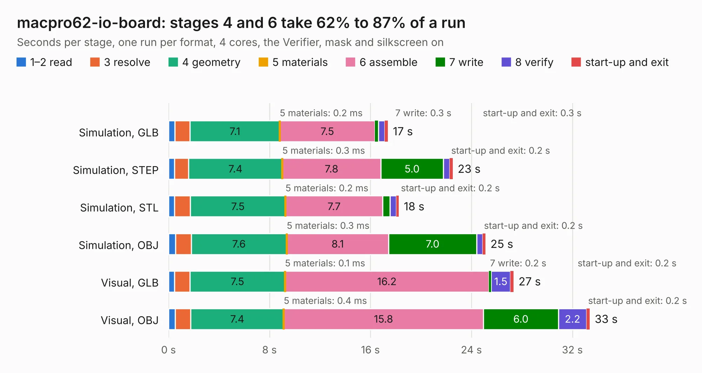

# 3026. macpro62-io-board

Board 3,026 of the 3,131 of [Corpus Testing](../Corpus-Testing.md), on [Corpus Page 29](../CorpusTestingPages/Corpus-Testing-29.md#3026-macpro62-io-board).

| Mode and format | 1–2 read | 3 resolve | 4 geometry | 5 materials | 6 assemble | 7 write | 8 verify | start-up and exit | Total |
|---|---:|---:|---:|---:|---:|---:|---:|---:|---:|
| Simulation, GLB | 0.5 | 1.2 | 7.1 | 0.2&nbsp;ms | 7.5 | 0.3 | 0.5 | 0.3 | 17.4 |
| Simulation, STEP | 0.5 | 1.1 | 7.4 | 0.3&nbsp;ms | 7.8 | 5.0 | 0.5 | 0.2 | 22.5 |
| Simulation, STL | 0.5 | 1.3 | 7.5 | 0.2&nbsp;ms | 7.7 | 0.6 | 0.5 | 0.2 | 18.2 |
| Simulation, OBJ | 0.5 | 1.2 | 7.6 | 0.3&nbsp;ms | 8.1 | 7.0 | 0.5 | 0.2 | 25.1 |
| Visual, GLB | 0.5 | 1.2 | 7.5 | 0.1&nbsp;ms | 16.2 | 0.2 | 1.5 | 0.2 | 27.3 |
| Visual, OBJ | 0.5 | 1.2 | 7.4 | 0.4&nbsp;ms | 15.8 | 6.0 | 2.2 | 0.2 | 33.4 |

<table align="center"><tr><td valign="top">

| Board | Repo: [winkleplex10-bit/the-mac-pro-project](https://github.com/winkleplex10-bit/the-mac-pro-project) Board: `macpro62-io-board.kicad_pcb` |
|---|---|
| Folder | kicad / macpro62-io-board |
| Complexity | 237&nbsp;/&nbsp;1000 (size&nbsp;162, features&nbsp;75) |
| KESE&nbsp;features | slotted holes, rounded, trapezoid or chamfered pads, curved board outline, stack-up, dielectric εr and tanδ, copper finish |
| Tested | 9th November 2026 |
| Copper&nbsp;layers | 6 |
| File&nbsp;format | KiCad 9 (20241229) |
| Parts,&nbsp;tracks,&nbsp;vias | 143, 0, 0 |
| Triangles,&nbsp;simulation | 1,595,010 in 16 parts |
| Note | mostly unrouted |
| Verifier | PASS in all six runs |

</td><td valign="top">

<table>
<tr><th>File type</th><th>File size</th><th>Peak memory used</th></tr>
<tr><th colspan="3" align="left">Simulation</th></tr>
<tr><td>GLB</td><td align="right">59&nbsp;MB</td><td align="right">735&nbsp;MB</td></tr>
<tr><td>STEP</td><td align="right">284&nbsp;MB</td><td align="right">919&nbsp;MB</td></tr>
<tr><td>STL</td><td align="right">80&nbsp;MB</td><td align="right">752&nbsp;MB</td></tr>
<tr><td>OBJ</td><td align="right">180&nbsp;MB</td><td align="right">1.2&nbsp;GB</td></tr>
<tr><th colspan="3" align="left">Visual</th></tr>
<tr><td>GLB</td><td align="right">47&nbsp;MB</td><td align="right">1.1&nbsp;GB</td></tr>
<tr><td>OBJ</td><td align="right">147&nbsp;MB</td><td align="right">1.1&nbsp;GB</td></tr>
</table>

</td></tr></table>

| Previous | Next |
|:---|---:|
| [3025. backplane_hub_fp2](b3025b_the-mac-pro-project_backplane-hub-fp2.md) | [3027. mod_hdmi](b3027b_the-mac-pro-project_mod-hdmi.md) |
