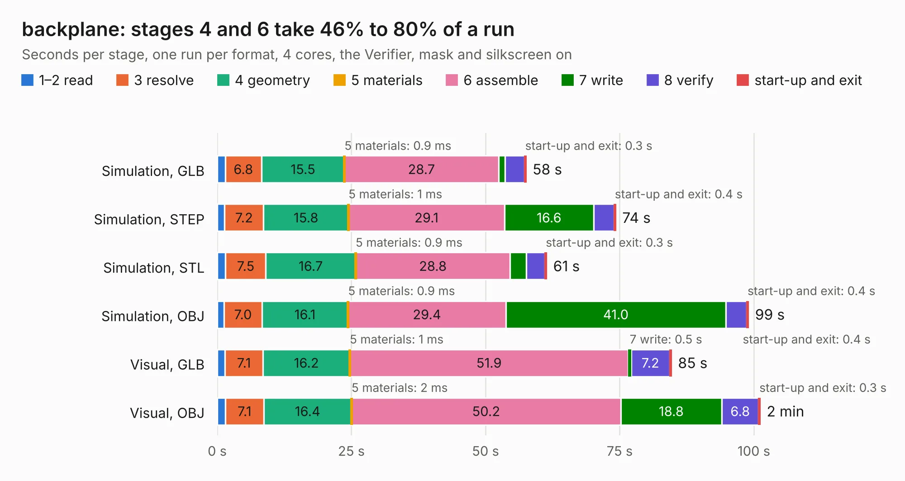

# 3027. backplane

Board 3,027 of the 3,138 of [Corpus Testing](../Corpus-Testing.md), on [Corpus Page 29](../CorpusTestingPages/Corpus-Testing-29.md#3027-backplane).

| Mode and format | 1–2 read | 3 resolve | 4 geometry | 5 materials | 6 assemble | 7 write | 8 verify | start-up and exit | Total |
|---|---:|---:|---:|---:|---:|---:|---:|---:|---:|
| Simulation, GLB | 1.5 | 6.8 | 15.5 | 0.9&nbsp;ms | 28.7 | 1.2 | 3.6 | 0.3 | 57.6 |
| Simulation, STEP | 1.4 | 7.2 | 15.8 | 1&nbsp;ms | 29.1 | 16.6 | 3.8 | 0.4 | 74.3 |
| Simulation, STL | 1.6 | 7.5 | 16.7 | 0.9&nbsp;ms | 28.8 | 3.0 | 3.5 | 0.3 | 61.4 |
| Simulation, OBJ | 1.3 | 7.0 | 16.1 | 0.9&nbsp;ms | 29.4 | 41.0 | 3.8 | 0.4 | 99.0 |
| Visual, GLB | 1.4 | 7.1 | 16.2 | 1&nbsp;ms | 51.9 | 0.5 | 7.2 | 0.4 | 84.7 |
| Visual, OBJ | 1.5 | 7.1 | 16.4 | 2&nbsp;ms | 50.2 | 18.8 | 6.8 | 0.3 | 101.2 |

<table align="center"><tr><td valign="top">

| Board | Repo: [winkleplex10-bit/the-mac-pro-project](https://github.com/winkleplex10-bit/the-mac-pro-project) Board: `backplane.kicad_pcb` |
|---|---|
| Folder | kicad / macpro62-backplane-v3 |
| Complexity | 427&nbsp;/&nbsp;1000 (size&nbsp;292, features&nbsp;135) |
| KESE&nbsp;features | through vias, slotted holes, custom pads, rounded, trapezoid or chamfered pads, filled zones, copper drawings, curved board outline, stack-up, dielectric εr and tanδ, copper finish |
| Tested | 9th November 2026 |
| Copper&nbsp;layers | 6 |
| File&nbsp;format | KiCad 9 (20241229) |
| Parts,&nbsp;tracks,&nbsp;vias | 152, 8,103, 1,423 |
| Triangles,&nbsp;simulation | 7,763,616 in 333 parts |
| Verifier | PASS in all six runs |

</td><td valign="top">

<table>
<tr><th>File type</th><th>File size</th><th>Peak memory used</th></tr>
<tr><th colspan="3" align="left">Simulation</th></tr>
<tr><td>GLB</td><td align="right">258&nbsp;MB</td><td align="right">2.0&nbsp;GB</td></tr>
<tr><td>STEP</td><td align="right">837&nbsp;MB</td><td align="right">2.9&nbsp;GB</td></tr>
<tr><td>STL</td><td align="right">388&nbsp;MB</td><td align="right">2.1&nbsp;GB</td></tr>
<tr><td>OBJ</td><td align="right">834&nbsp;MB</td><td align="right">4.8&nbsp;GB</td></tr>
<tr><th colspan="3" align="left">Visual</th></tr>
<tr><td>GLB</td><td align="right">124&nbsp;MB</td><td align="right">2.1&nbsp;GB</td></tr>
<tr><td>OBJ</td><td align="right">410&nbsp;MB</td><td align="right">2.7&nbsp;GB</td></tr>
</table>

</td></tr></table>

| Previous | Next |
|:---|---:|
| [3026. backplane](b3026b_the-mac-pro-project_kicad-macpro62-backplane-v2_backplane.md) | [3028. backplane](b3028b_the-mac-pro-project_kicad-macpro62-backplane_backplane.md) |
