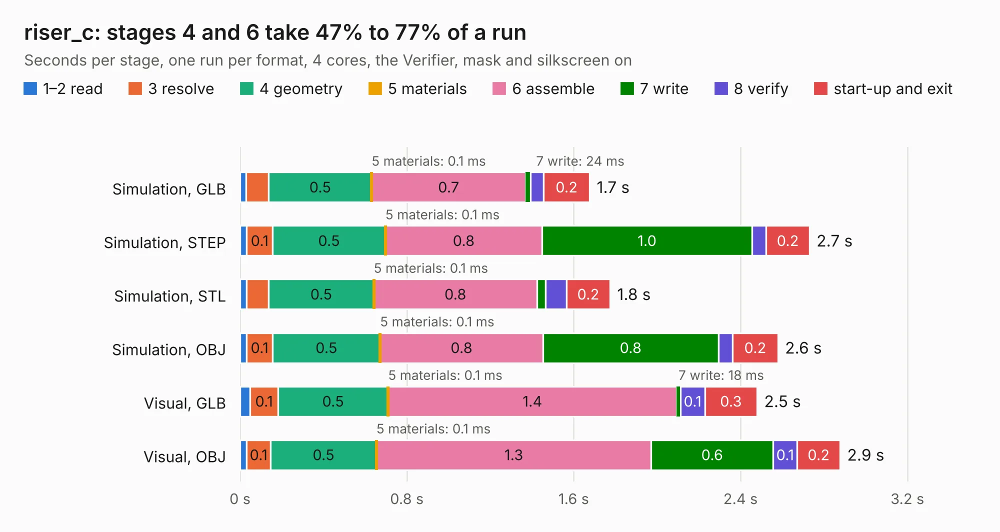

# 3027. riser_c

Board 3,027 of the 3,123 of [Corpus Testing](../Corpus-Testing.md), on [Corpus Page 29](../CorpusTestingPages/Corpus-Testing-29.md#3027-riser_c).

| Mode and format | 1–2 read | 3 resolve | 4 geometry | 5 materials | 6 assemble | 7 write | 8 verify | start-up and exit | Total |
|---|---:|---:|---:|---:|---:|---:|---:|---:|---:|
| Simulation, GLB | 30&nbsp;ms | 0.1 | 0.5 | 0.1&nbsp;ms | 0.7 | 24&nbsp;ms | 62&nbsp;ms | 0.2 | 1.7 |
| Simulation, STEP | 32&nbsp;ms | 0.1 | 0.5 | 0.1&nbsp;ms | 0.8 | 1.0 | 68&nbsp;ms | 0.2 | 2.7 |
| Simulation, STL | 31&nbsp;ms | 0.1 | 0.5 | 0.1&nbsp;ms | 0.8 | 42&nbsp;ms | 0.1 | 0.2 | 1.8 |
| Simulation, OBJ | 31&nbsp;ms | 0.1 | 0.5 | 0.1&nbsp;ms | 0.8 | 0.8 | 68&nbsp;ms | 0.2 | 2.6 |
| Visual, GLB | 48&nbsp;ms | 0.1 | 0.5 | 0.1&nbsp;ms | 1.4 | 18&nbsp;ms | 0.1 | 0.3 | 2.5 |
| Visual, OBJ | 31&nbsp;ms | 0.1 | 0.5 | 0.1&nbsp;ms | 1.3 | 0.6 | 0.1 | 0.2 | 2.9 |

<table align="center"><tr><td valign="top">

| Board | Repo: [winkleplex10-bit/the-mac-pro-project](https://github.com/winkleplex10-bit/the-mac-pro-project) Board: `riser_c.kicad_pcb` |
|---|---|
| Folder | kicad / macpro62-io-risers / riser_c |
| Complexity | 81&nbsp;/&nbsp;1000 (size&nbsp;51, features&nbsp;30) |
| KESE&nbsp;features | slotted holes, rounded, trapezoid or chamfered pads, curved board outline |
| Tested | 9th November 2026 |
| Copper&nbsp;layers | 4 |
| File&nbsp;format | KiCad 9 (20241229) |
| Parts,&nbsp;tracks,&nbsp;vias | 4, 0, 0 |
| Triangles,&nbsp;simulation | 139,356 in 12 parts |
| Verifier | PASS in all six runs |

</td><td valign="top">

<table>
<tr><th>File type</th><th>File size</th><th>Peak memory used</th></tr>
<tr><th colspan="3" align="left">Simulation</th></tr>
<tr><td>GLB</td><td align="right">4.9&nbsp;MB</td><td align="right">180&nbsp;MB</td></tr>
<tr><td>STEP</td><td align="right">19&nbsp;MB</td><td align="right">192&nbsp;MB</td></tr>
<tr><td>STL</td><td align="right">7.0&nbsp;MB</td><td align="right">180&nbsp;MB</td></tr>
<tr><td>OBJ</td><td align="right">14&nbsp;MB</td><td align="right">181&nbsp;MB</td></tr>
<tr><th colspan="3" align="left">Visual</th></tr>
<tr><td>GLB</td><td align="right">3.6&nbsp;MB</td><td align="right">146&nbsp;MB</td></tr>
<tr><td>OBJ</td><td align="right">10&nbsp;MB</td><td align="right">139&nbsp;MB</td></tr>
</table>

</td></tr></table>

| Previous | Next |
|:---|---:|
| [3026. riser_a](b3026b_the-mac-pro-project_riser-a.md) | [3028. riser_hdmi](b3028b_the-mac-pro-project_riser-hdmi.md) |
