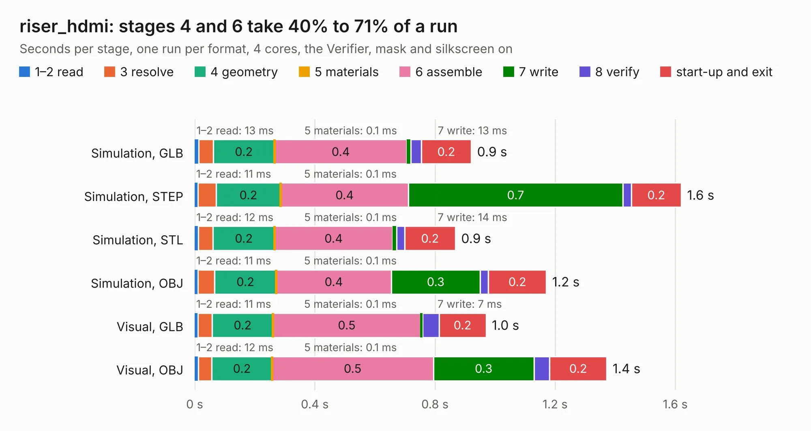

# 3028. riser_hdmi

Board 3,028 of the 3,123 of [Corpus Testing](../Corpus-Testing.md), on [Corpus Page 29](../CorpusTestingPages/Corpus-Testing-29.md#3028-riser_hdmi).

| Mode and format | 1–2 read | 3 resolve | 4 geometry | 5 materials | 6 assemble | 7 write | 8 verify | start-up and exit | Total |
|---|---:|---:|---:|---:|---:|---:|---:|---:|---:|
| Simulation, GLB | 13&nbsp;ms | 49&nbsp;ms | 0.2 | 0.1&nbsp;ms | 0.4 | 13&nbsp;ms | 35&nbsp;ms | 0.2 | 0.9 |
| Simulation, STEP | 11&nbsp;ms | 61&nbsp;ms | 0.2 | 0.1&nbsp;ms | 0.4 | 0.7 | 29&nbsp;ms | 0.2 | 1.6 |
| Simulation, STL | 12&nbsp;ms | 49&nbsp;ms | 0.2 | 0.1&nbsp;ms | 0.4 | 14&nbsp;ms | 26&nbsp;ms | 0.2 | 0.9 |
| Simulation, OBJ | 11&nbsp;ms | 56&nbsp;ms | 0.2 | 0.1&nbsp;ms | 0.4 | 0.3 | 28&nbsp;ms | 0.2 | 1.2 |
| Visual, GLB | 11&nbsp;ms | 48&nbsp;ms | 0.2 | 0.1&nbsp;ms | 0.5 | 7&nbsp;ms | 55&nbsp;ms | 0.2 | 1.0 |
| Visual, OBJ | 12&nbsp;ms | 46&nbsp;ms | 0.2 | 0.1&nbsp;ms | 0.5 | 0.3 | 52&nbsp;ms | 0.2 | 1.4 |

<table align="center"><tr><td valign="top">

| Board | Repo: [winkleplex10-bit/the-mac-pro-project](https://github.com/winkleplex10-bit/the-mac-pro-project) Board: `riser_hdmi.kicad_pcb` |
|---|---|
| Folder | kicad / macpro62-io-risers / riser_hdmi |
| Complexity | 65&nbsp;/&nbsp;1000 (size&nbsp;45, features&nbsp;20) |
| KESE&nbsp;features | slotted holes, rounded, trapezoid or chamfered pads |
| Tested | 9th November 2026 |
| Copper&nbsp;layers | 4 |
| File&nbsp;format | KiCad 9 (20241229) |
| Parts,&nbsp;tracks,&nbsp;vias | 2, 0, 0 |
| Triangles,&nbsp;simulation | 64,084 in 12 parts |
| Verifier | PASS in all six runs |

</td><td valign="top">

<table>
<tr><th>File type</th><th>File size</th><th>Peak memory used</th></tr>
<tr><th colspan="3" align="left">Simulation</th></tr>
<tr><td>GLB</td><td align="right">2.3&nbsp;MB</td><td align="right">53&nbsp;MB</td></tr>
<tr><td>STEP</td><td align="right">11&nbsp;MB</td><td align="right">166&nbsp;MB</td></tr>
<tr><td>STL</td><td align="right">3.2&nbsp;MB</td><td align="right">53&nbsp;MB</td></tr>
<tr><td>OBJ</td><td align="right">6.3&nbsp;MB</td><td align="right">68&nbsp;MB</td></tr>
<tr><th colspan="3" align="left">Visual</th></tr>
<tr><td>GLB</td><td align="right">1.6&nbsp;MB</td><td align="right">89&nbsp;MB</td></tr>
<tr><td>OBJ</td><td align="right">4.5&nbsp;MB</td><td align="right">82&nbsp;MB</td></tr>
</table>

</td></tr></table>

| Previous | Next |
|:---|---:|
| [3027. riser_c](b3027b_the-mac-pro-project_riser-c.md) | [3029. macpro62_lga1700](b3029b_the-mac-pro-project_macpro62-lga1700.md) |
