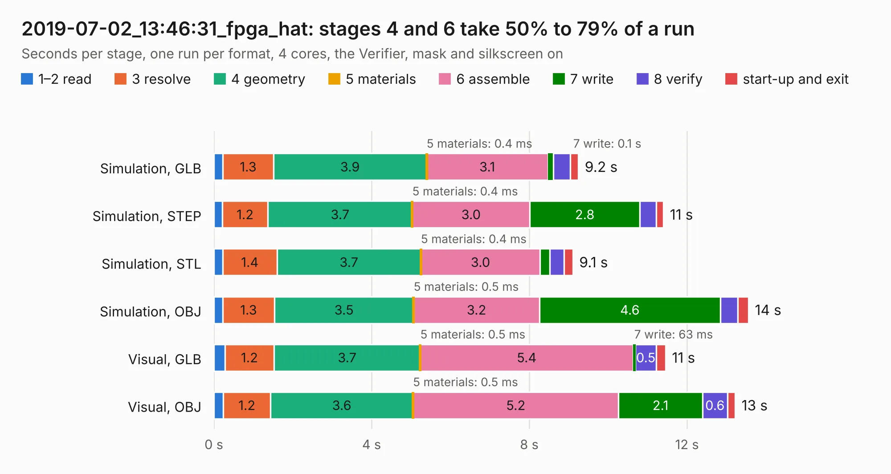

# 3029. 2019-07-02_13:46:31_fpga_hat

Board 3,029 of the 3,111 of [Corpus Testing](../Corpus-Testing.md), on [Corpus Page 29](../CorpusTestingPages/Corpus-Testing-29.md#3029-2019-07-02_134631_fpga_hat).

| Mode and format | 1–2 read | 3 resolve | 4 geometry | 5 materials | 6 assemble | 7 write | 8 verify | start-up and exit | Total |
|---|---:|---:|---:|---:|---:|---:|---:|---:|---:|
| Simulation, GLB | 0.2 | 1.3 | 3.9 | 0.4&nbsp;ms | 3.1 | 0.1 | 0.4 | 0.2 | 9.2 |
| Simulation, STEP | 0.2 | 1.2 | 3.7 | 0.4&nbsp;ms | 3.0 | 2.8 | 0.4 | 0.2 | 11.4 |
| Simulation, STL | 0.2 | 1.4 | 3.7 | 0.4&nbsp;ms | 3.0 | 0.2 | 0.4 | 0.2 | 9.1 |
| Simulation, OBJ | 0.2 | 1.3 | 3.5 | 0.5&nbsp;ms | 3.2 | 4.6 | 0.4 | 0.3 | 13.6 |
| Visual, GLB | 0.3 | 1.2 | 3.7 | 0.5&nbsp;ms | 5.4 | 63&nbsp;ms | 0.5 | 0.2 | 11.5 |
| Visual, OBJ | 0.2 | 1.2 | 3.6 | 0.5&nbsp;ms | 5.2 | 2.1 | 0.6 | 0.2 | 13.2 |

<table align="center"><tr><td valign="top">

| Board | Repo: [Wren6991/Snowflake-FPGA](https://github.com/Wren6991/Snowflake-FPGA) Board: `2019-07-02_13:46:31_fpga_hat.kicad_pcb` |
|---|---|
| Folder | timelapse |
| Complexity | 160&nbsp;/&nbsp;1000 (size&nbsp;140, features&nbsp;20) |
| KESE&nbsp;features | rounded, trapezoid or chamfered pads, curved board outline |
| Tested | 9th November 2026 |
| Copper&nbsp;layers | 4 |
| File&nbsp;format | KiCad 5 (20171130) |
| Parts,&nbsp;tracks,&nbsp;vias | 81, 0, 0 |
| Triangles,&nbsp;simulation | 902,386 in 150 parts |
| Note | mostly unrouted |
| Verifier | PASS in all six runs |

</td><td valign="top">

<table>
<tr><th>File type</th><th>File size</th><th>Peak memory used</th></tr>
<tr><th colspan="3" align="left">Simulation</th></tr>
<tr><td>GLB</td><td align="right">30&nbsp;MB</td><td align="right">377&nbsp;MB</td></tr>
<tr><td>STEP</td><td align="right">138&nbsp;MB</td><td align="right">481&nbsp;MB</td></tr>
<tr><td>STL</td><td align="right">45&nbsp;MB</td><td align="right">367&nbsp;MB</td></tr>
<tr><td>OBJ</td><td align="right">92&nbsp;MB</td><td align="right">670&nbsp;MB</td></tr>
<tr><th colspan="3" align="left">Visual</th></tr>
<tr><td>GLB</td><td align="right">15&nbsp;MB</td><td align="right">432&nbsp;MB</td></tr>
<tr><td>OBJ</td><td align="right">45&nbsp;MB</td><td align="right">426&nbsp;MB</td></tr>
</table>

</td></tr></table>

| Previous | Next |
|:---|---:|
| [3028. 2019-07-02_13:30:37_fpga_hat](b3028b_Snowflake-FPGA_2019-07-02-13-30-37-fpga-hat.md) | [3030. 2019-07-02_13:56:17_fpga_hat](b3030b_Snowflake-FPGA_2019-07-02-13-56-17-fpga-hat.md) |
