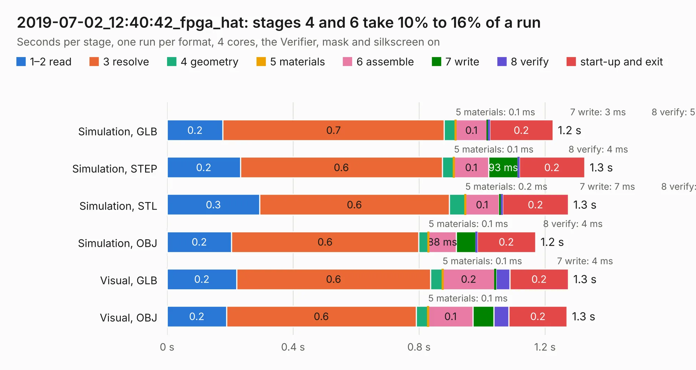

# 3033. 2019-07-02_12:40:42_fpga_hat

Board 3,033 of the 3,121 of [Corpus Testing](../Corpus-Testing.md), on [Corpus Page 29](../CorpusTestingPages/Corpus-Testing-29.md#3033-2019-07-02_124042_fpga_hat).

| Mode and format | 1–2 read | 3 resolve | 4 geometry | 5 materials | 6 assemble | 7 write | 8 verify | start-up and exit | Total |
|---|---:|---:|---:|---:|---:|---:|---:|---:|---:|
| Simulation, GLB | 0.2 | 0.7 | 36&nbsp;ms | 0.1&nbsp;ms | 0.1 | 3&nbsp;ms | 5&nbsp;ms | 0.2 | 1.2 |
| Simulation, STEP | 0.2 | 0.6 | 37&nbsp;ms | 0.1&nbsp;ms | 0.1 | 93&nbsp;ms | 4&nbsp;ms | 0.2 | 1.3 |
| Simulation, STL | 0.3 | 0.6 | 51&nbsp;ms | 0.2&nbsp;ms | 0.1 | 7&nbsp;ms | 5&nbsp;ms | 0.2 | 1.3 |
| Simulation, OBJ | 0.2 | 0.6 | 31&nbsp;ms | 0.1&nbsp;ms | 88&nbsp;ms | 62&nbsp;ms | 4&nbsp;ms | 0.2 | 1.2 |
| Visual, GLB | 0.2 | 0.6 | 38&nbsp;ms | 0.1&nbsp;ms | 0.2 | 4&nbsp;ms | 44&nbsp;ms | 0.2 | 1.3 |
| Visual, OBJ | 0.2 | 0.6 | 38&nbsp;ms | 0.1&nbsp;ms | 0.1 | 66&nbsp;ms | 47&nbsp;ms | 0.2 | 1.3 |

<table align="center"><tr><td valign="top">

| Board | Repo: [Wren6991/Snowflake-FPGA](https://github.com/Wren6991/Snowflake-FPGA) Board: `2019-07-02_12:40:42_fpga_hat.kicad_pcb` |
|---|---|
| Folder | timelapse |
| Complexity | 160&nbsp;/&nbsp;1000 (size&nbsp;140, features&nbsp;20) |
| KESE&nbsp;features | rounded, trapezoid or chamfered pads, curved board outline |
| Tested | 9th November 2026 |
| Copper&nbsp;layers | 4 |
| File&nbsp;format | KiCad 5 (20171130) |
| Parts,&nbsp;tracks,&nbsp;vias | 81, 0, 0 |
| Triangles,&nbsp;simulation | 16,832 in 5 parts |
| Note | mostly unrouted |
| Verifier | PASS in all six runs |

</td><td valign="top">

<table>
<tr><th>File type</th><th>File size</th><th>Peak memory used</th></tr>
<tr><th colspan="3" align="left">Simulation</th></tr>
<tr><td>GLB</td><td align="right">463&nbsp;kB</td><td align="right">79&nbsp;MB</td></tr>
<tr><td>STEP</td><td align="right">1.8&nbsp;MB</td><td align="right">79&nbsp;MB</td></tr>
<tr><td>STL</td><td align="right">842&nbsp;kB</td><td align="right">78&nbsp;MB</td></tr>
<tr><td>OBJ</td><td align="right">1.6&nbsp;MB</td><td align="right">77&nbsp;MB</td></tr>
<tr><th colspan="3" align="left">Visual</th></tr>
<tr><td>GLB</td><td align="right">507&nbsp;kB</td><td align="right">105&nbsp;MB</td></tr>
<tr><td>OBJ</td><td align="right">1.3&nbsp;MB</td><td align="right">111&nbsp;MB</td></tr>
</table>

</td></tr></table>

| Previous | Next |
|:---|---:|
| [3032. 2019-07-02_12:31:57_fpga_hat](b3032b_Snowflake-FPGA_2019-07-02-12-31-57-fpga-hat.md) | [3034. 2019-07-02_12:48:58_fpga_hat](b3034b_Snowflake-FPGA_2019-07-02-12-48-58-fpga-hat.md) |
