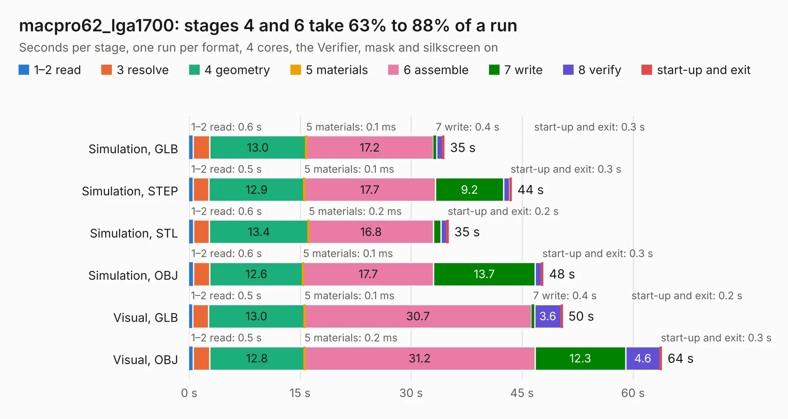

# 3033. macpro62_lga1700

Board 3,033 of the 3,127 of [Corpus Testing](../Corpus-Testing.md), on [Corpus Page 29](../CorpusTestingPages/Corpus-Testing-29.md#3033-macpro62_lga1700).

| Mode and format | 1–2 read | 3 resolve | 4 geometry | 5 materials | 6 assemble | 7 write | 8 verify | start-up and exit | Total |
|---|---:|---:|---:|---:|---:|---:|---:|---:|---:|
| Simulation, GLB | 0.6 | 2.2 | 13.0 | 0.1&nbsp;ms | 17.2 | 0.4 | 0.8 | 0.3 | 34.5 |
| Simulation, STEP | 0.5 | 2.2 | 12.9 | 0.1&nbsp;ms | 17.7 | 9.2 | 0.8 | 0.3 | 43.6 |
| Simulation, STL | 0.6 | 2.1 | 13.4 | 0.2&nbsp;ms | 16.8 | 1.0 | 0.8 | 0.2 | 35.1 |
| Simulation, OBJ | 0.6 | 2.2 | 12.6 | 0.1&nbsp;ms | 17.7 | 13.7 | 0.8 | 0.3 | 47.9 |
| Visual, GLB | 0.5 | 2.1 | 13.0 | 0.1&nbsp;ms | 30.7 | 0.4 | 3.6 | 0.2 | 50.5 |
| Visual, OBJ | 0.5 | 2.2 | 12.8 | 0.2&nbsp;ms | 31.2 | 12.3 | 4.6 | 0.3 | 63.9 |

<table align="center"><tr><td valign="top">

| Board | Repo: [winkleplex10-bit/the-mac-pro-project](https://github.com/winkleplex10-bit/the-mac-pro-project) Board: `macpro62_lga1700.kicad_pcb` |
|---|---|
| Folder | kicad / macpro62-lga1700-v2 |
| Complexity | 217&nbsp;/&nbsp;1000 (size&nbsp;162, features&nbsp;55) |
| KESE&nbsp;features | curved board outline, stack-up, dielectric εr and tanδ, copper finish |
| Tested | 9th November 2026 |
| Copper&nbsp;layers | 10 |
| File&nbsp;format | KiCad 9 (20241229) |
| Parts,&nbsp;tracks,&nbsp;vias | 24, 0, 0 |
| Triangles,&nbsp;simulation | 2,922,588 in 26 parts |
| Verifier | PASS in all six runs |

</td><td valign="top">

<table>
<tr><th>File type</th><th>File size</th><th>Peak memory used</th></tr>
<tr><th colspan="3" align="left">Simulation</th></tr>
<tr><td>GLB</td><td align="right">103&nbsp;MB</td><td align="right">1.2&nbsp;GB</td></tr>
<tr><td>STEP</td><td align="right">402&nbsp;MB</td><td align="right">1.6&nbsp;GB</td></tr>
<tr><td>STL</td><td align="right">146&nbsp;MB</td><td align="right">1.2&nbsp;GB</td></tr>
<tr><td>OBJ</td><td align="right">319&nbsp;MB</td><td align="right">2.0&nbsp;GB</td></tr>
<tr><th colspan="3" align="left">Visual</th></tr>
<tr><td>GLB</td><td align="right">90&nbsp;MB</td><td align="right">1.9&nbsp;GB</td></tr>
<tr><td>OBJ</td><td align="right">287&nbsp;MB</td><td align="right">1.9&nbsp;GB</td></tr>
</table>

</td></tr></table>

| Previous | Next |
|:---|---:|
| [3032. riser_hdmi](b3032b_the-mac-pro-project_riser-hdmi.md) | [3034. macpro62-storage-face-2x](b3034b_the-mac-pro-project_macpro62-storage-face-2x.md) |
