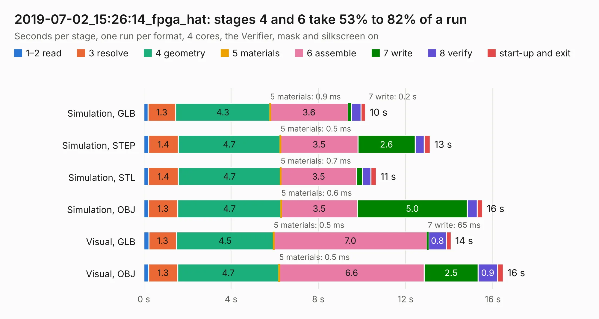

# 3035. 2019-07-02_15:26:14_fpga_hat

Board 3,035 of the 3,112 of [Corpus Testing](../Corpus-Testing.md), on [Corpus Page 29](../CorpusTestingPages/Corpus-Testing-29.md#3035-2019-07-02_152614_fpga_hat).

| Mode and format | 1–2 read | 3 resolve | 4 geometry | 5 materials | 6 assemble | 7 write | 8 verify | start-up and exit | Total |
|---|---:|---:|---:|---:|---:|---:|---:|---:|---:|
| Simulation, GLB | 0.2 | 1.3 | 4.3 | 0.9&nbsp;ms | 3.6 | 0.2 | 0.4 | 0.2 | 10.2 |
| Simulation, STEP | 0.2 | 1.4 | 4.7 | 0.5&nbsp;ms | 3.5 | 2.6 | 0.4 | 0.3 | 13.1 |
| Simulation, STL | 0.2 | 1.4 | 4.7 | 0.7&nbsp;ms | 3.5 | 0.3 | 0.4 | 0.2 | 10.7 |
| Simulation, OBJ | 0.2 | 1.3 | 4.7 | 0.6&nbsp;ms | 3.5 | 5.0 | 0.5 | 0.2 | 15.5 |
| Visual, GLB | 0.2 | 1.3 | 4.5 | 0.5&nbsp;ms | 7.0 | 65&nbsp;ms | 0.8 | 0.2 | 14.1 |
| Visual, OBJ | 0.2 | 1.3 | 4.7 | 0.5&nbsp;ms | 6.6 | 2.5 | 0.9 | 0.3 | 16.5 |

<table align="center"><tr><td valign="top">

| Board | Repo: [Wren6991/Snowflake-FPGA](https://github.com/Wren6991/Snowflake-FPGA) Board: `2019-07-02_15:26:14_fpga_hat.kicad_pcb` |
|---|---|
| Folder | timelapse |
| Complexity | 243&nbsp;/&nbsp;1000 (size&nbsp;208, features&nbsp;35) |
| KESE&nbsp;features | through vias, rounded, trapezoid or chamfered pads, curved board outline |
| Tested | 9th November 2026 |
| Copper&nbsp;layers | 4 |
| File&nbsp;format | KiCad 5 (20171130) |
| Parts,&nbsp;tracks,&nbsp;vias | 81, 25, 13 |
| Triangles,&nbsp;simulation | 1,049,378 in 150 parts |
| Verifier | PASS in all six runs |

</td><td valign="top">

<table>
<tr><th>File type</th><th>File size</th><th>Peak memory used</th></tr>
<tr><th colspan="3" align="left">Simulation</th></tr>
<tr><td>GLB</td><td align="right">35&nbsp;MB</td><td align="right">405&nbsp;MB</td></tr>
<tr><td>STEP</td><td align="right">165&nbsp;MB</td><td align="right">517&nbsp;MB</td></tr>
<tr><td>STL</td><td align="right">52&nbsp;MB</td><td align="right">411&nbsp;MB</td></tr>
<tr><td>OBJ</td><td align="right">107&nbsp;MB</td><td align="right">730&nbsp;MB</td></tr>
<tr><th colspan="3" align="left">Visual</th></tr>
<tr><td>GLB</td><td align="right">19&nbsp;MB</td><td align="right">475&nbsp;MB</td></tr>
<tr><td>OBJ</td><td align="right">55&nbsp;MB</td><td align="right">476&nbsp;MB</td></tr>
</table>

</td></tr></table>

| Previous | Next |
|:---|---:|
| [3034. 2019-07-02_15:12:10_fpga_hat](b3034b_Snowflake-FPGA_2019-07-02-15-12-10-fpga-hat.md) | [3036. 2019-07-02_15:37:58_fpga_hat](b3036b_Snowflake-FPGA_2019-07-02-15-37-58-fpga-hat.md) |
