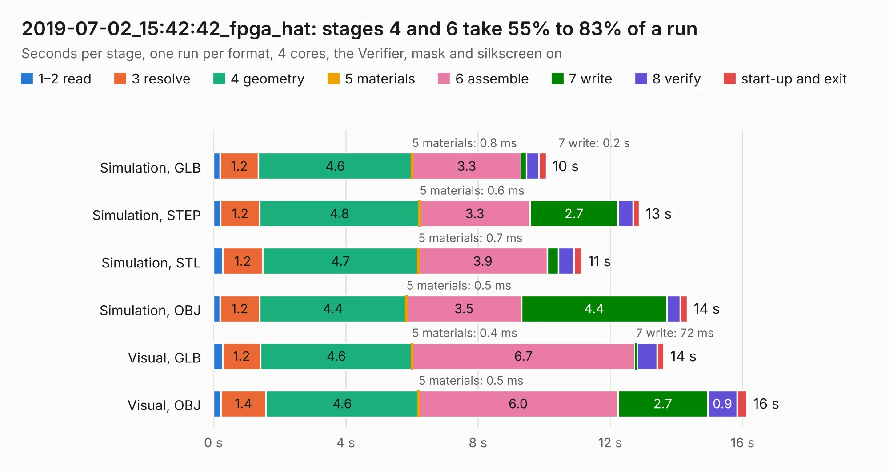

# 3036. 2019-07-02_15:42:42_fpga_hat

Board 3,036 of the 3,111 of [Corpus Testing](../Corpus-Testing.md), on [Corpus Page 29](../CorpusTestingPages/Corpus-Testing-29.md#3036-2019-07-02_154242_fpga_hat).

| Mode and format | 1–2 read | 3 resolve | 4 geometry | 5 materials | 6 assemble | 7 write | 8 verify | start-up and exit | Total |
|---|---:|---:|---:|---:|---:|---:|---:|---:|---:|
| Simulation, GLB | 0.2 | 1.2 | 4.6 | 0.8&nbsp;ms | 3.3 | 0.2 | 0.4 | 0.2 | 10.1 |
| Simulation, STEP | 0.2 | 1.2 | 4.8 | 0.6&nbsp;ms | 3.3 | 2.7 | 0.5 | 0.2 | 12.9 |
| Simulation, STL | 0.3 | 1.2 | 4.7 | 0.7&nbsp;ms | 3.9 | 0.3 | 0.5 | 0.2 | 11.1 |
| Simulation, OBJ | 0.2 | 1.2 | 4.4 | 0.5&nbsp;ms | 3.5 | 4.4 | 0.4 | 0.2 | 14.3 |
| Visual, GLB | 0.3 | 1.2 | 4.6 | 0.4&nbsp;ms | 6.7 | 72&nbsp;ms | 0.6 | 0.2 | 13.6 |
| Visual, OBJ | 0.2 | 1.4 | 4.6 | 0.5&nbsp;ms | 6.0 | 2.7 | 0.9 | 0.3 | 16.1 |

<table align="center"><tr><td valign="top">

| Board | Repo: [Wren6991/Snowflake-FPGA](https://github.com/Wren6991/Snowflake-FPGA) Board: `2019-07-02_15:42:42_fpga_hat.kicad_pcb` |
|---|---|
| Folder | timelapse |
| Complexity | 264&nbsp;/&nbsp;1000 (size&nbsp;209, features&nbsp;55) |
| KESE&nbsp;features | through vias, rounded, trapezoid or chamfered pads, filled zones, curved board outline |
| Tested | 9th November 2026 |
| Copper&nbsp;layers | 4 |
| File&nbsp;format | KiCad 5 (20171130) |
| Parts,&nbsp;tracks,&nbsp;vias | 81, 28, 13 |
| Triangles,&nbsp;simulation | 1,080,820 in 150 parts |
| Verifier | PASS in all six runs |

</td><td valign="top">

<table>
<tr><th>File type</th><th>File size</th><th>Peak memory used</th></tr>
<tr><th colspan="3" align="left">Simulation</th></tr>
<tr><td>GLB</td><td align="right">36&nbsp;MB</td><td align="right">414&nbsp;MB</td></tr>
<tr><td>STEP</td><td align="right">169&nbsp;MB</td><td align="right">521&nbsp;MB</td></tr>
<tr><td>STL</td><td align="right">54&nbsp;MB</td><td align="right">414&nbsp;MB</td></tr>
<tr><td>OBJ</td><td align="right">110&nbsp;MB</td><td align="right">783&nbsp;MB</td></tr>
<tr><th colspan="3" align="left">Visual</th></tr>
<tr><td>GLB</td><td align="right">19&nbsp;MB</td><td align="right">475&nbsp;MB</td></tr>
<tr><td>OBJ</td><td align="right">55&nbsp;MB</td><td align="right">492&nbsp;MB</td></tr>
</table>

</td></tr></table>

| Previous | Next |
|:---|---:|
| [3035. 2019-07-02_15:37:58_fpga_hat](b3035b_Snowflake-FPGA_2019-07-02-15-37-58-fpga-hat.md) | [3037. 2019-07-02_15:44:50_fpga_hat](b3037b_Snowflake-FPGA_2019-07-02-15-44-50-fpga-hat.md) |
