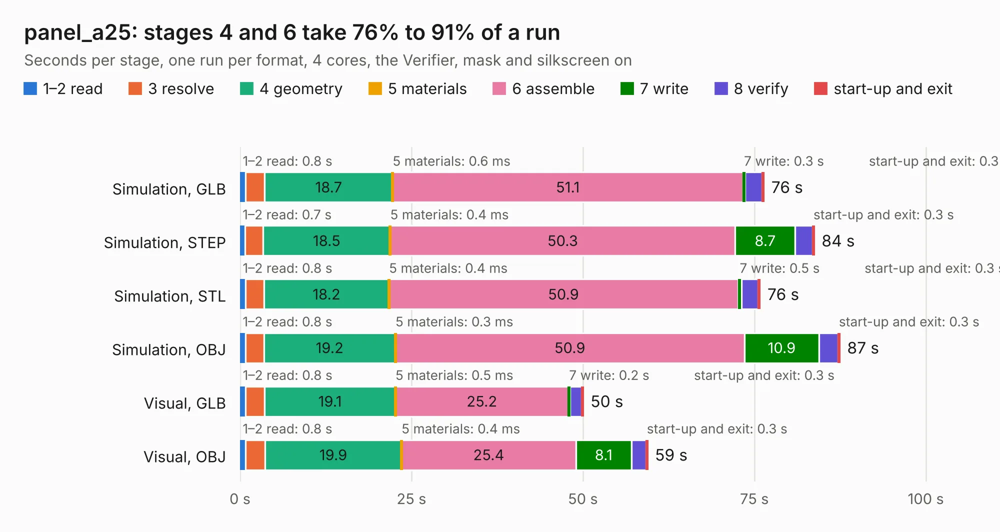

# 3038. panel_a25

Board 3,038 of the 3,139 of [Corpus Testing](../Corpus-Testing.md), on [Corpus Page 29](../CorpusTestingPages/Corpus-Testing-29.md#3038-panel_a25).

| Mode and format | 1–2 read | 3 resolve | 4 geometry | 5 materials | 6 assemble | 7 write | 8 verify | start-up and exit | Total |
|---|---:|---:|---:|---:|---:|---:|---:|---:|---:|
| Simulation, GLB | 0.8 | 2.8 | 18.7 | 0.6&nbsp;ms | 51.1 | 0.3 | 2.5 | 0.3 | 76.4 |
| Simulation, STEP | 0.7 | 2.6 | 18.5 | 0.4&nbsp;ms | 50.3 | 8.7 | 2.5 | 0.3 | 83.8 |
| Simulation, STL | 0.8 | 2.7 | 18.2 | 0.4&nbsp;ms | 50.9 | 0.5 | 2.4 | 0.3 | 75.9 |
| Simulation, OBJ | 0.8 | 2.7 | 19.2 | 0.3&nbsp;ms | 50.9 | 10.9 | 2.7 | 0.3 | 87.5 |
| Visual, GLB | 0.8 | 2.8 | 19.1 | 0.5&nbsp;ms | 25.2 | 0.2 | 1.7 | 0.3 | 50.1 |
| Visual, OBJ | 0.8 | 2.9 | 19.9 | 0.4&nbsp;ms | 25.4 | 8.1 | 2.1 | 0.3 | 59.5 |

<table align="center"><tr><td valign="top">

| Board | Repo: [winkleplex10-bit/the-mac-pro-project](https://github.com/winkleplex10-bit/the-mac-pro-project) Board: `panel_a25.kicad_pcb` |
|---|---|
| Folder | kicad / macpro62-io-modules / panel / panel_a25 |
| Complexity | 220&nbsp;/&nbsp;1000 (size&nbsp;165, features&nbsp;55) |
| KESE&nbsp;features | through vias, rounded, trapezoid or chamfered pads, filled zones, copper drawings |
| Tested | 9th November 2026 |
| Copper&nbsp;layers | 2 |
| File&nbsp;format | KiCad 9 (20241229) |
| Parts,&nbsp;tracks,&nbsp;vias | 22, 825, 88 |
| Triangles,&nbsp;simulation | 1,738,244 in 61 parts |
| Note | panel |
| Verifier | PASS in all six runs |

</td><td valign="top">

<table>
<tr><th>File type</th><th>File size</th><th>Peak memory used</th></tr>
<tr><th colspan="3" align="left">Simulation</th></tr>
<tr><td>GLB</td><td align="right">68&nbsp;MB</td><td align="right">969&nbsp;MB</td></tr>
<tr><td>STEP</td><td align="right">418&nbsp;MB</td><td align="right">1.0&nbsp;GB</td></tr>
<tr><td>STL</td><td align="right">87&nbsp;MB</td><td align="right">945&nbsp;MB</td></tr>
<tr><td>OBJ</td><td align="right">202&nbsp;MB</td><td align="right">1.4&nbsp;GB</td></tr>
<tr><th colspan="3" align="left">Visual</th></tr>
<tr><td>GLB</td><td align="right">48&nbsp;MB</td><td align="right">1.2&nbsp;GB</td></tr>
<tr><td>OBJ</td><td align="right">142&nbsp;MB</td><td align="right">1.1&nbsp;GB</td></tr>
</table>

</td></tr></table>

| Previous | Next |
|:---|---:|
| [3037. mod_usbc](b3037b_the-mac-pro-project_mod-usbc.md) | [3039. panel_c50](b3039b_the-mac-pro-project_panel-c50.md) |
