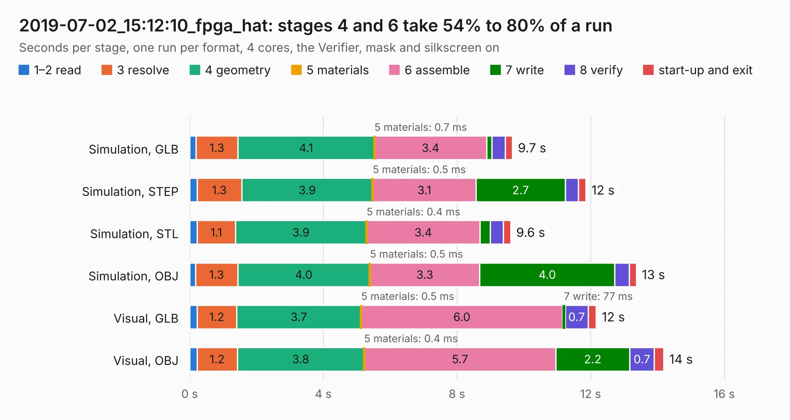

# 3045. 2019-07-02_15:12:10_fpga_hat

Board 3,045 of the 3,123 of [Corpus Testing](../Corpus-Testing.md), on [Corpus Page 29](../CorpusTestingPages/Corpus-Testing-29.md#3045-2019-07-02_151210_fpga_hat).

| Mode and format | 1–2 read | 3 resolve | 4 geometry | 5 materials | 6 assemble | 7 write | 8 verify | start-up and exit | Total |
|---|---:|---:|---:|---:|---:|---:|---:|---:|---:|
| Simulation, GLB | 0.2 | 1.3 | 4.1 | 0.7&nbsp;ms | 3.4 | 0.2 | 0.4 | 0.2 | 9.7 |
| Simulation, STEP | 0.2 | 1.3 | 3.9 | 0.5&nbsp;ms | 3.1 | 2.7 | 0.4 | 0.2 | 11.9 |
| Simulation, STL | 0.2 | 1.1 | 3.9 | 0.4&nbsp;ms | 3.4 | 0.3 | 0.4 | 0.2 | 9.6 |
| Simulation, OBJ | 0.2 | 1.3 | 4.0 | 0.5&nbsp;ms | 3.3 | 4.0 | 0.4 | 0.2 | 13.4 |
| Visual, GLB | 0.2 | 1.2 | 3.7 | 0.5&nbsp;ms | 6.0 | 77&nbsp;ms | 0.7 | 0.2 | 12.2 |
| Visual, OBJ | 0.2 | 1.2 | 3.8 | 0.4&nbsp;ms | 5.7 | 2.2 | 0.7 | 0.3 | 14.2 |

<table align="center"><tr><td valign="top">

| Board | Repo: [Wren6991/Snowflake-FPGA](https://github.com/Wren6991/Snowflake-FPGA) Board: `2019-07-02_15:12:10_fpga_hat.kicad_pcb` |
|---|---|
| Folder | timelapse |
| Complexity | 160&nbsp;/&nbsp;1000 (size&nbsp;140, features&nbsp;20) |
| KESE&nbsp;features | rounded, trapezoid or chamfered pads, curved board outline |
| Tested | 9th November 2026 |
| Copper&nbsp;layers | 4 |
| File&nbsp;format | KiCad 5 (20171130) |
| Parts,&nbsp;tracks,&nbsp;vias | 81, 0, 0 |
| Triangles,&nbsp;simulation | 1,005,282 in 150 parts |
| Note | mostly unrouted |
| Verifier | PASS in all six runs |

</td><td valign="top">

<table>
<tr><th>File type</th><th>File size</th><th>Peak memory used</th></tr>
<tr><th colspan="3" align="left">Simulation</th></tr>
<tr><td>GLB</td><td align="right">33&nbsp;MB</td><td align="right">409&nbsp;MB</td></tr>
<tr><td>STEP</td><td align="right">160&nbsp;MB</td><td align="right">514&nbsp;MB</td></tr>
<tr><td>STL</td><td align="right">50&nbsp;MB</td><td align="right">402&nbsp;MB</td></tr>
<tr><td>OBJ</td><td align="right">102&nbsp;MB</td><td align="right">727&nbsp;MB</td></tr>
<tr><th colspan="3" align="left">Visual</th></tr>
<tr><td>GLB</td><td align="right">18&nbsp;MB</td><td align="right">471&nbsp;MB</td></tr>
<tr><td>OBJ</td><td align="right">52&nbsp;MB</td><td align="right">505&nbsp;MB</td></tr>
</table>

</td></tr></table>

| Previous | Next |
|:---|---:|
| [3044. 2019-07-02_14:14:35_fpga_hat](b3044b_Snowflake-FPGA_2019-07-02-14-14-35-fpga-hat.md) | [3046. 2019-07-02_15:26:14_fpga_hat](b3046b_Snowflake-FPGA_2019-07-02-15-26-14-fpga-hat.md) |
