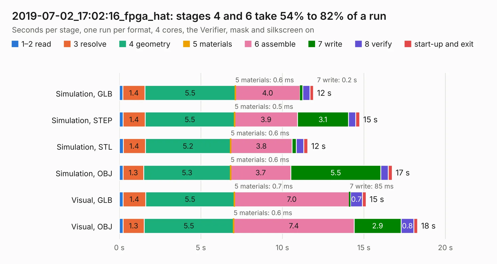

# 3049. 2019-07-02_17:02:16_fpga_hat

Board 3,049 of the 3,121 of [Corpus Testing](../Corpus-Testing.md), on [Corpus Page 29](../CorpusTestingPages/Corpus-Testing-29.md#3049-2019-07-02_170216_fpga_hat).

| Mode and format | 1–2 read | 3 resolve | 4 geometry | 5 materials | 6 assemble | 7 write | 8 verify | start-up and exit | Total |
|---|---:|---:|---:|---:|---:|---:|---:|---:|---:|
| Simulation, GLB | 0.2 | 1.4 | 5.5 | 0.6&nbsp;ms | 4.0 | 0.2 | 0.4 | 0.2 | 11.9 |
| Simulation, STEP | 0.2 | 1.4 | 5.5 | 0.5&nbsp;ms | 3.9 | 3.1 | 0.4 | 0.2 | 14.7 |
| Simulation, STL | 0.2 | 1.4 | 5.2 | 0.6&nbsp;ms | 3.8 | 0.3 | 0.5 | 0.2 | 11.6 |
| Simulation, OBJ | 0.2 | 1.3 | 5.3 | 0.6&nbsp;ms | 3.7 | 5.5 | 0.5 | 0.2 | 16.7 |
| Visual, GLB | 0.2 | 1.4 | 5.5 | 0.7&nbsp;ms | 7.0 | 85&nbsp;ms | 0.7 | 0.2 | 15.1 |
| Visual, OBJ | 0.2 | 1.3 | 5.5 | 0.6&nbsp;ms | 7.4 | 2.9 | 0.8 | 0.2 | 18.3 |

<table align="center"><tr><td valign="top">

| Board | Repo: [Wren6991/Snowflake-FPGA](https://github.com/Wren6991/Snowflake-FPGA) Board: `2019-07-02_17:02:16_fpga_hat.kicad_pcb` |
|---|---|
| Folder | timelapse |
| Complexity | 271&nbsp;/&nbsp;1000 (size&nbsp;236, features&nbsp;35) |
| KESE&nbsp;features | through vias, rounded, trapezoid or chamfered pads, curved board outline |
| Tested | 9th November 2026 |
| Copper&nbsp;layers | 4 |
| File&nbsp;format | KiCad 5 (20171130) |
| Parts,&nbsp;tracks,&nbsp;vias | 81, 314, 15 |
| Triangles,&nbsp;simulation | 1,104,480 in 150 parts |
| Verifier | PASS in all six runs |

</td><td valign="top">

<table>
<tr><th>File type</th><th>File size</th><th>Peak memory used</th></tr>
<tr><th colspan="3" align="left">Simulation</th></tr>
<tr><td>GLB</td><td align="right">37&nbsp;MB</td><td align="right">445&nbsp;MB</td></tr>
<tr><td>STEP</td><td align="right">181&nbsp;MB</td><td align="right">560&nbsp;MB</td></tr>
<tr><td>STL</td><td align="right">55&nbsp;MB</td><td align="right">429&nbsp;MB</td></tr>
<tr><td>OBJ</td><td align="right">113&nbsp;MB</td><td align="right">798&nbsp;MB</td></tr>
<tr><th colspan="3" align="left">Visual</th></tr>
<tr><td>GLB</td><td align="right">20&nbsp;MB</td><td align="right">562&nbsp;MB</td></tr>
<tr><td>OBJ</td><td align="right">60&nbsp;MB</td><td align="right">526&nbsp;MB</td></tr>
</table>

</td></tr></table>

| Previous | Next |
|:---|---:|
| [3048. 2019-07-02_15:48:31_fpga_hat](b3048b_Snowflake-FPGA_2019-07-02-15-48-31-fpga-hat.md) | [3050. 2019-07-02_17:04:43_fpga_hat](b3050b_Snowflake-FPGA_2019-07-02-17-04-43-fpga-hat.md) |
