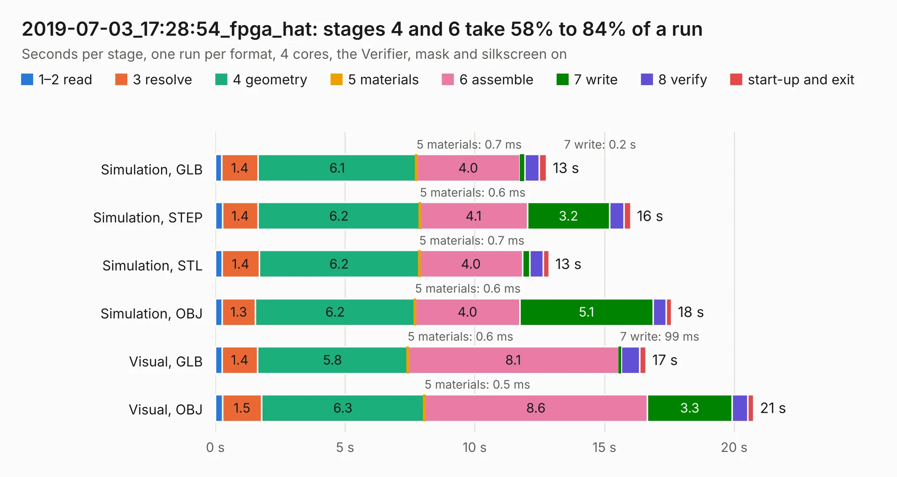

# 3061. 2019-07-03_17:28:54_fpga_hat

Board 3,061 of the 3,109 of [Corpus Testing](../Corpus-Testing.md), on [Corpus Page 29](../CorpusTestingPages/Corpus-Testing-29.md#3061-2019-07-03_172854_fpga_hat).

| Mode and format | 1–2 read | 3 resolve | 4 geometry | 5 materials | 6 assemble | 7 write | 8 verify | start-up and exit | Total |
|---|---:|---:|---:|---:|---:|---:|---:|---:|---:|
| Simulation, GLB | 0.2 | 1.4 | 6.1 | 0.7&nbsp;ms | 4.0 | 0.2 | 0.5 | 0.3 | 12.8 |
| Simulation, STEP | 0.3 | 1.4 | 6.2 | 0.6&nbsp;ms | 4.1 | 3.2 | 0.5 | 0.3 | 16.0 |
| Simulation, STL | 0.3 | 1.4 | 6.2 | 0.7&nbsp;ms | 4.0 | 0.3 | 0.5 | 0.2 | 12.9 |
| Simulation, OBJ | 0.3 | 1.3 | 6.2 | 0.6&nbsp;ms | 4.0 | 5.1 | 0.5 | 0.2 | 17.6 |
| Visual, GLB | 0.3 | 1.4 | 5.8 | 0.6&nbsp;ms | 8.1 | 99&nbsp;ms | 0.7 | 0.2 | 16.6 |
| Visual, OBJ | 0.3 | 1.5 | 6.3 | 0.5&nbsp;ms | 8.6 | 3.3 | 0.6 | 0.2 | 20.7 |

<table align="center"><tr><td valign="top">

| Board | Repo: [Wren6991/Snowflake-FPGA](https://github.com/Wren6991/Snowflake-FPGA) Board: `2019-07-03_17:28:54_fpga_hat.kicad_pcb` |
|---|---|
| Folder | timelapse |
| Complexity | 286&nbsp;/&nbsp;1000 (size&nbsp;251, features&nbsp;35) |
| KESE&nbsp;features | through vias, rounded, trapezoid or chamfered pads, curved board outline |
| Tested | 9th November 2026 |
| Copper&nbsp;layers | 4 |
| File&nbsp;format | KiCad 5 (20171130) |
| Parts,&nbsp;tracks,&nbsp;vias | 81, 783, 30 |
| Triangles,&nbsp;simulation | 1,200,172 in 150 parts |
| Verifier | PASS in all six runs |

</td><td valign="top">

<table>
<tr><th>File type</th><th>File size</th><th>Peak memory used</th></tr>
<tr><th colspan="3" align="left">Simulation</th></tr>
<tr><td>GLB</td><td align="right">41&nbsp;MB</td><td align="right">519&nbsp;MB</td></tr>
<tr><td>STEP</td><td align="right">202&nbsp;MB</td><td align="right">576&nbsp;MB</td></tr>
<tr><td>STL</td><td align="right">60&nbsp;MB</td><td align="right">496&nbsp;MB</td></tr>
<tr><td>OBJ</td><td align="right">124&nbsp;MB</td><td align="right">854&nbsp;MB</td></tr>
<tr><th colspan="3" align="left">Visual</th></tr>
<tr><td>GLB</td><td align="right">23&nbsp;MB</td><td align="right">568&nbsp;MB</td></tr>
<tr><td>OBJ</td><td align="right">69&nbsp;MB</td><td align="right">556&nbsp;MB</td></tr>
</table>

</td></tr></table>

| Previous | Next |
|:---|---:|
| [3060. 2019-07-03_07:15:18_fpga_hat](b3060b_Snowflake-FPGA_2019-07-03-07-15-18-fpga-hat.md) | [3062. 2019-07-03_17:47:28_fpga_hat](b3062b_Snowflake-FPGA_2019-07-03-17-47-28-fpga-hat.md) |
