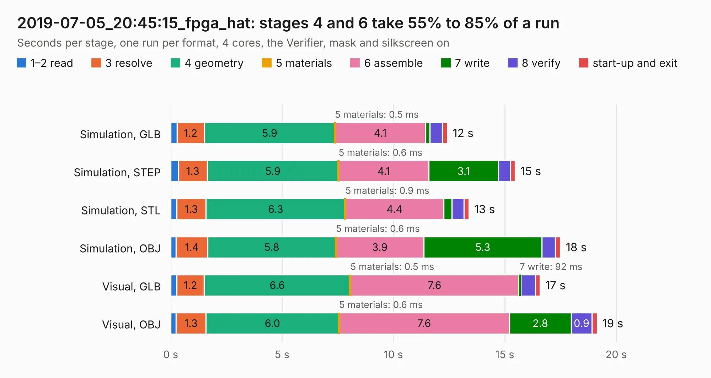

# 3063. 2019-07-05_20:45:15_fpga_hat

Board 3,063 of the 3,105 of [Corpus Testing](../Corpus-Testing.md), on [Corpus Page 29](../CorpusTestingPages/Corpus-Testing-29.md#3063-2019-07-05_204515_fpga_hat).

| Mode and format | 1–2 read | 3 resolve | 4 geometry | 5 materials | 6 assemble | 7 write | 8 verify | start-up and exit | Total |
|---|---:|---:|---:|---:|---:|---:|---:|---:|---:|
| Simulation, GLB | 0.3 | 1.2 | 5.9 | 0.5&nbsp;ms | 4.1 | 0.2 | 0.6 | 0.2 | 12.4 |
| Simulation, STEP | 0.3 | 1.3 | 5.9 | 0.6&nbsp;ms | 4.1 | 3.1 | 0.5 | 0.2 | 15.5 |
| Simulation, STL | 0.3 | 1.3 | 6.3 | 0.9&nbsp;ms | 4.4 | 0.4 | 0.5 | 0.2 | 13.4 |
| Simulation, OBJ | 0.2 | 1.4 | 5.8 | 0.6&nbsp;ms | 3.9 | 5.3 | 0.6 | 0.2 | 17.5 |
| Visual, GLB | 0.3 | 1.2 | 6.6 | 0.5&nbsp;ms | 7.6 | 92&nbsp;ms | 0.7 | 0.2 | 16.6 |
| Visual, OBJ | 0.2 | 1.3 | 6.0 | 0.6&nbsp;ms | 7.6 | 2.8 | 0.9 | 0.2 | 19.2 |

<table align="center"><tr><td valign="top">

| Board | Repo: [Wren6991/Snowflake-FPGA](https://github.com/Wren6991/Snowflake-FPGA) Board: `2019-07-05_20:45:15_fpga_hat.kicad_pcb` |
|---|---|
| Folder | timelapse |
| Complexity | 307&nbsp;/&nbsp;1000 (size&nbsp;252, features&nbsp;55) |
| KESE&nbsp;features | through vias, rounded, trapezoid or chamfered pads, filled zones, curved board outline |
| Tested | 9th November 2026 |
| Copper&nbsp;layers | 4 |
| File&nbsp;format | KiCad 5 (20171130) |
| Parts,&nbsp;tracks,&nbsp;vias | 81, 856, 32 |
| Triangles,&nbsp;simulation | 1,277,596 in 150 parts |
| Verifier | PASS in all six runs |

</td><td valign="top">

<table>
<tr><th>File type</th><th>File size</th><th>Peak memory used</th></tr>
<tr><th colspan="3" align="left">Simulation</th></tr>
<tr><td>GLB</td><td align="right">44&nbsp;MB</td><td align="right">505&nbsp;MB</td></tr>
<tr><td>STEP</td><td align="right">214&nbsp;MB</td><td align="right">581&nbsp;MB</td></tr>
<tr><td>STL</td><td align="right">64&nbsp;MB</td><td align="right">487&nbsp;MB</td></tr>
<tr><td>OBJ</td><td align="right">133&nbsp;MB</td><td align="right">881&nbsp;MB</td></tr>
<tr><th colspan="3" align="left">Visual</th></tr>
<tr><td>GLB</td><td align="right">24&nbsp;MB</td><td align="right">594&nbsp;MB</td></tr>
<tr><td>OBJ</td><td align="right">70&nbsp;MB</td><td align="right">591&nbsp;MB</td></tr>
</table>

</td></tr></table>

| Previous | Next |
|:---|---:|
| [3062. 2019-07-03_18:34:30_fpga_hat](b3062b_Snowflake-FPGA_2019-07-03-18-34-30-fpga-hat.md) | [3064. 2019-07-05_21:08:22_fpga_hat](b3064b_Snowflake-FPGA_2019-07-05-21-08-22-fpga-hat.md) |
