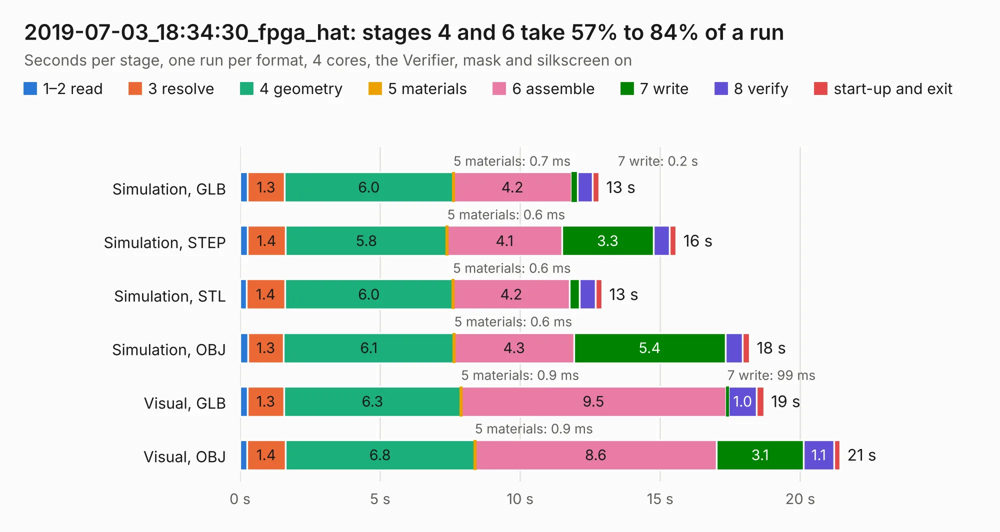

# 3067. 2019-07-03_18:34:30_fpga_hat

Board 3,067 of the 3,110 of [Corpus Testing](../Corpus-Testing.md), on [Corpus Page 29](../CorpusTestingPages/Corpus-Testing-29.md#3067-2019-07-03_183430_fpga_hat).

| Mode and format | 1–2 read | 3 resolve | 4 geometry | 5 materials | 6 assemble | 7 write | 8 verify | start-up and exit | Total |
|---|---:|---:|---:|---:|---:|---:|---:|---:|---:|
| Simulation, GLB | 0.3 | 1.3 | 6.0 | 0.7&nbsp;ms | 4.2 | 0.2 | 0.5 | 0.2 | 12.8 |
| Simulation, STEP | 0.3 | 1.4 | 5.8 | 0.6&nbsp;ms | 4.1 | 3.3 | 0.6 | 0.2 | 15.6 |
| Simulation, STL | 0.2 | 1.4 | 6.0 | 0.6&nbsp;ms | 4.2 | 0.4 | 0.6 | 0.2 | 12.9 |
| Simulation, OBJ | 0.3 | 1.3 | 6.1 | 0.6&nbsp;ms | 4.3 | 5.4 | 0.6 | 0.3 | 18.2 |
| Visual, GLB | 0.3 | 1.3 | 6.3 | 0.9&nbsp;ms | 9.5 | 99&nbsp;ms | 1.0 | 0.3 | 18.7 |
| Visual, OBJ | 0.2 | 1.4 | 6.8 | 0.9&nbsp;ms | 8.6 | 3.1 | 1.1 | 0.2 | 21.4 |

<table align="center"><tr><td valign="top">

| Board | Repo: [Wren6991/Snowflake-FPGA](https://github.com/Wren6991/Snowflake-FPGA) Board: `2019-07-03_18:34:30_fpga_hat.kicad_pcb` |
|---|---|
| Folder | timelapse |
| Complexity | 287&nbsp;/&nbsp;1000 (size&nbsp;252, features&nbsp;35) |
| KESE&nbsp;features | through vias, rounded, trapezoid or chamfered pads, curved board outline |
| Tested | 9th November 2026 |
| Copper&nbsp;layers | 4 |
| File&nbsp;format | KiCad 5 (20171130) |
| Parts,&nbsp;tracks,&nbsp;vias | 81, 853, 32 |
| Triangles,&nbsp;simulation | 1,216,442 in 150 parts |
| Verifier | PASS in all six runs |

</td><td valign="top">

<table>
<tr><th>File type</th><th>File size</th><th>Peak memory used</th></tr>
<tr><th colspan="3" align="left">Simulation</th></tr>
<tr><td>GLB</td><td align="right">41&nbsp;MB</td><td align="right">502&nbsp;MB</td></tr>
<tr><td>STEP</td><td align="right">206&nbsp;MB</td><td align="right">576&nbsp;MB</td></tr>
<tr><td>STL</td><td align="right">61&nbsp;MB</td><td align="right">487&nbsp;MB</td></tr>
<tr><td>OBJ</td><td align="right">126&nbsp;MB</td><td align="right">839&nbsp;MB</td></tr>
<tr><th colspan="3" align="left">Visual</th></tr>
<tr><td>GLB</td><td align="right">24&nbsp;MB</td><td align="right">542&nbsp;MB</td></tr>
<tr><td>OBJ</td><td align="right">70&nbsp;MB</td><td align="right">579&nbsp;MB</td></tr>
</table>

</td></tr></table>

| Previous | Next |
|:---|---:|
| [3066. 2019-07-03_18:30:05_fpga_hat](b3066b_Snowflake-FPGA_2019-07-03-18-30-05-fpga-hat.md) | [3068. 2019-07-05_20:45:15_fpga_hat](b3068b_Snowflake-FPGA_2019-07-05-20-45-15-fpga-hat.md) |
