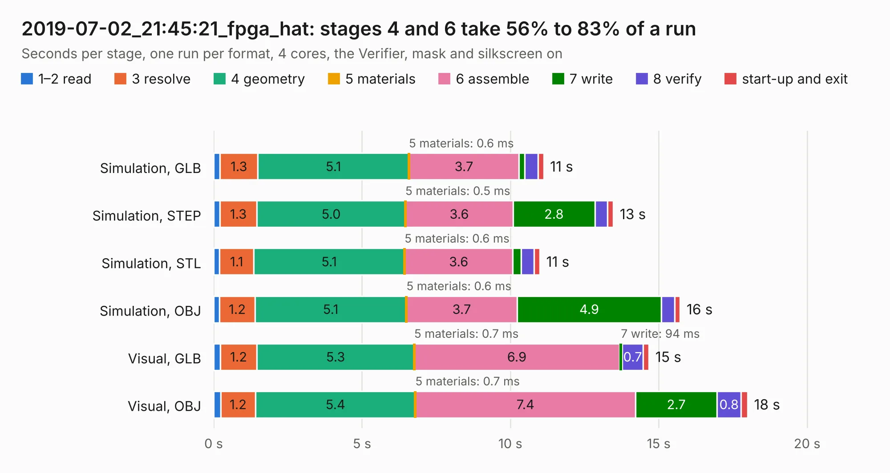

# 3069. 2019-07-02_21:45:21_fpga_hat

Board 3,069 of the 3,122 of [Corpus Testing](../Corpus-Testing.md), on [Corpus Page 29](../CorpusTestingPages/Corpus-Testing-29.md#3069-2019-07-02_214521_fpga_hat).

| Mode and format | 1–2 read | 3 resolve | 4 geometry | 5 materials | 6 assemble | 7 write | 8 verify | start-up and exit | Total |
|---|---:|---:|---:|---:|---:|---:|---:|---:|---:|
| Simulation, GLB | 0.2 | 1.3 | 5.1 | 0.6&nbsp;ms | 3.7 | 0.2 | 0.4 | 0.2 | 11.1 |
| Simulation, STEP | 0.2 | 1.3 | 5.0 | 0.5&nbsp;ms | 3.6 | 2.8 | 0.4 | 0.2 | 13.5 |
| Simulation, STL | 0.2 | 1.1 | 5.1 | 0.6&nbsp;ms | 3.6 | 0.3 | 0.4 | 0.2 | 11.0 |
| Simulation, OBJ | 0.2 | 1.2 | 5.1 | 0.6&nbsp;ms | 3.7 | 4.9 | 0.4 | 0.2 | 15.7 |
| Visual, GLB | 0.2 | 1.2 | 5.3 | 0.7&nbsp;ms | 6.9 | 94&nbsp;ms | 0.7 | 0.2 | 14.7 |
| Visual, OBJ | 0.2 | 1.2 | 5.4 | 0.7&nbsp;ms | 7.4 | 2.7 | 0.8 | 0.2 | 18.0 |

<table align="center"><tr><td valign="top">

| Board | Repo: [Wren6991/Snowflake-FPGA](https://github.com/Wren6991/Snowflake-FPGA) Board: `2019-07-02_21:45:21_fpga_hat.kicad_pcb` |
|---|---|
| Folder | timelapse |
| Complexity | 285&nbsp;/&nbsp;1000 (size&nbsp;250, features&nbsp;35) |
| KESE&nbsp;features | through vias, rounded, trapezoid or chamfered pads, curved board outline |
| Tested | 9th November 2026 |
| Copper&nbsp;layers | 4 |
| File&nbsp;format | KiCad 5 (20171130) |
| Parts,&nbsp;tracks,&nbsp;vias | 81, 722, 30 |
| Triangles,&nbsp;simulation | 1,197,164 in 150 parts |
| Verifier | PASS in all six runs |

</td><td valign="top">

<table>
<tr><th>File type</th><th>File size</th><th>Peak memory used</th></tr>
<tr><th colspan="3" align="left">Simulation</th></tr>
<tr><td>GLB</td><td align="right">41&nbsp;MB</td><td align="right">453&nbsp;MB</td></tr>
<tr><td>STEP</td><td align="right">200&nbsp;MB</td><td align="right">570&nbsp;MB</td></tr>
<tr><td>STL</td><td align="right">60&nbsp;MB</td><td align="right">485&nbsp;MB</td></tr>
<tr><td>OBJ</td><td align="right">124&nbsp;MB</td><td align="right">840&nbsp;MB</td></tr>
<tr><th colspan="3" align="left">Visual</th></tr>
<tr><td>GLB</td><td align="right">23&nbsp;MB</td><td align="right">582&nbsp;MB</td></tr>
<tr><td>OBJ</td><td align="right">68&nbsp;MB</td><td align="right">612&nbsp;MB</td></tr>
</table>

</td></tr></table>

| Previous | Next |
|:---|---:|
| [3068. 2019-07-02_21:04:22_fpga_hat](b3068b_Snowflake-FPGA_2019-07-02-21-04-22-fpga-hat.md) | [3070. 2019-07-03_06:45:34_fpga_hat](b3070b_Snowflake-FPGA_2019-07-03-06-45-34-fpga-hat.md) |
