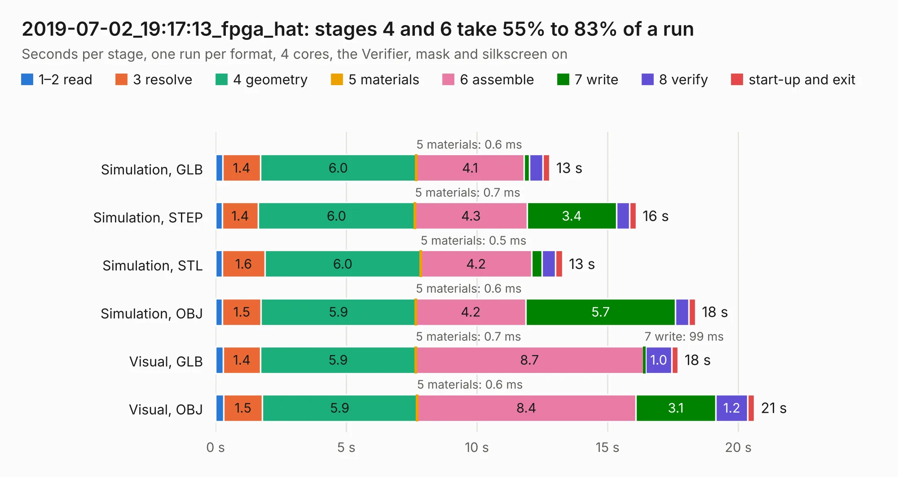

# 3071. 2019-07-02_19:17:13_fpga_hat

Board 3,071 of the 3,132 of [Corpus Testing](../Corpus-Testing.md), on [Corpus Page 29](../CorpusTestingPages/Corpus-Testing-29.md#3071-2019-07-02_191713_fpga_hat).

| Mode and format | 1–2 read | 3 resolve | 4 geometry | 5 materials | 6 assemble | 7 write | 8 verify | start-up and exit | Total |
|---|---:|---:|---:|---:|---:|---:|---:|---:|---:|
| Simulation, GLB | 0.3 | 1.4 | 6.0 | 0.6&nbsp;ms | 4.1 | 0.2 | 0.5 | 0.3 | 12.8 |
| Simulation, STEP | 0.3 | 1.4 | 6.0 | 0.7&nbsp;ms | 4.3 | 3.4 | 0.5 | 0.2 | 16.1 |
| Simulation, STL | 0.3 | 1.6 | 6.0 | 0.5&nbsp;ms | 4.2 | 0.4 | 0.5 | 0.3 | 13.3 |
| Simulation, OBJ | 0.3 | 1.5 | 5.9 | 0.6&nbsp;ms | 4.2 | 5.7 | 0.5 | 0.2 | 18.4 |
| Visual, GLB | 0.3 | 1.4 | 5.9 | 0.7&nbsp;ms | 8.7 | 99&nbsp;ms | 1.0 | 0.2 | 17.7 |
| Visual, OBJ | 0.3 | 1.5 | 5.9 | 0.6&nbsp;ms | 8.4 | 3.1 | 1.2 | 0.3 | 20.6 |

<table align="center"><tr><td valign="top">

| Board | Repo: [Wren6991/Snowflake-FPGA](https://github.com/Wren6991/Snowflake-FPGA) Board: `2019-07-02_19:17:13_fpga_hat.kicad_pcb` |
|---|---|
| Folder | timelapse |
| Complexity | 279&nbsp;/&nbsp;1000 (size&nbsp;244, features&nbsp;35) |
| KESE&nbsp;features | through vias, rounded, trapezoid or chamfered pads, curved board outline |
| Tested | 9th November 2026 |
| Copper&nbsp;layers | 4 |
| File&nbsp;format | KiCad 5 (20171130) |
| Parts,&nbsp;tracks,&nbsp;vias | 81, 547, 16 |
| Triangles,&nbsp;simulation | 1,133,988 in 150 parts |
| Verifier | PASS in all six runs |

</td><td valign="top">

<table>
<tr><th>File type</th><th>File size</th><th>Peak memory used</th></tr>
<tr><th colspan="3" align="left">Simulation</th></tr>
<tr><td>GLB</td><td align="right">38&nbsp;MB</td><td align="right">452&nbsp;MB</td></tr>
<tr><td>STEP</td><td align="right">189&nbsp;MB</td><td align="right">574&nbsp;MB</td></tr>
<tr><td>STL</td><td align="right">57&nbsp;MB</td><td align="right">472&nbsp;MB</td></tr>
<tr><td>OBJ</td><td align="right">117&nbsp;MB</td><td align="right">808&nbsp;MB</td></tr>
<tr><th colspan="3" align="left">Visual</th></tr>
<tr><td>GLB</td><td align="right">21&nbsp;MB</td><td align="right">581&nbsp;MB</td></tr>
<tr><td>OBJ</td><td align="right">63&nbsp;MB</td><td align="right">531&nbsp;MB</td></tr>
</table>

</td></tr></table>

| Previous | Next |
|:---|---:|
| [3070. 2019-07-02_19:05:24_fpga_hat](b3070b_Snowflake-FPGA_2019-07-02-19-05-24-fpga-hat.md) | [3072. 2019-07-02_19:35:16_fpga_hat](b3072b_Snowflake-FPGA_2019-07-02-19-35-16-fpga-hat.md) |
