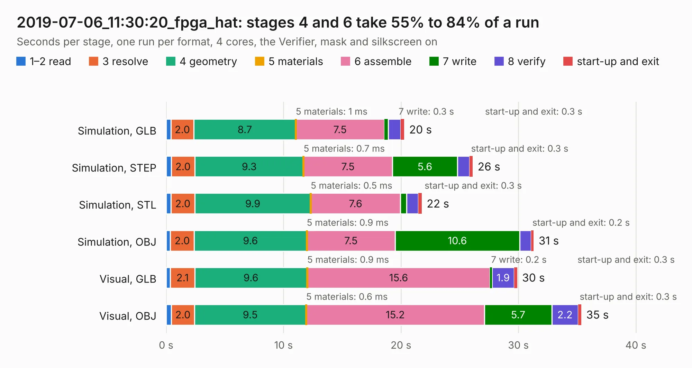

# 3071. 2019-07-06_11:30:20_fpga_hat

Board 3,071 of the 3,104 of [Corpus Testing](../Corpus-Testing.md), on [Corpus Page 29](../CorpusTestingPages/Corpus-Testing-29.md#3071-2019-07-06_113020_fpga_hat).

| Mode and format | 1–2 read | 3 resolve | 4 geometry | 5 materials | 6 assemble | 7 write | 8 verify | start-up and exit | Total |
|---|---:|---:|---:|---:|---:|---:|---:|---:|---:|
| Simulation, GLB | 0.4 | 2.0 | 8.7 | 1&nbsp;ms | 7.5 | 0.3 | 1.1 | 0.3 | 20.3 |
| Simulation, STEP | 0.4 | 2.0 | 9.3 | 0.7&nbsp;ms | 7.5 | 5.6 | 1.0 | 0.3 | 26.1 |
| Simulation, STL | 0.4 | 2.0 | 9.9 | 0.5&nbsp;ms | 7.6 | 0.5 | 1.0 | 0.3 | 21.8 |
| Simulation, OBJ | 0.4 | 2.0 | 9.6 | 0.9&nbsp;ms | 7.5 | 10.6 | 1.0 | 0.2 | 31.3 |
| Visual, GLB | 0.4 | 2.1 | 9.6 | 0.9&nbsp;ms | 15.6 | 0.2 | 1.9 | 0.3 | 29.9 |
| Visual, OBJ | 0.5 | 2.0 | 9.5 | 0.6&nbsp;ms | 15.2 | 5.7 | 2.2 | 0.3 | 35.4 |

<table align="center"><tr><td valign="top">

| Board | Repo: [Wren6991/Snowflake-FPGA](https://github.com/Wren6991/Snowflake-FPGA) Board: `2019-07-06_11:30:20_fpga_hat.kicad_pcb` |
|---|---|
| Folder | timelapse |
| Complexity | 314&nbsp;/&nbsp;1000 (size&nbsp;259, features&nbsp;55) |
| KESE&nbsp;features | through vias, rounded, trapezoid or chamfered pads, filled zones, curved board outline |
| Tested | 9th November 2026 |
| Copper&nbsp;layers | 4 |
| File&nbsp;format | KiCad 5 (20171130) |
| Parts,&nbsp;tracks,&nbsp;vias | 82, 1,082, 113 |
| Triangles,&nbsp;simulation | 1,942,906 in 150 parts |
| Verifier | PASS in all six runs |

</td><td valign="top">

<table>
<tr><th>File type</th><th>File size</th><th>Peak memory used</th></tr>
<tr><th colspan="3" align="left">Simulation</th></tr>
<tr><td>GLB</td><td align="right">67&nbsp;MB</td><td align="right">716&nbsp;MB</td></tr>
<tr><td>STEP</td><td align="right">317&nbsp;MB</td><td align="right">846&nbsp;MB</td></tr>
<tr><td>STL</td><td align="right">97&nbsp;MB</td><td align="right">737&nbsp;MB</td></tr>
<tr><td>OBJ</td><td align="right">205&nbsp;MB</td><td align="right">1.3&nbsp;GB</td></tr>
<tr><th colspan="3" align="left">Visual</th></tr>
<tr><td>GLB</td><td align="right">40&nbsp;MB</td><td align="right">955&nbsp;MB</td></tr>
<tr><td>OBJ</td><td align="right">121&nbsp;MB</td><td align="right">949&nbsp;MB</td></tr>
</table>

</td></tr></table>

| Previous | Next |
|:---|---:|
| [3070. 2019-07-06_11:24:12_fpga_hat](b3070b_Snowflake-FPGA_2019-07-06-11-24-12-fpga-hat.md) | [3072. 2019-07-06_11:52:16_fpga_hat](b3072b_Snowflake-FPGA_2019-07-06-11-52-16-fpga-hat.md) |
