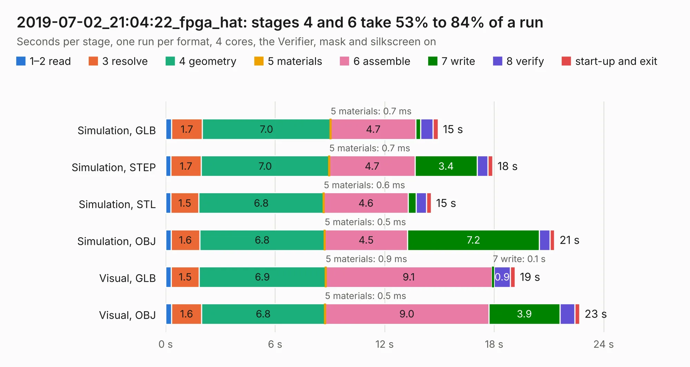

# 3073. 2019-07-02_21:04:22_fpga_hat

Board 3,073 of the 3,127 of [Corpus Testing](../Corpus-Testing.md), on [Corpus Page 29](../CorpusTestingPages/Corpus-Testing-29.md#3073-2019-07-02_210422_fpga_hat).

| Mode and format | 1–2 read | 3 resolve | 4 geometry | 5 materials | 6 assemble | 7 write | 8 verify | start-up and exit | Total |
|---|---:|---:|---:|---:|---:|---:|---:|---:|---:|
| Simulation, GLB | 0.3 | 1.7 | 7.0 | 0.7&nbsp;ms | 4.7 | 0.3 | 0.7 | 0.3 | 14.9 |
| Simulation, STEP | 0.3 | 1.7 | 7.0 | 0.7&nbsp;ms | 4.7 | 3.4 | 0.6 | 0.3 | 17.9 |
| Simulation, STL | 0.3 | 1.5 | 6.8 | 0.6&nbsp;ms | 4.6 | 0.4 | 0.6 | 0.3 | 14.5 |
| Simulation, OBJ | 0.3 | 1.6 | 6.8 | 0.5&nbsp;ms | 4.5 | 7.2 | 0.6 | 0.2 | 21.3 |
| Visual, GLB | 0.3 | 1.5 | 6.9 | 0.9&nbsp;ms | 9.1 | 0.1 | 0.9 | 0.3 | 19.1 |
| Visual, OBJ | 0.3 | 1.6 | 6.8 | 0.5&nbsp;ms | 9.0 | 3.9 | 0.8 | 0.3 | 22.7 |

<table align="center"><tr><td valign="top">

| Board | Repo: [Wren6991/Snowflake-FPGA](https://github.com/Wren6991/Snowflake-FPGA) Board: `2019-07-02_21:04:22_fpga_hat.kicad_pcb` |
|---|---|
| Folder | timelapse |
| Complexity | 283&nbsp;/&nbsp;1000 (size&nbsp;248, features&nbsp;35) |
| KESE&nbsp;features | through vias, rounded, trapezoid or chamfered pads, curved board outline |
| Tested | 9th November 2026 |
| Copper&nbsp;layers | 4 |
| File&nbsp;format | KiCad 5 (20171130) |
| Parts,&nbsp;tracks,&nbsp;vias | 81, 629, 29 |
| Triangles,&nbsp;simulation | 1,179,118 in 150 parts |
| Verifier | PASS in all six runs |

</td><td valign="top">

<table>
<tr><th>File type</th><th>File size</th><th>Peak memory used</th></tr>
<tr><th colspan="3" align="left">Simulation</th></tr>
<tr><td>GLB</td><td align="right">40&nbsp;MB</td><td align="right">481&nbsp;MB</td></tr>
<tr><td>STEP</td><td align="right">195&nbsp;MB</td><td align="right">580&nbsp;MB</td></tr>
<tr><td>STL</td><td align="right">59&nbsp;MB</td><td align="right">489&nbsp;MB</td></tr>
<tr><td>OBJ</td><td align="right">122&nbsp;MB</td><td align="right">836&nbsp;MB</td></tr>
<tr><th colspan="3" align="left">Visual</th></tr>
<tr><td>GLB</td><td align="right">22&nbsp;MB</td><td align="right">532&nbsp;MB</td></tr>
<tr><td>OBJ</td><td align="right">66&nbsp;MB</td><td align="right">563&nbsp;MB</td></tr>
</table>

</td></tr></table>

| Previous | Next |
|:---|---:|
| [3072. 2019-07-02_20:54:50_fpga_hat](b3072b_Snowflake-FPGA_2019-07-02-20-54-50-fpga-hat.md) | [3074. 2019-07-02_21:45:21_fpga_hat](b3074b_Snowflake-FPGA_2019-07-02-21-45-21-fpga-hat.md) |
