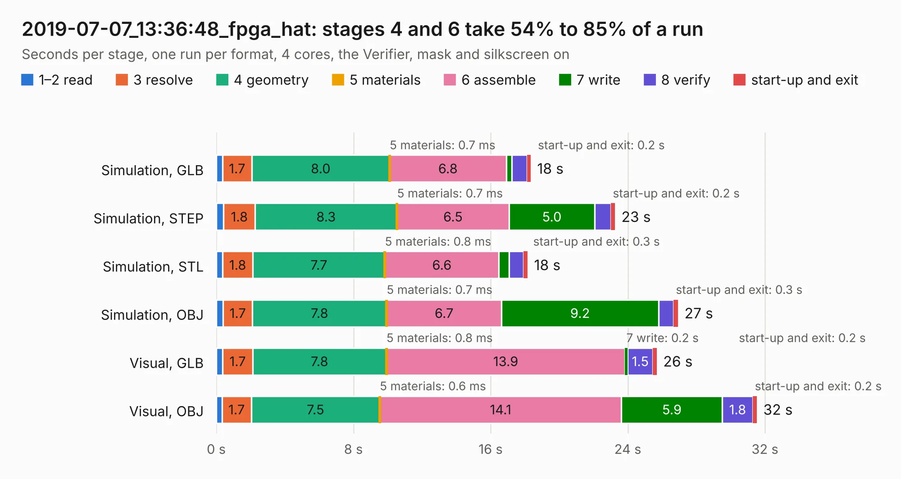

# 3085. 2019-07-07_13:36:48_fpga_hat

Board 3,085 of the 3,104 of [Corpus Testing](../Corpus-Testing.md), on [Corpus Page 29](../CorpusTestingPages/Corpus-Testing-29.md#3085-2019-07-07_133648_fpga_hat).

| Mode and format | 1–2 read | 3 resolve | 4 geometry | 5 materials | 6 assemble | 7 write | 8 verify | start-up and exit | Total |
|---|---:|---:|---:|---:|---:|---:|---:|---:|---:|
| Simulation, GLB | 0.4 | 1.7 | 8.0 | 0.7&nbsp;ms | 6.8 | 0.3 | 0.9 | 0.2 | 18.3 |
| Simulation, STEP | 0.4 | 1.8 | 8.3 | 0.7&nbsp;ms | 6.5 | 5.0 | 0.9 | 0.2 | 23.3 |
| Simulation, STL | 0.4 | 1.8 | 7.7 | 0.8&nbsp;ms | 6.6 | 0.6 | 0.8 | 0.3 | 18.2 |
| Simulation, OBJ | 0.4 | 1.7 | 7.8 | 0.7&nbsp;ms | 6.7 | 9.2 | 0.9 | 0.3 | 26.9 |
| Visual, GLB | 0.4 | 1.7 | 7.8 | 0.8&nbsp;ms | 13.9 | 0.2 | 1.5 | 0.2 | 25.7 |
| Visual, OBJ | 0.3 | 1.7 | 7.5 | 0.6&nbsp;ms | 14.1 | 5.9 | 1.8 | 0.2 | 31.5 |

<table align="center"><tr><td valign="top">

| Board | Repo: [Wren6991/Snowflake-FPGA](https://github.com/Wren6991/Snowflake-FPGA) Board: `2019-07-07_13:36:48_fpga_hat.kicad_pcb` |
|---|---|
| Folder | timelapse |
| Complexity | 314&nbsp;/&nbsp;1000 (size&nbsp;259, features&nbsp;55) |
| KESE&nbsp;features | through vias, rounded, trapezoid or chamfered pads, filled zones, curved board outline |
| Tested | 9th November 2026 |
| Copper&nbsp;layers | 4 |
| File&nbsp;format | KiCad 5 (20171130) |
| Parts,&nbsp;tracks,&nbsp;vias | 82, 1,081, 122 |
| Triangles,&nbsp;simulation | 1,969,958 in 150 parts |
| Verifier | PASS in all six runs |

</td><td valign="top">

<table>
<tr><th>File type</th><th>File size</th><th>Peak memory used</th></tr>
<tr><th colspan="3" align="left">Simulation</th></tr>
<tr><td>GLB</td><td align="right">69&nbsp;MB</td><td align="right">738&nbsp;MB</td></tr>
<tr><td>STEP</td><td align="right">316&nbsp;MB</td><td align="right">851&nbsp;MB</td></tr>
<tr><td>STL</td><td align="right">99&nbsp;MB</td><td align="right">731&nbsp;MB</td></tr>
<tr><td>OBJ</td><td align="right">208&nbsp;MB</td><td align="right">1.3&nbsp;GB</td></tr>
<tr><th colspan="3" align="left">Visual</th></tr>
<tr><td>GLB</td><td align="right">42&nbsp;MB</td><td align="right">893&nbsp;MB</td></tr>
<tr><td>OBJ</td><td align="right">125&nbsp;MB</td><td align="right">975&nbsp;MB</td></tr>
</table>

</td></tr></table>

| Previous | Next |
|:---|---:|
| [3084. 2019-07-07_13:19:32_fpga_hat](b3084b_Snowflake-FPGA_2019-07-07-13-19-32-fpga-hat.md) | [3086. 2019-07-07_17:06:09_fpga_hat](b3086b_Snowflake-FPGA_2019-07-07-17-06-09-fpga-hat.md) |
