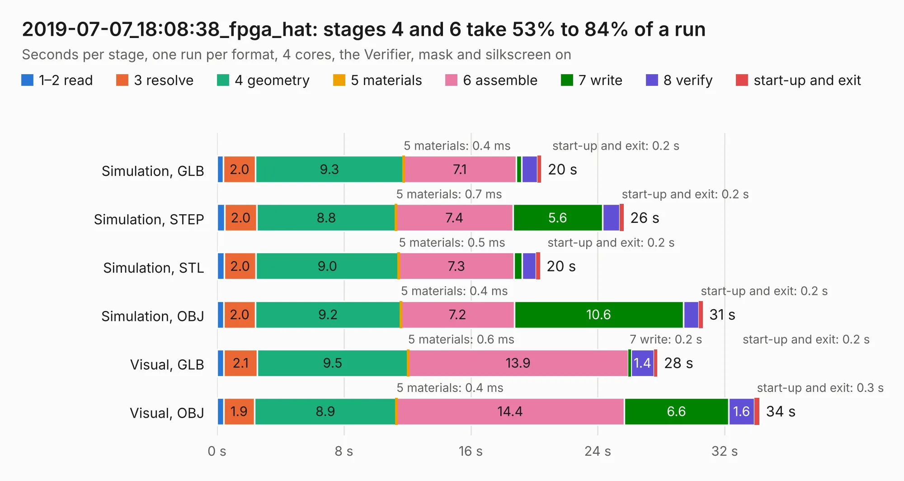

# 3085. 2019-07-07_18:08:38_fpga_hat

Board 3,085 of the 3,101 of [Corpus Testing](../Corpus-Testing.md), on [Corpus Page 29](../CorpusTestingPages/Corpus-Testing-29.md#3085-2019-07-07_180838_fpga_hat).

| Mode and format | 1–2 read | 3 resolve | 4 geometry | 5 materials | 6 assemble | 7 write | 8 verify | start-up and exit | Total |
|---|---:|---:|---:|---:|---:|---:|---:|---:|---:|
| Simulation, GLB | 0.4 | 2.0 | 9.3 | 0.4&nbsp;ms | 7.1 | 0.4 | 1.0 | 0.2 | 20.4 |
| Simulation, STEP | 0.5 | 2.0 | 8.8 | 0.7&nbsp;ms | 7.4 | 5.6 | 1.1 | 0.2 | 25.6 |
| Simulation, STL | 0.4 | 2.0 | 9.0 | 0.5&nbsp;ms | 7.3 | 0.5 | 0.9 | 0.2 | 20.4 |
| Simulation, OBJ | 0.4 | 2.0 | 9.2 | 0.4&nbsp;ms | 7.2 | 10.6 | 1.0 | 0.2 | 30.6 |
| Visual, GLB | 0.4 | 2.1 | 9.5 | 0.6&nbsp;ms | 13.9 | 0.2 | 1.4 | 0.2 | 27.8 |
| Visual, OBJ | 0.4 | 1.9 | 8.9 | 0.4&nbsp;ms | 14.4 | 6.6 | 1.6 | 0.3 | 34.2 |

<table align="center"><tr><td valign="top">

| Board | Repo: [Wren6991/Snowflake-FPGA](https://github.com/Wren6991/Snowflake-FPGA) Board: `2019-07-07_18:08:38_fpga_hat.kicad_pcb` |
|---|---|
| Folder | timelapse |
| Complexity | 316&nbsp;/&nbsp;1000 (size&nbsp;261, features&nbsp;55) |
| KESE&nbsp;features | through vias, rounded, trapezoid or chamfered pads, filled zones, curved board outline |
| Tested | 9th November 2026 |
| Copper&nbsp;layers | 4 |
| File&nbsp;format | KiCad 5 (20171130) |
| Parts,&nbsp;tracks,&nbsp;vias | 82, 1,080, 164 |
| Triangles,&nbsp;simulation | 2,069,672 in 150 parts |
| Verifier | PASS in all six runs |

</td><td valign="top">

<table>
<tr><th>File type</th><th>File size</th><th>Peak memory used</th></tr>
<tr><th colspan="3" align="left">Simulation</th></tr>
<tr><td>GLB</td><td align="right">72&nbsp;MB</td><td align="right">811&nbsp;MB</td></tr>
<tr><td>STEP</td><td align="right">320&nbsp;MB</td><td align="right">860&nbsp;MB</td></tr>
<tr><td>STL</td><td align="right">103&nbsp;MB</td><td align="right">778&nbsp;MB</td></tr>
<tr><td>OBJ</td><td align="right">219&nbsp;MB</td><td align="right">1.4&nbsp;GB</td></tr>
<tr><th colspan="3" align="left">Visual</th></tr>
<tr><td>GLB</td><td align="right">43&nbsp;MB</td><td align="right">788&nbsp;MB</td></tr>
<tr><td>OBJ</td><td align="right">131&nbsp;MB</td><td align="right">952&nbsp;MB</td></tr>
</table>

</td></tr></table>

| Previous | Next |
|:---|---:|
| [3084. 2019-07-07_17:15:58_fpga_hat](b3084b_Snowflake-FPGA_2019-07-07-17-15-58-fpga-hat.md) | [3086. CAT](b3086b_CAT-Board_CAT.md) |
