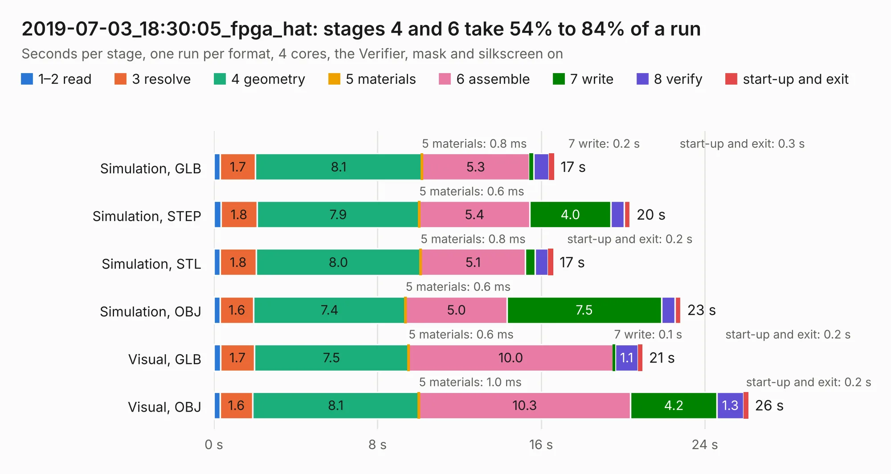

# 3087. 2019-07-03_18:30:05_fpga_hat

Board 3,087 of the 3,131 of [Corpus Testing](../Corpus-Testing.md), on [Corpus Page 29](../CorpusTestingPages/Corpus-Testing-29.md#3087-2019-07-03_183005_fpga_hat).

| Mode and format | 1–2 read | 3 resolve | 4 geometry | 5 materials | 6 assemble | 7 write | 8 verify | start-up and exit | Total |
|---|---:|---:|---:|---:|---:|---:|---:|---:|---:|
| Simulation, GLB | 0.3 | 1.7 | 8.1 | 0.8&nbsp;ms | 5.3 | 0.2 | 0.7 | 0.3 | 16.6 |
| Simulation, STEP | 0.3 | 1.8 | 7.9 | 0.6&nbsp;ms | 5.4 | 4.0 | 0.6 | 0.3 | 20.3 |
| Simulation, STL | 0.3 | 1.8 | 8.0 | 0.8&nbsp;ms | 5.1 | 0.5 | 0.6 | 0.2 | 16.6 |
| Simulation, OBJ | 0.3 | 1.6 | 7.4 | 0.6&nbsp;ms | 5.0 | 7.5 | 0.7 | 0.3 | 22.8 |
| Visual, GLB | 0.3 | 1.7 | 7.5 | 0.6&nbsp;ms | 10.0 | 0.1 | 1.1 | 0.2 | 21.0 |
| Visual, OBJ | 0.3 | 1.6 | 8.1 | 1.0&nbsp;ms | 10.3 | 4.2 | 1.3 | 0.2 | 26.1 |

<table align="center"><tr><td valign="top">

| Board | Repo: [Wren6991/Snowflake-FPGA](https://github.com/Wren6991/Snowflake-FPGA) Board: `2019-07-03_18:30:05_fpga_hat.kicad_pcb` |
|---|---|
| Folder | timelapse |
| Complexity | 287&nbsp;/&nbsp;1000 (size&nbsp;252, features&nbsp;35) |
| KESE&nbsp;features | through vias, rounded, trapezoid or chamfered pads, curved board outline |
| Tested | 9th November 2026 |
| Copper&nbsp;layers | 4 |
| File&nbsp;format | KiCad 5 (20171130) |
| Parts,&nbsp;tracks,&nbsp;vias | 81, 853, 32 |
| Triangles,&nbsp;simulation | 1,216,442 in 150 parts |
| Verifier | PASS in all six runs |

</td><td valign="top">

<table>
<tr><th>File type</th><th>File size</th><th>Peak memory used</th></tr>
<tr><th colspan="3" align="left">Simulation</th></tr>
<tr><td>GLB</td><td align="right">41&nbsp;MB</td><td align="right">484&nbsp;MB</td></tr>
<tr><td>STEP</td><td align="right">206&nbsp;MB</td><td align="right">595&nbsp;MB</td></tr>
<tr><td>STL</td><td align="right">61&nbsp;MB</td><td align="right">507&nbsp;MB</td></tr>
<tr><td>OBJ</td><td align="right">126&nbsp;MB</td><td align="right">880&nbsp;MB</td></tr>
<tr><th colspan="3" align="left">Visual</th></tr>
<tr><td>GLB</td><td align="right">24&nbsp;MB</td><td align="right">608&nbsp;MB</td></tr>
<tr><td>OBJ</td><td align="right">70&nbsp;MB</td><td align="right">589&nbsp;MB</td></tr>
</table>

</td></tr></table>

| Previous | Next |
|:---|---:|
| [3086. 2019-07-03_18:11:15_fpga_hat](b3086b_Snowflake-FPGA_2019-07-03-18-11-15-fpga-hat.md) | [3088. 2019-07-03_18:34:30_fpga_hat](b3088b_Snowflake-FPGA_2019-07-03-18-34-30-fpga-hat.md) |
