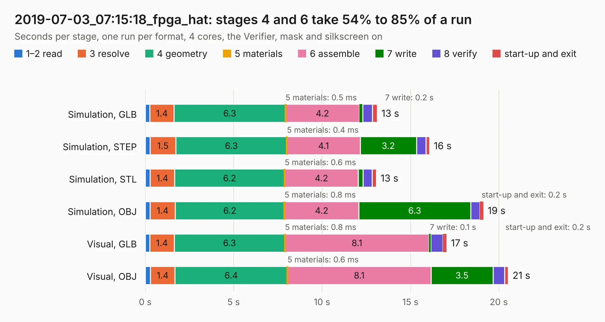

# 3089. 2019-07-03_07:15:18_fpga_hat

Board 3,089 of the 3,138 of [Corpus Testing](../Corpus-Testing.md), on [Corpus Page 29](../CorpusTestingPages/Corpus-Testing-29.md#3089-2019-07-03_071518_fpga_hat).

| Mode and format | 1–2 read | 3 resolve | 4 geometry | 5 materials | 6 assemble | 7 write | 8 verify | start-up and exit | Total |
|---|---:|---:|---:|---:|---:|---:|---:|---:|---:|
| Simulation, GLB | 0.3 | 1.4 | 6.3 | 0.5&nbsp;ms | 4.2 | 0.2 | 0.5 | 0.3 | 13.1 |
| Simulation, STEP | 0.3 | 1.5 | 6.3 | 0.4&nbsp;ms | 4.1 | 3.2 | 0.5 | 0.2 | 16.1 |
| Simulation, STL | 0.3 | 1.4 | 6.2 | 0.6&nbsp;ms | 4.2 | 0.3 | 0.5 | 0.2 | 13.1 |
| Simulation, OBJ | 0.3 | 1.4 | 6.2 | 0.8&nbsp;ms | 4.2 | 6.3 | 0.5 | 0.2 | 19.1 |
| Visual, GLB | 0.3 | 1.4 | 6.3 | 0.8&nbsp;ms | 8.1 | 0.1 | 0.7 | 0.2 | 17.0 |
| Visual, OBJ | 0.3 | 1.4 | 6.4 | 0.6&nbsp;ms | 8.1 | 3.5 | 0.7 | 0.2 | 20.5 |

<table align="center"><tr><td valign="top">

| Board | Repo: [Wren6991/Snowflake-FPGA](https://github.com/Wren6991/Snowflake-FPGA) Board: `2019-07-03_07:15:18_fpga_hat.kicad_pcb` |
|---|---|
| Folder | timelapse |
| Complexity | 285&nbsp;/&nbsp;1000 (size&nbsp;250, features&nbsp;35) |
| KESE&nbsp;features | through vias, rounded, trapezoid or chamfered pads, curved board outline |
| Tested | 9th November 2026 |
| Copper&nbsp;layers | 4 |
| File&nbsp;format | KiCad 5 (20171130) |
| Parts,&nbsp;tracks,&nbsp;vias | 81, 761, 30 |
| Triangles,&nbsp;simulation | 1,199,694 in 150 parts |
| Verifier | PASS in all six runs |

</td><td valign="top">

<table>
<tr><th>File type</th><th>File size</th><th>Peak memory used</th></tr>
<tr><th colspan="3" align="left">Simulation</th></tr>
<tr><td>GLB</td><td align="right">41&nbsp;MB</td><td align="right">490&nbsp;MB</td></tr>
<tr><td>STEP</td><td align="right">201&nbsp;MB</td><td align="right">583&nbsp;MB</td></tr>
<tr><td>STL</td><td align="right">60&nbsp;MB</td><td align="right">507&nbsp;MB</td></tr>
<tr><td>OBJ</td><td align="right">124&nbsp;MB</td><td align="right">851&nbsp;MB</td></tr>
<tr><th colspan="3" align="left">Visual</th></tr>
<tr><td>GLB</td><td align="right">23&nbsp;MB</td><td align="right">592&nbsp;MB</td></tr>
<tr><td>OBJ</td><td align="right">69&nbsp;MB</td><td align="right">536&nbsp;MB</td></tr>
</table>

</td></tr></table>

| Previous | Next |
|:---|---:|
| [3088. 2019-07-03_07:08:37_fpga_hat](b3088b_Snowflake-FPGA_2019-07-03-07-08-37-fpga-hat.md) | [3090. 2019-07-03_17:28:54_fpga_hat](b3090b_Snowflake-FPGA_2019-07-03-17-28-54-fpga-hat.md) |
