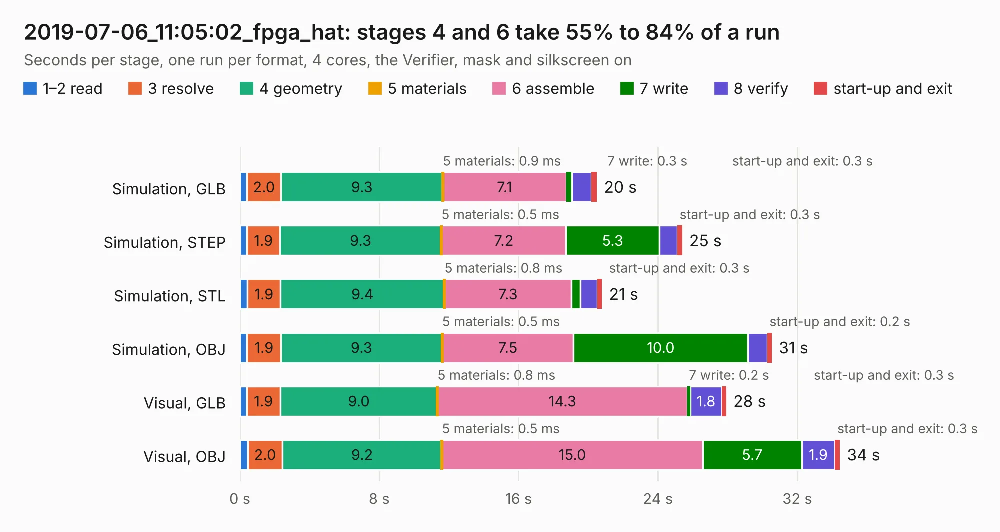

# 3090. 2019-07-06_11:05:02_fpga_hat

Board 3,090 of the 3,125 of [Corpus Testing](../Corpus-Testing.md), on [Corpus Page 29](../CorpusTestingPages/Corpus-Testing-29.md#3090-2019-07-06_110502_fpga_hat).

| Mode and format | 1–2 read | 3 resolve | 4 geometry | 5 materials | 6 assemble | 7 write | 8 verify | start-up and exit | Total |
|---|---:|---:|---:|---:|---:|---:|---:|---:|---:|
| Simulation, GLB | 0.4 | 2.0 | 9.3 | 0.9&nbsp;ms | 7.1 | 0.3 | 1.1 | 0.3 | 20.5 |
| Simulation, STEP | 0.4 | 1.9 | 9.3 | 0.5&nbsp;ms | 7.2 | 5.3 | 1.0 | 0.3 | 25.4 |
| Simulation, STL | 0.4 | 1.9 | 9.4 | 0.8&nbsp;ms | 7.3 | 0.5 | 1.0 | 0.3 | 20.8 |
| Simulation, OBJ | 0.4 | 1.9 | 9.3 | 0.5&nbsp;ms | 7.5 | 10.0 | 1.1 | 0.2 | 30.5 |
| Visual, GLB | 0.4 | 1.9 | 9.0 | 0.8&nbsp;ms | 14.3 | 0.2 | 1.8 | 0.3 | 27.9 |
| Visual, OBJ | 0.5 | 2.0 | 9.2 | 0.5&nbsp;ms | 15.0 | 5.7 | 1.9 | 0.3 | 34.4 |

<table align="center"><tr><td valign="top">

| Board | Repo: [Wren6991/Snowflake-FPGA](https://github.com/Wren6991/Snowflake-FPGA) Board: `2019-07-06_11:05:02_fpga_hat.kicad_pcb` |
|---|---|
| Folder | timelapse |
| Complexity | 312&nbsp;/&nbsp;1000 (size&nbsp;257, features&nbsp;55) |
| KESE&nbsp;features | through vias, rounded, trapezoid or chamfered pads, filled zones, curved board outline |
| Tested | 9th November 2026 |
| Copper&nbsp;layers | 4 |
| File&nbsp;format | KiCad 5 (20171130) |
| Parts,&nbsp;tracks,&nbsp;vias | 82, 1,020, 89 |
| Triangles,&nbsp;simulation | 1,864,436 in 150 parts |
| Verifier | PASS in all six runs |

</td><td valign="top">

<table>
<tr><th>File type</th><th>File size</th><th>Peak memory used</th></tr>
<tr><th colspan="3" align="left">Simulation</th></tr>
<tr><td>GLB</td><td align="right">65&nbsp;MB</td><td align="right">673&nbsp;MB</td></tr>
<tr><td>STEP</td><td align="right">308&nbsp;MB</td><td align="right">812&nbsp;MB</td></tr>
<tr><td>STL</td><td align="right">93&nbsp;MB</td><td align="right">703&nbsp;MB</td></tr>
<tr><td>OBJ</td><td align="right">196&nbsp;MB</td><td align="right">1.3&nbsp;GB</td></tr>
<tr><th colspan="3" align="left">Visual</th></tr>
<tr><td>GLB</td><td align="right">38&nbsp;MB</td><td align="right">775&nbsp;MB</td></tr>
<tr><td>OBJ</td><td align="right">115&nbsp;MB</td><td align="right">924&nbsp;MB</td></tr>
</table>

</td></tr></table>

| Previous | Next |
|:---|---:|
| [3089. 2019-07-05_22:26:53_fpga_hat](b3089b_Snowflake-FPGA_2019-07-05-22-26-53-fpga-hat.md) | [3091. 2019-07-06_11:24:12_fpga_hat](b3091b_Snowflake-FPGA_2019-07-06-11-24-12-fpga-hat.md) |
