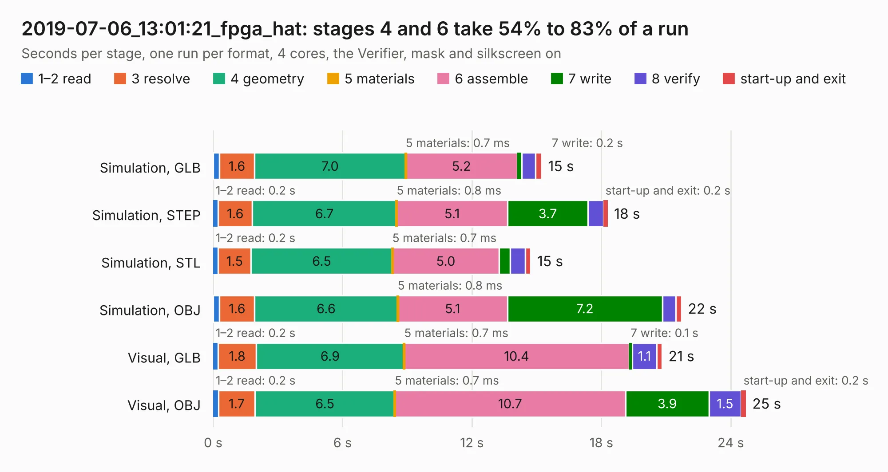

# 3090. 2019-07-06_13:01:21_fpga_hat

Board 3,090 of the 3,116 of [Corpus Testing](../Corpus-Testing.md), on [Corpus Page 29](../CorpusTestingPages/Corpus-Testing-29.md#3090-2019-07-06_130121_fpga_hat).

| Mode and format | 1–2 read | 3 resolve | 4 geometry | 5 materials | 6 assemble | 7 write | 8 verify | start-up and exit | Total |
|---|---:|---:|---:|---:|---:|---:|---:|---:|---:|
| Simulation, GLB | 0.3 | 1.6 | 7.0 | 0.7&nbsp;ms | 5.2 | 0.2 | 0.6 | 0.3 | 15.2 |
| Simulation, STEP | 0.2 | 1.6 | 6.7 | 0.8&nbsp;ms | 5.1 | 3.7 | 0.7 | 0.2 | 18.3 |
| Simulation, STL | 0.2 | 1.5 | 6.5 | 0.7&nbsp;ms | 5.0 | 0.5 | 0.7 | 0.3 | 14.7 |
| Simulation, OBJ | 0.3 | 1.6 | 6.6 | 0.8&nbsp;ms | 5.1 | 7.2 | 0.6 | 0.3 | 21.7 |
| Visual, GLB | 0.2 | 1.8 | 6.9 | 0.7&nbsp;ms | 10.4 | 0.1 | 1.1 | 0.3 | 20.8 |
| Visual, OBJ | 0.2 | 1.7 | 6.5 | 0.7&nbsp;ms | 10.7 | 3.9 | 1.5 | 0.2 | 24.7 |

<table align="center"><tr><td valign="top">

| Board | Repo: [Wren6991/Snowflake-FPGA](https://github.com/Wren6991/Snowflake-FPGA) Board: `2019-07-06_13:01:21_fpga_hat.kicad_pcb` |
|---|---|
| Folder | timelapse |
| Complexity | 294&nbsp;/&nbsp;1000 (size&nbsp;259, features&nbsp;35) |
| KESE&nbsp;features | through vias, rounded, trapezoid or chamfered pads, curved board outline |
| Tested | 9th November 2026 |
| Copper&nbsp;layers | 4 |
| File&nbsp;format | KiCad 5 (20171130) |
| Parts,&nbsp;tracks,&nbsp;vias | 82, 1,098, 122 |
| Triangles,&nbsp;simulation | 1,545,620 in 150 parts |
| Verifier | PASS in all six runs |

</td><td valign="top">

<table>
<tr><th>File type</th><th>File size</th><th>Peak memory used</th></tr>
<tr><th colspan="3" align="left">Simulation</th></tr>
<tr><td>GLB</td><td align="right">53&nbsp;MB</td><td align="right">644&nbsp;MB</td></tr>
<tr><td>STEP</td><td align="right">240&nbsp;MB</td><td align="right">681&nbsp;MB</td></tr>
<tr><td>STL</td><td align="right">77&nbsp;MB</td><td align="right">617&nbsp;MB</td></tr>
<tr><td>OBJ</td><td align="right">161&nbsp;MB</td><td align="right">1.1&nbsp;GB</td></tr>
<tr><th colspan="3" align="left">Visual</th></tr>
<tr><td>GLB</td><td align="right">31&nbsp;MB</td><td align="right">698&nbsp;MB</td></tr>
<tr><td>OBJ</td><td align="right">93&nbsp;MB</td><td align="right">683&nbsp;MB</td></tr>
</table>

</td></tr></table>

| Previous | Next |
|:---|---:|
| [3089. 2019-07-06_12:56:05_fpga_hat](b3089b_Snowflake-FPGA_2019-07-06-12-56-05-fpga-hat.md) | [3091. 2019-07-06_13:25:29_fpga_hat](b3091b_Snowflake-FPGA_2019-07-06-13-25-29-fpga-hat.md) |
