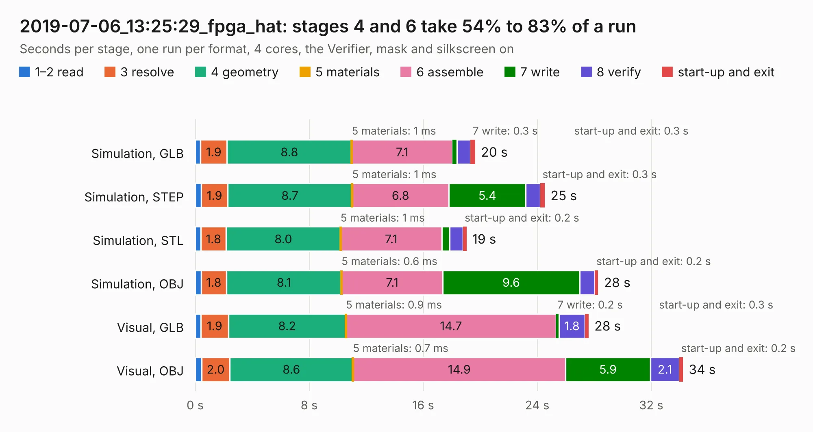

# 3091. 2019-07-06_13:25:29_fpga_hat

Board 3,091 of the 3,116 of [Corpus Testing](../Corpus-Testing.md), on [Corpus Page 29](../CorpusTestingPages/Corpus-Testing-29.md#3091-2019-07-06_132529_fpga_hat).

| Mode and format | 1–2 read | 3 resolve | 4 geometry | 5 materials | 6 assemble | 7 write | 8 verify | start-up and exit | Total |
|---|---:|---:|---:|---:|---:|---:|---:|---:|---:|
| Simulation, GLB | 0.4 | 1.9 | 8.8 | 1&nbsp;ms | 7.1 | 0.3 | 0.9 | 0.3 | 19.6 |
| Simulation, STEP | 0.4 | 1.9 | 8.7 | 1&nbsp;ms | 6.8 | 5.4 | 1.0 | 0.3 | 24.5 |
| Simulation, STL | 0.4 | 1.8 | 8.0 | 1&nbsp;ms | 7.1 | 0.5 | 1.0 | 0.2 | 19.0 |
| Simulation, OBJ | 0.4 | 1.8 | 8.1 | 0.6&nbsp;ms | 7.1 | 9.6 | 1.1 | 0.2 | 28.3 |
| Visual, GLB | 0.4 | 1.9 | 8.2 | 0.9&nbsp;ms | 14.7 | 0.2 | 1.8 | 0.3 | 27.6 |
| Visual, OBJ | 0.4 | 2.0 | 8.6 | 0.7&nbsp;ms | 14.9 | 5.9 | 2.1 | 0.2 | 34.2 |

<table align="center"><tr><td valign="top">

| Board | Repo: [Wren6991/Snowflake-FPGA](https://github.com/Wren6991/Snowflake-FPGA) Board: `2019-07-06_13:25:29_fpga_hat.kicad_pcb` |
|---|---|
| Folder | timelapse |
| Complexity | 314&nbsp;/&nbsp;1000 (size&nbsp;259, features&nbsp;55) |
| KESE&nbsp;features | through vias, rounded, trapezoid or chamfered pads, filled zones, curved board outline |
| Tested | 9th November 2026 |
| Copper&nbsp;layers | 4 |
| File&nbsp;format | KiCad 5 (20171130) |
| Parts,&nbsp;tracks,&nbsp;vias | 82, 1,098, 122 |
| Triangles,&nbsp;simulation | 1,959,772 in 150 parts |
| Verifier | PASS in all six runs |

</td><td valign="top">

<table>
<tr><th>File type</th><th>File size</th><th>Peak memory used</th></tr>
<tr><th colspan="3" align="left">Simulation</th></tr>
<tr><td>GLB</td><td align="right">68&nbsp;MB</td><td align="right">745&nbsp;MB</td></tr>
<tr><td>STEP</td><td align="right">315&nbsp;MB</td><td align="right">842&nbsp;MB</td></tr>
<tr><td>STL</td><td align="right">98&nbsp;MB</td><td align="right">715&nbsp;MB</td></tr>
<tr><td>OBJ</td><td align="right">207&nbsp;MB</td><td align="right">1.4&nbsp;GB</td></tr>
<tr><th colspan="3" align="left">Visual</th></tr>
<tr><td>GLB</td><td align="right">41&nbsp;MB</td><td align="right">809&nbsp;MB</td></tr>
<tr><td>OBJ</td><td align="right">123&nbsp;MB</td><td align="right">932&nbsp;MB</td></tr>
</table>

</td></tr></table>

| Previous | Next |
|:---|---:|
| [3090. 2019-07-06_13:01:21_fpga_hat](b3090b_Snowflake-FPGA_2019-07-06-13-01-21-fpga-hat.md) | [3092. 2019-07-06_13:40:41_fpga_hat](b3092b_Snowflake-FPGA_2019-07-06-13-40-41-fpga-hat.md) |
