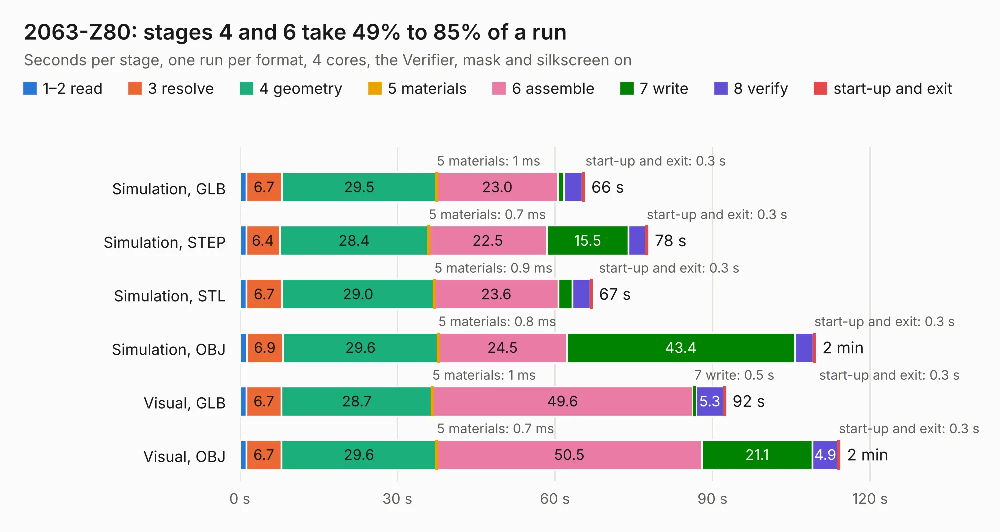

# 3092. 2063-Z80

Board 3,092 of the 3,102 of [Corpus Testing](../Corpus-Testing.md), on [Corpus Page 29](../CorpusTestingPages/Corpus-Testing-29.md#3092-2063-z80).

| Mode and format | 1–2 read | 3 resolve | 4 geometry | 5 materials | 6 assemble | 7 write | 8 verify | start-up and exit | Total |
|---|---:|---:|---:|---:|---:|---:|---:|---:|---:|
| Simulation, GLB | 1.2 | 6.7 | 29.5 | 1&nbsp;ms | 23.0 | 1.2 | 3.5 | 0.3 | 65.6 |
| Simulation, STEP | 1.2 | 6.4 | 28.4 | 0.7&nbsp;ms | 22.5 | 15.5 | 3.3 | 0.3 | 77.7 |
| Simulation, STL | 1.3 | 6.7 | 29.0 | 0.9&nbsp;ms | 23.6 | 2.7 | 3.4 | 0.3 | 67.0 |
| Simulation, OBJ | 1.3 | 6.9 | 29.6 | 0.8&nbsp;ms | 24.5 | 43.4 | 3.6 | 0.3 | 109.6 |
| Visual, GLB | 1.2 | 6.7 | 28.7 | 1&nbsp;ms | 49.6 | 0.5 | 5.3 | 0.3 | 92.5 |
| Visual, OBJ | 1.2 | 6.7 | 29.6 | 0.7&nbsp;ms | 50.5 | 21.1 | 4.9 | 0.3 | 114.2 |

<table align="center"><tr><td valign="top">

| Board | Repo: [Z80-Retro/2063-Z80](https://github.com/Z80-Retro/2063-Z80) Board: `2063-Z80.kicad_pcb` |
|---|---|
| Complexity | 286&nbsp;/&nbsp;1000 (size&nbsp;211, features&nbsp;75) |
| KESE&nbsp;features | through vias, slotted holes, rounded, trapezoid or chamfered pads, drill offsets, filled zones, curved board outline |
| Tested | 9th November 2026 |
| Copper&nbsp;layers | 4 |
| File&nbsp;format | KiCad 5 (20171130) |
| Parts,&nbsp;tracks,&nbsp;vias | 80, 1,997, 244 |
| Triangles,&nbsp;simulation | 6,315,170 in 166 parts |
| Verifier | PASS in all six runs |

</td><td valign="top">

<table>
<tr><th>File type</th><th>File size</th><th>Peak memory used</th></tr>
<tr><th colspan="3" align="left">Simulation</th></tr>
<tr><td>GLB</td><td align="right">216&nbsp;MB</td><td align="right">1.6&nbsp;GB</td></tr>
<tr><td>STEP</td><td align="right">878&nbsp;MB</td><td align="right">2.0&nbsp;GB</td></tr>
<tr><td>STL</td><td align="right">316&nbsp;MB</td><td align="right">1.6&nbsp;GB</td></tr>
<tr><td>OBJ</td><td align="right">677&nbsp;MB</td><td align="right">4.1&nbsp;GB</td></tr>
<tr><th colspan="3" align="left">Visual</th></tr>
<tr><td>GLB</td><td align="right">117&nbsp;MB</td><td align="right">1.9&nbsp;GB</td></tr>
<tr><td>OBJ</td><td align="right">373&nbsp;MB</td><td align="right">2.4&nbsp;GB</td></tr>
</table>

</td></tr></table>

| Previous | Next |
|:---|---:|
| [3091. Prism](b3091b_prism-pcb_Prism.md) | [3093. pcb](b3093b_Fobu_pcb.md) |
