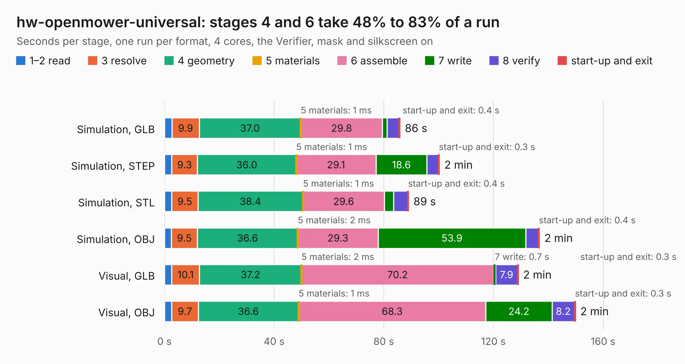

# 3092. hw-openmower-universal

Board 3,092 of the 3,105 of [Corpus Testing](../Corpus-Testing.md), on [Corpus Page 29](../CorpusTestingPages/Corpus-Testing-29.md#3092-hw-openmower-universal).

| Mode and format | 1–2 read | 3 resolve | 4 geometry | 5 materials | 6 assemble | 7 write | 8 verify | start-up and exit | Total |
|---|---:|---:|---:|---:|---:|---:|---:|---:|---:|
| Simulation, GLB | 2.8 | 9.9 | 37.0 | 1&nbsp;ms | 29.8 | 1.7 | 4.4 | 0.4 | 85.9 |
| Simulation, STEP | 2.7 | 9.3 | 36.0 | 1&nbsp;ms | 29.1 | 18.6 | 4.2 | 0.3 | 100.3 |
| Simulation, STL | 2.7 | 9.5 | 38.4 | 1&nbsp;ms | 29.6 | 3.4 | 5.1 | 0.4 | 89.1 |
| Simulation, OBJ | 2.5 | 9.5 | 36.6 | 2&nbsp;ms | 29.3 | 53.9 | 4.6 | 0.4 | 136.8 |
| Visual, GLB | 2.7 | 10.1 | 37.2 | 2&nbsp;ms | 70.2 | 0.7 | 7.9 | 0.3 | 129.1 |
| Visual, OBJ | 2.7 | 9.7 | 36.6 | 1&nbsp;ms | 68.3 | 24.2 | 8.2 | 0.3 | 149.9 |

<table align="center"><tr><td valign="top">

| Board | Repo: [xtech/hw-openmower-universal](https://github.com/xtech/hw-openmower-universal) Board: `hw-openmower-universal.kicad_pcb` |
|---|---|
| Complexity | 358&nbsp;/&nbsp;1000 (size&nbsp;238, features&nbsp;120) |
| KESE&nbsp;features | through vias, slotted holes, custom pads, rounded, trapezoid or chamfered pads, drill offsets, filled zones, curved board outline, stack-up, dielectric εr and tanδ |
| Tested | 9th November 2026 |
| Copper&nbsp;layers | 4 |
| File&nbsp;format | KiCad 8 (20240108) |
| Parts,&nbsp;tracks,&nbsp;vias | 382, 2,241, 928 |
| Triangles,&nbsp;simulation | 8,494,312 in 357 parts |
| Verifier | PASS in all six runs |

</td><td valign="top">

<table>
<tr><th>File type</th><th>File size</th><th>Peak memory used</th></tr>
<tr><th colspan="3" align="left">Simulation</th></tr>
<tr><td>GLB</td><td align="right">286&nbsp;MB</td><td align="right">2.3&nbsp;GB</td></tr>
<tr><td>STEP</td><td align="right">993&nbsp;MB</td><td align="right">3.0&nbsp;GB</td></tr>
<tr><td>STL</td><td align="right">425&nbsp;MB</td><td align="right">2.4&nbsp;GB</td></tr>
<tr><td>OBJ</td><td align="right">899&nbsp;MB</td><td align="right">5.4&nbsp;GB</td></tr>
<tr><th colspan="3" align="left">Visual</th></tr>
<tr><td>GLB</td><td align="right">149&nbsp;MB</td><td align="right">2.6&nbsp;GB</td></tr>
<tr><td>OBJ</td><td align="right">479&nbsp;MB</td><td align="right">3.1&nbsp;GB</td></tr>
</table>

</td></tr></table>

| Previous | Next |
|:---|---:|
| [3091. hw-openmower-sabo](b3091b_hw-openmower-sabo_hw-openmower-sabo.md) | [3093. hw-openmower-yardforce](b3093b_hw-openmower-yardforce_hw-openmower-yardforce.md) |
