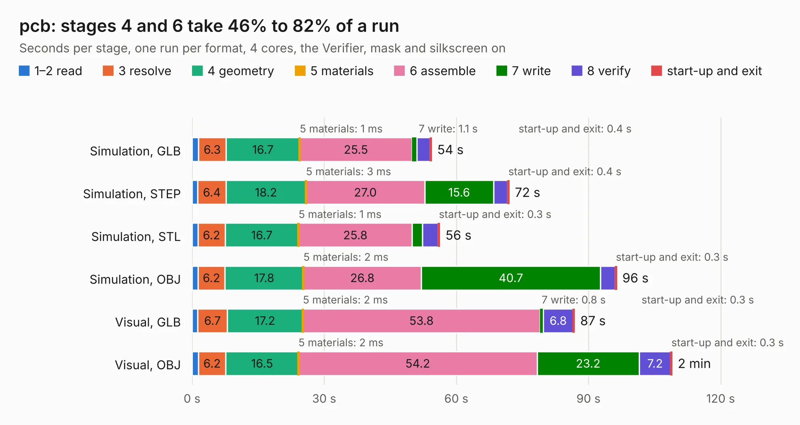

# 3093. pcb

Board 3,093 of the 3,102 of [Corpus Testing](../Corpus-Testing.md), on [Corpus Page 29](../CorpusTestingPages/Corpus-Testing-29.md#3093-pcb).

| Mode and format | 1–2 read | 3 resolve | 4 geometry | 5 materials | 6 assemble | 7 write | 8 verify | start-up and exit | Total |
|---|---:|---:|---:|---:|---:|---:|---:|---:|---:|
| Simulation, GLB | 1.4 | 6.3 | 16.7 | 1&nbsp;ms | 25.5 | 1.1 | 3.0 | 0.4 | 54.4 |
| Simulation, STEP | 1.3 | 6.4 | 18.2 | 3&nbsp;ms | 27.0 | 15.6 | 3.2 | 0.4 | 72.0 |
| Simulation, STL | 1.3 | 6.2 | 16.7 | 1&nbsp;ms | 25.8 | 2.3 | 3.6 | 0.3 | 56.2 |
| Simulation, OBJ | 1.3 | 6.2 | 17.8 | 2&nbsp;ms | 26.8 | 40.7 | 3.3 | 0.3 | 96.4 |
| Visual, GLB | 1.3 | 6.7 | 17.2 | 2&nbsp;ms | 53.8 | 0.8 | 6.8 | 0.3 | 86.8 |
| Visual, OBJ | 1.4 | 6.2 | 16.5 | 2&nbsp;ms | 54.2 | 23.2 | 7.2 | 0.3 | 109.0 |

<table align="center"><tr><td valign="top">

| Board | Repo: [zephray/Fobu](https://github.com/zephray/Fobu) Board: `pcb.kicad_pcb` |
|---|---|
| Folder | hardware / pcb |
| Complexity | 465&nbsp;/&nbsp;1000 (size&nbsp;325, features&nbsp;140) |
| KESE&nbsp;features | through vias, slotted holes, custom pads, rounded, trapezoid or chamfered pads, filled zones, copper drawings, curved board outline, stack-up, dielectric εr and tanδ, copper finish, mask and silkscreen colours |
| Tested | 9th November 2026 |
| Copper&nbsp;layers | 6 |
| File&nbsp;format | KiCad 6 (20211014) |
| Parts,&nbsp;tracks,&nbsp;vias | 255, 6,378, 920 |
| Triangles,&nbsp;simulation | 7,037,632 in 519 parts |
| Verifier | PASS in all six runs |

</td><td valign="top">

<table>
<tr><th>File type</th><th>File size</th><th>Peak memory used</th></tr>
<tr><th colspan="3" align="left">Simulation</th></tr>
<tr><td>GLB</td><td align="right">236&nbsp;MB</td><td align="right">1.8&nbsp;GB</td></tr>
<tr><td>STEP</td><td align="right">827&nbsp;MB</td><td align="right">2.4&nbsp;GB</td></tr>
<tr><td>STL</td><td align="right">352&nbsp;MB</td><td align="right">1.8&nbsp;GB</td></tr>
<tr><td>OBJ</td><td align="right">754&nbsp;MB</td><td align="right">4.5&nbsp;GB</td></tr>
<tr><th colspan="3" align="left">Visual</th></tr>
<tr><td>GLB</td><td align="right">136&nbsp;MB</td><td align="right">2.3&nbsp;GB</td></tr>
<tr><td>OBJ</td><td align="right">456&nbsp;MB</td><td align="right">2.9&nbsp;GB</td></tr>
</table>

</td></tr></table>

| Previous | Next |
|:---|---:|
| [3092. 2063-Z80](b3092b_2063-Z80_2063-Z80.md) | [3094. adapter](b3094b_nekoink_adapter.md) |
