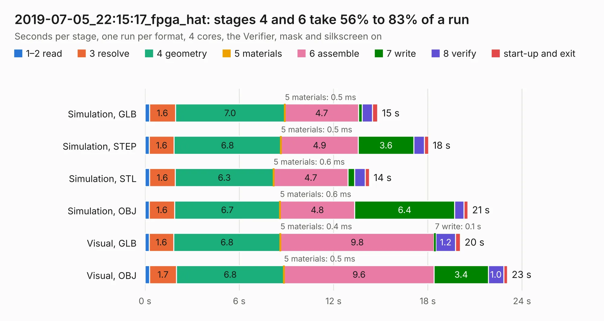

# 3093. 2019-07-05_22:15:17_fpga_hat

Board 3,093 of the 3,130 of [Corpus Testing](../Corpus-Testing.md), on [Corpus Page 29](../CorpusTestingPages/Corpus-Testing-29.md#3093-2019-07-05_221517_fpga_hat).

| Mode and format | 1–2 read | 3 resolve | 4 geometry | 5 materials | 6 assemble | 7 write | 8 verify | start-up and exit | Total |
|---|---:|---:|---:|---:|---:|---:|---:|---:|---:|
| Simulation, GLB | 0.3 | 1.6 | 7.0 | 0.5&nbsp;ms | 4.7 | 0.2 | 0.7 | 0.3 | 14.8 |
| Simulation, STEP | 0.3 | 1.6 | 6.8 | 0.5&nbsp;ms | 4.9 | 3.6 | 0.7 | 0.3 | 18.0 |
| Simulation, STL | 0.3 | 1.6 | 6.3 | 0.6&nbsp;ms | 4.7 | 0.4 | 0.7 | 0.3 | 14.3 |
| Simulation, OBJ | 0.3 | 1.6 | 6.7 | 0.6&nbsp;ms | 4.8 | 6.4 | 0.6 | 0.2 | 20.6 |
| Visual, GLB | 0.3 | 1.6 | 6.8 | 0.4&nbsp;ms | 9.8 | 0.1 | 1.2 | 0.3 | 20.1 |
| Visual, OBJ | 0.3 | 1.7 | 6.8 | 0.5&nbsp;ms | 9.6 | 3.4 | 1.0 | 0.2 | 23.1 |

<table align="center"><tr><td valign="top">

| Board | Repo: [Wren6991/Snowflake-FPGA](https://github.com/Wren6991/Snowflake-FPGA) Board: `2019-07-05_22:15:17_fpga_hat.kicad_pcb` |
|---|---|
| Folder | timelapse |
| Complexity | 291&nbsp;/&nbsp;1000 (size&nbsp;256, features&nbsp;35) |
| KESE&nbsp;features | through vias, rounded, trapezoid or chamfered pads, curved board outline |
| Tested | 9th November 2026 |
| Copper&nbsp;layers | 4 |
| File&nbsp;format | KiCad 5 (20171130) |
| Parts,&nbsp;tracks,&nbsp;vias | 82, 996, 57 |
| Triangles,&nbsp;simulation | 1,303,642 in 150 parts |
| Verifier | PASS in all six runs |

</td><td valign="top">

<table>
<tr><th>File type</th><th>File size</th><th>Peak memory used</th></tr>
<tr><th colspan="3" align="left">Simulation</th></tr>
<tr><td>GLB</td><td align="right">44&nbsp;MB</td><td align="right">555&nbsp;MB</td></tr>
<tr><td>STEP</td><td align="right">216&nbsp;MB</td><td align="right">610&nbsp;MB</td></tr>
<tr><td>STL</td><td align="right">65&nbsp;MB</td><td align="right">527&nbsp;MB</td></tr>
<tr><td>OBJ</td><td align="right">135&nbsp;MB</td><td align="right">914&nbsp;MB</td></tr>
<tr><th colspan="3" align="left">Visual</th></tr>
<tr><td>GLB</td><td align="right">25&nbsp;MB</td><td align="right">617&nbsp;MB</td></tr>
<tr><td>OBJ</td><td align="right">76&nbsp;MB</td><td align="right">595&nbsp;MB</td></tr>
</table>

</td></tr></table>

| Previous | Next |
|:---|---:|
| [3092. 2019-07-05_22:03:31_fpga_hat](b3092b_Snowflake-FPGA_2019-07-05-22-03-31-fpga-hat.md) | [3094. 2019-07-05_22:26:53_fpga_hat](b3094b_Snowflake-FPGA_2019-07-05-22-26-53-fpga-hat.md) |
