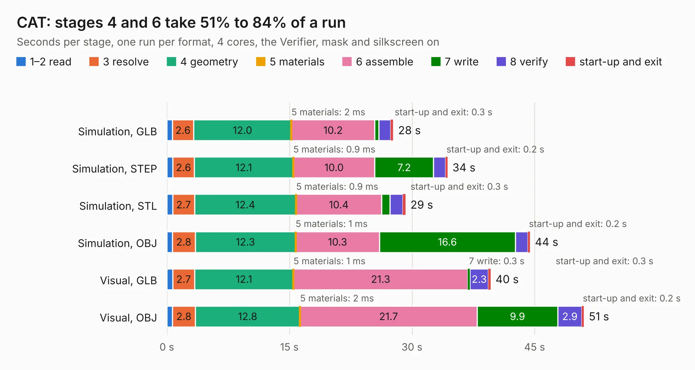

# 3094. CAT

Board 3,094 of the 3,109 of [Corpus Testing](../Corpus-Testing.md), on [Corpus Page 29](../CorpusTestingPages/Corpus-Testing-29.md#3094-cat).

| Mode and format | 1–2 read | 3 resolve | 4 geometry | 5 materials | 6 assemble | 7 write | 8 verify | start-up and exit | Total |
|---|---:|---:|---:|---:|---:|---:|---:|---:|---:|
| Simulation, GLB | 0.7 | 2.6 | 12.0 | 2&nbsp;ms | 10.2 | 0.5 | 1.4 | 0.3 | 27.7 |
| Simulation, STEP | 0.7 | 2.6 | 12.1 | 0.9&nbsp;ms | 10.0 | 7.2 | 1.5 | 0.2 | 34.3 |
| Simulation, STL | 0.7 | 2.7 | 12.4 | 0.9&nbsp;ms | 10.4 | 1.1 | 1.6 | 0.3 | 29.2 |
| Simulation, OBJ | 0.7 | 2.8 | 12.3 | 1&nbsp;ms | 10.3 | 16.6 | 1.6 | 0.2 | 44.4 |
| Visual, GLB | 0.7 | 2.7 | 12.1 | 1&nbsp;ms | 21.3 | 0.3 | 2.3 | 0.3 | 39.6 |
| Visual, OBJ | 0.7 | 2.8 | 12.8 | 2&nbsp;ms | 21.7 | 9.9 | 2.9 | 0.2 | 51.0 |

<table align="center"><tr><td valign="top">

| Board | Repo: [xesscorp/CAT-Board](https://github.com/xesscorp/CAT-Board) Board: `CAT.kicad_pcb` |
|---|---|
| Folder | pcb |
| Complexity | 319&nbsp;/&nbsp;1000 (size&nbsp;264, features&nbsp;55) |
| KESE&nbsp;features | through vias, drill offsets, filled zones, curved board outline |
| Tested | 9th November 2026 |
| Copper&nbsp;layers | 4 |
| File&nbsp;format | KiCad 5 (20171130) |
| Parts,&nbsp;tracks,&nbsp;vias | 107, 1,919, 174 |
| Triangles,&nbsp;simulation | 2,714,340 in 182 parts |
| Verifier | PASS in all six runs |

</td><td valign="top">

<table>
<tr><th>File type</th><th>File size</th><th>Peak memory used</th></tr>
<tr><th colspan="3" align="left">Simulation</th></tr>
<tr><td>GLB</td><td align="right">94&nbsp;MB</td><td align="right">908&nbsp;MB</td></tr>
<tr><td>STEP</td><td align="right">426&nbsp;MB</td><td align="right">998&nbsp;MB</td></tr>
<tr><td>STL</td><td align="right">136&nbsp;MB</td><td align="right">893&nbsp;MB</td></tr>
<tr><td>OBJ</td><td align="right">288&nbsp;MB</td><td align="right">1.8&nbsp;GB</td></tr>
<tr><th colspan="3" align="left">Visual</th></tr>
<tr><td>GLB</td><td align="right">59&nbsp;MB</td><td align="right">1.1&nbsp;GB</td></tr>
<tr><td>OBJ</td><td align="right">181&nbsp;MB</td><td align="right">1.3&nbsp;GB</td></tr>
</table>

</td></tr></table>

| Previous | Next |
|:---|---:|
| [3093. 2019-07-07_18:08:38_fpga_hat](b3093b_Snowflake-FPGA_2019-07-07-18-08-38-fpga-hat.md) | [3095. hw-openmower-sabo](b3095b_hw-openmower-sabo_hw-openmower-sabo.md) |
