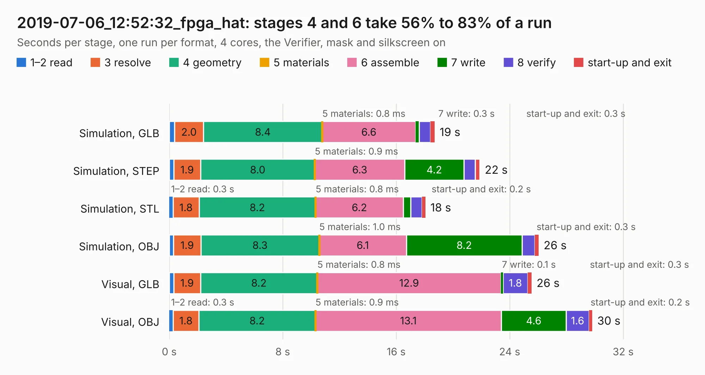

# 3097. 2019-07-06_12:52:32_fpga_hat

Board 3,097 of the 3,125 of [Corpus Testing](../Corpus-Testing.md), on [Corpus Page 29](../CorpusTestingPages/Corpus-Testing-29.md#3097-2019-07-06_125232_fpga_hat).

| Mode and format | 1–2 read | 3 resolve | 4 geometry | 5 materials | 6 assemble | 7 write | 8 verify | start-up and exit | Total |
|---|---:|---:|---:|---:|---:|---:|---:|---:|---:|
| Simulation, GLB | 0.4 | 2.0 | 8.4 | 0.8&nbsp;ms | 6.6 | 0.3 | 0.8 | 0.3 | 18.7 |
| Simulation, STEP | 0.3 | 1.9 | 8.0 | 0.9&nbsp;ms | 6.3 | 4.2 | 0.8 | 0.3 | 21.9 |
| Simulation, STL | 0.3 | 1.8 | 8.2 | 0.8&nbsp;ms | 6.2 | 0.5 | 0.8 | 0.2 | 18.1 |
| Simulation, OBJ | 0.3 | 1.9 | 8.3 | 1.0&nbsp;ms | 6.1 | 8.2 | 0.9 | 0.3 | 26.0 |
| Visual, GLB | 0.3 | 1.9 | 8.2 | 0.8&nbsp;ms | 12.9 | 0.1 | 1.8 | 0.3 | 25.5 |
| Visual, OBJ | 0.3 | 1.8 | 8.2 | 0.9&nbsp;ms | 13.1 | 4.6 | 1.6 | 0.2 | 29.8 |

<table align="center"><tr><td valign="top">

| Board | Repo: [Wren6991/Snowflake-FPGA](https://github.com/Wren6991/Snowflake-FPGA) Board: `2019-07-06_12:52:32_fpga_hat.kicad_pcb` |
|---|---|
| Folder | timelapse |
| Complexity | 294&nbsp;/&nbsp;1000 (size&nbsp;259, features&nbsp;35) |
| KESE&nbsp;features | through vias, rounded, trapezoid or chamfered pads, curved board outline |
| Tested | 9th November 2026 |
| Copper&nbsp;layers | 4 |
| File&nbsp;format | KiCad 5 (20171130) |
| Parts,&nbsp;tracks,&nbsp;vias | 82, 1,098, 122 |
| Triangles,&nbsp;simulation | 1,583,024 in 150 parts |
| Verifier | PASS in all six runs |

</td><td valign="top">

<table>
<tr><th>File type</th><th>File size</th><th>Peak memory used</th></tr>
<tr><th colspan="3" align="left">Simulation</th></tr>
<tr><td>GLB</td><td align="right">55&nbsp;MB</td><td align="right">624&nbsp;MB</td></tr>
<tr><td>STEP</td><td align="right">252&nbsp;MB</td><td align="right">670&nbsp;MB</td></tr>
<tr><td>STL</td><td align="right">79&nbsp;MB</td><td align="right">633&nbsp;MB</td></tr>
<tr><td>OBJ</td><td align="right">165&nbsp;MB</td><td align="right">1.0&nbsp;GB</td></tr>
<tr><th colspan="3" align="left">Visual</th></tr>
<tr><td>GLB</td><td align="right">32&nbsp;MB</td><td align="right">729&nbsp;MB</td></tr>
<tr><td>OBJ</td><td align="right">96&nbsp;MB</td><td align="right">729&nbsp;MB</td></tr>
</table>

</td></tr></table>

| Previous | Next |
|:---|---:|
| [3096. 2019-07-06_12:41:44_fpga_hat](b3096b_Snowflake-FPGA_2019-07-06-12-41-44-fpga-hat.md) | [3098. 2019-07-06_12:56:05_fpga_hat](b3098b_Snowflake-FPGA_2019-07-06-12-56-05-fpga-hat.md) |
