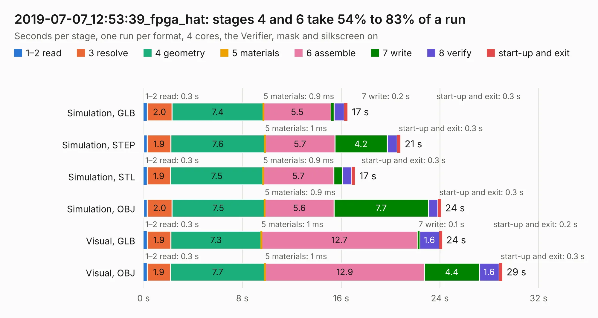

# 3098. 2019-07-07_12:53:39_fpga_hat

Board 3,098 of the 3,120 of [Corpus Testing](../Corpus-Testing.md), on [Corpus Page 29](../CorpusTestingPages/Corpus-Testing-29.md#3098-2019-07-07_125339_fpga_hat).

| Mode and format | 1–2 read | 3 resolve | 4 geometry | 5 materials | 6 assemble | 7 write | 8 verify | start-up and exit | Total |
|---|---:|---:|---:|---:|---:|---:|---:|---:|---:|
| Simulation, GLB | 0.3 | 2.0 | 7.4 | 0.9&nbsp;ms | 5.5 | 0.2 | 0.8 | 0.3 | 16.5 |
| Simulation, STEP | 0.3 | 1.9 | 7.6 | 1&nbsp;ms | 5.7 | 4.2 | 0.8 | 0.3 | 20.8 |
| Simulation, STL | 0.3 | 1.9 | 7.5 | 0.9&nbsp;ms | 5.7 | 0.7 | 0.8 | 0.3 | 17.1 |
| Simulation, OBJ | 0.3 | 2.0 | 7.5 | 0.9&nbsp;ms | 5.6 | 7.7 | 0.7 | 0.3 | 24.1 |
| Visual, GLB | 0.3 | 1.9 | 7.3 | 1&nbsp;ms | 12.7 | 0.1 | 1.6 | 0.2 | 24.2 |
| Visual, OBJ | 0.3 | 1.9 | 7.7 | 1&nbsp;ms | 12.9 | 4.4 | 1.6 | 0.3 | 29.1 |

<table align="center"><tr><td valign="top">

| Board | Repo: [Wren6991/Snowflake-FPGA](https://github.com/Wren6991/Snowflake-FPGA) Board: `2019-07-07_12:53:39_fpga_hat.kicad_pcb` |
|---|---|
| Folder | timelapse |
| Complexity | 294&nbsp;/&nbsp;1000 (size&nbsp;259, features&nbsp;35) |
| KESE&nbsp;features | through vias, rounded, trapezoid or chamfered pads, curved board outline |
| Tested | 9th November 2026 |
| Copper&nbsp;layers | 4 |
| File&nbsp;format | KiCad 5 (20171130) |
| Parts,&nbsp;tracks,&nbsp;vias | 82, 1,101, 122 |
| Triangles,&nbsp;simulation | 1,560,228 in 150 parts |
| Verifier | PASS in all six runs |

</td><td valign="top">

<table>
<tr><th>File type</th><th>File size</th><th>Peak memory used</th></tr>
<tr><th colspan="3" align="left">Simulation</th></tr>
<tr><td>GLB</td><td align="right">54&nbsp;MB</td><td align="right">643&nbsp;MB</td></tr>
<tr><td>STEP</td><td align="right">243&nbsp;MB</td><td align="right">656&nbsp;MB</td></tr>
<tr><td>STL</td><td align="right">78&nbsp;MB</td><td align="right">596&nbsp;MB</td></tr>
<tr><td>OBJ</td><td align="right">163&nbsp;MB</td><td align="right">1.1&nbsp;GB</td></tr>
<tr><th colspan="3" align="left">Visual</th></tr>
<tr><td>GLB</td><td align="right">32&nbsp;MB</td><td align="right">667&nbsp;MB</td></tr>
<tr><td>OBJ</td><td align="right">95&nbsp;MB</td><td align="right">713&nbsp;MB</td></tr>
</table>

</td></tr></table>

| Previous | Next |
|:---|---:|
| [3097. 2019-07-06_13:40:48_fpga_hat](b3097b_Snowflake-FPGA_2019-07-06-13-40-48-fpga-hat.md) | [3099. 2019-07-07_13:11:04_fpga_hat](b3099b_Snowflake-FPGA_2019-07-07-13-11-04-fpga-hat.md) |
