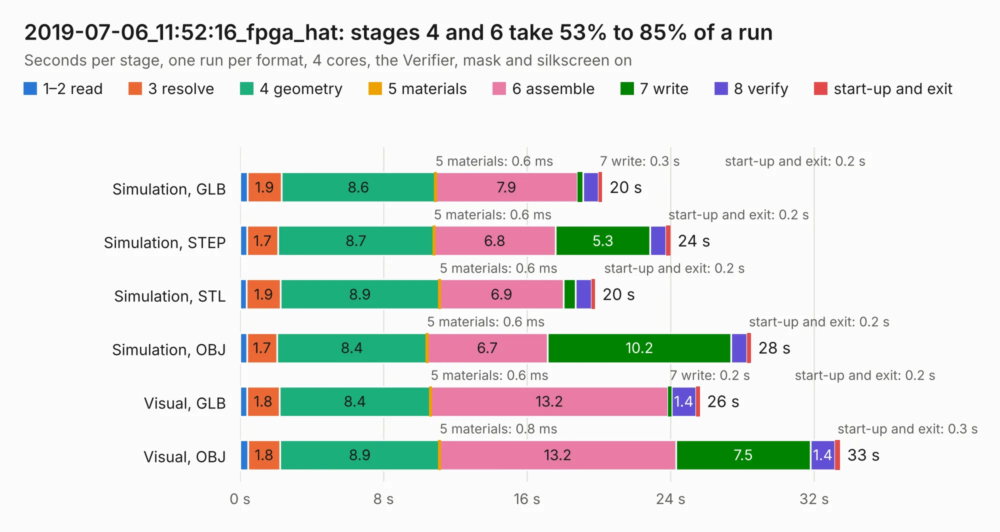

# 3099. 2019-07-06_11:52:16_fpga_hat

Board 3,099 of the 3,131 of [Corpus Testing](../Corpus-Testing.md), on [Corpus Page 29](../CorpusTestingPages/Corpus-Testing-29.md#3099-2019-07-06_115216_fpga_hat).

| Mode and format | 1–2 read | 3 resolve | 4 geometry | 5 materials | 6 assemble | 7 write | 8 verify | start-up and exit | Total |
|---|---:|---:|---:|---:|---:|---:|---:|---:|---:|
| Simulation, GLB | 0.4 | 1.9 | 8.6 | 0.6&nbsp;ms | 7.9 | 0.3 | 0.9 | 0.2 | 20.2 |
| Simulation, STEP | 0.4 | 1.7 | 8.7 | 0.6&nbsp;ms | 6.8 | 5.3 | 0.9 | 0.2 | 24.0 |
| Simulation, STL | 0.4 | 1.9 | 8.9 | 0.6&nbsp;ms | 6.9 | 0.7 | 0.9 | 0.2 | 19.8 |
| Simulation, OBJ | 0.4 | 1.7 | 8.4 | 0.6&nbsp;ms | 6.7 | 10.2 | 0.9 | 0.2 | 28.5 |
| Visual, GLB | 0.4 | 1.8 | 8.4 | 0.6&nbsp;ms | 13.2 | 0.2 | 1.4 | 0.2 | 25.6 |
| Visual, OBJ | 0.4 | 1.8 | 8.9 | 0.8&nbsp;ms | 13.2 | 7.5 | 1.4 | 0.3 | 33.4 |

<table align="center"><tr><td valign="top">

| Board | Repo: [Wren6991/Snowflake-FPGA](https://github.com/Wren6991/Snowflake-FPGA) Board: `2019-07-06_11:52:16_fpga_hat.kicad_pcb` |
|---|---|
| Folder | timelapse |
| Complexity | 314&nbsp;/&nbsp;1000 (size&nbsp;259, features&nbsp;55) |
| KESE&nbsp;features | through vias, rounded, trapezoid or chamfered pads, filled zones, curved board outline |
| Tested | 9th November 2026 |
| Copper&nbsp;layers | 4 |
| File&nbsp;format | KiCad 5 (20171130) |
| Parts,&nbsp;tracks,&nbsp;vias | 82, 1,099, 117 |
| Triangles,&nbsp;simulation | 1,963,140 in 150 parts |
| Verifier | PASS in all six runs |

</td><td valign="top">

<table>
<tr><th>File type</th><th>File size</th><th>Peak memory used</th></tr>
<tr><th colspan="3" align="left">Simulation</th></tr>
<tr><td>GLB</td><td align="right">68&nbsp;MB</td><td align="right">733&nbsp;MB</td></tr>
<tr><td>STEP</td><td align="right">320&nbsp;MB</td><td align="right">846&nbsp;MB</td></tr>
<tr><td>STL</td><td align="right">98&nbsp;MB</td><td align="right">764&nbsp;MB</td></tr>
<tr><td>OBJ</td><td align="right">207&nbsp;MB</td><td align="right">1.4&nbsp;GB</td></tr>
<tr><th colspan="3" align="left">Visual</th></tr>
<tr><td>GLB</td><td align="right">41&nbsp;MB</td><td align="right">753&nbsp;MB</td></tr>
<tr><td>OBJ</td><td align="right">123&nbsp;MB</td><td align="right">949&nbsp;MB</td></tr>
</table>

</td></tr></table>

| Previous | Next |
|:---|---:|
| [3098. 2019-07-06_11:30:20_fpga_hat](b3098b_Snowflake-FPGA_2019-07-06-11-30-20-fpga-hat.md) | [3100. 2019-07-06_12:26:53_fpga_hat](b3100b_Snowflake-FPGA_2019-07-06-12-26-53-fpga-hat.md) |
