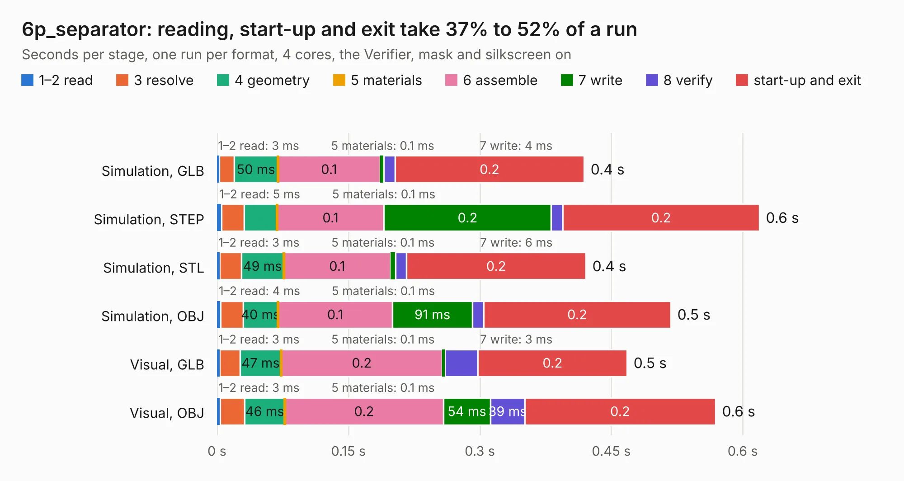

# 3101. 6p_separator

Board 3,101 of the 3,105 of [Corpus Testing](../Corpus-Testing.md), on [Corpus Page 29](../CorpusTestingPages/Corpus-Testing-29.md#3101-6p_separator).

| Mode and format | 1–2 read | 3 resolve | 4 geometry | 5 materials | 6 assemble | 7 write | 8 verify | start-up and exit | Total |
|---|---:|---:|---:|---:|---:|---:|---:|---:|---:|
| Simulation, GLB | 3&nbsp;ms | 17&nbsp;ms | 50&nbsp;ms | 0.1&nbsp;ms | 0.1 | 4&nbsp;ms | 13&nbsp;ms | 0.2 | 0.4 |
| Simulation, STEP | 5&nbsp;ms | 26&nbsp;ms | 37&nbsp;ms | 0.1&nbsp;ms | 0.1 | 0.2 | 13&nbsp;ms | 0.2 | 0.6 |
| Simulation, STL | 3&nbsp;ms | 24&nbsp;ms | 49&nbsp;ms | 0.1&nbsp;ms | 0.1 | 6&nbsp;ms | 12&nbsp;ms | 0.2 | 0.4 |
| Simulation, OBJ | 4&nbsp;ms | 26&nbsp;ms | 40&nbsp;ms | 0.1&nbsp;ms | 0.1 | 91&nbsp;ms | 13&nbsp;ms | 0.2 | 0.5 |
| Visual, GLB | 3&nbsp;ms | 23&nbsp;ms | 47&nbsp;ms | 0.1&nbsp;ms | 0.2 | 3&nbsp;ms | 38&nbsp;ms | 0.2 | 0.5 |
| Visual, OBJ | 3&nbsp;ms | 28&nbsp;ms | 46&nbsp;ms | 0.1&nbsp;ms | 0.2 | 54&nbsp;ms | 39&nbsp;ms | 0.2 | 0.6 |

<table align="center"><tr><td valign="top">

| Board | Repo: [ZeroPhone/ZeroPhone-PCBs](https://github.com/ZeroPhone/ZeroPhone-PCBs) Board: `6p_separator.kicad_pcb` |
|---|---|
| Folder | 6p_separator |
| Complexity | 24&nbsp;/&nbsp;1000 (size&nbsp;24, features&nbsp;0) |
| Tested | 9th November 2026 |
| Copper&nbsp;layers | 2 |
| File&nbsp;format | KiCad 4 (4) |
| Parts,&nbsp;tracks,&nbsp;vias | 1, 0, 0 |
| Triangles,&nbsp;simulation | 18,436 in 9 parts |
| Verifier | PASS in all six runs |

</td><td valign="top">

<table>
<tr><th>File type</th><th>File size</th><th>Peak memory used</th></tr>
<tr><th colspan="3" align="left">Simulation</th></tr>
<tr><td>GLB</td><td align="right">598&nbsp;kB</td><td align="right">41&nbsp;MB</td></tr>
<tr><td>STEP</td><td align="right">2.3&nbsp;MB</td><td align="right">43&nbsp;MB</td></tr>
<tr><td>STL</td><td align="right">923&nbsp;kB</td><td align="right">41&nbsp;MB</td></tr>
<tr><td>OBJ</td><td align="right">1.7&nbsp;MB</td><td align="right">44&nbsp;MB</td></tr>
<tr><th colspan="3" align="left">Visual</th></tr>
<tr><td>GLB</td><td align="right">410&nbsp;kB</td><td align="right">69&nbsp;MB</td></tr>
<tr><td>OBJ</td><td align="right">1.1&nbsp;MB</td><td align="right">58&nbsp;MB</td></tr>
</table>

</td></tr></table>

| Previous | Next |
|:---|---:|
| [3100. 18650_pcb](b3100b_ZeroPhone-PCBs_18650-pcb.md) | [3102. back_pcb](b3102b_ZeroPhone-PCBs_back-pcb.md) |
