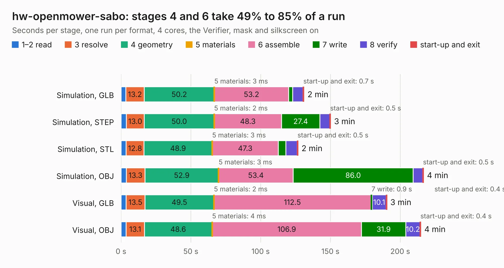

# 3102. hw-openmower-sabo

Board 3,102 of the 3,116 of [Corpus Testing](../Corpus-Testing.md), on [Corpus Page 29](../CorpusTestingPages/Corpus-Testing-29.md#3102-hw-openmower-sabo).

| Mode and format | 1–2 read | 3 resolve | 4 geometry | 5 materials | 6 assemble | 7 write | 8 verify | start-up and exit | Total |
|---|---:|---:|---:|---:|---:|---:|---:|---:|---:|
| Simulation, GLB | 3.4 | 13.2 | 50.2 | 3&nbsp;ms | 53.2 | 2.8 | 7.4 | 0.7 | 131.0 |
| Simulation, STEP | 3.7 | 13.0 | 50.0 | 2&nbsp;ms | 48.3 | 27.4 | 7.2 | 0.5 | 150.1 |
| Simulation, STL | 3.7 | 12.8 | 48.9 | 3&nbsp;ms | 47.3 | 5.4 | 8.1 | 0.5 | 126.7 |
| Simulation, OBJ | 3.7 | 13.3 | 52.9 | 3&nbsp;ms | 53.4 | 86.0 | 6.8 | 0.5 | 216.6 |
| Visual, GLB | 3.6 | 13.5 | 49.5 | 2&nbsp;ms | 112.5 | 0.9 | 10.1 | 0.4 | 190.3 |
| Visual, OBJ | 3.7 | 13.1 | 48.6 | 4&nbsp;ms | 106.9 | 31.9 | 10.2 | 0.4 | 214.7 |

<table align="center"><tr><td valign="top">

| Board | Repo: [xtech/hw-openmower-sabo](https://github.com/xtech/hw-openmower-sabo) Board: `hw-openmower-sabo.kicad_pcb` |
|---|---|
| Complexity | 419&nbsp;/&nbsp;1000 (size&nbsp;249, features&nbsp;170) |
| KESE&nbsp;features | through vias, slotted holes, custom pads, rounded, trapezoid or chamfered pads, drill offsets, filled zones, copper drawings, knockout text, TrueType text, stack-up, dielectric εr and tanδ, copper finish, mask and silkscreen colours |
| Tested | 9th November 2026 |
| Copper&nbsp;layers | 6 |
| File&nbsp;format | KiCad 10 (20260206) |
| Parts,&nbsp;tracks,&nbsp;vias | 324, 2,730, 1,177 |
| Triangles,&nbsp;simulation | 11,081,862 in 442 parts |
| Verifier | PASS in all six runs |

</td><td valign="top">

<table>
<tr><th>File type</th><th>File size</th><th>Peak memory used</th></tr>
<tr><th colspan="3" align="left">Simulation</th></tr>
<tr><td>GLB</td><td align="right">368&nbsp;MB</td><td align="right">3.1&nbsp;GB</td></tr>
<tr><td>STEP</td><td align="right">1.4&nbsp;GB</td><td align="right">3.8&nbsp;GB</td></tr>
<tr><td>STL</td><td align="right">554&nbsp;MB</td><td align="right">3.1&nbsp;GB</td></tr>
<tr><td>OBJ</td><td align="right">1.2&nbsp;GB</td><td align="right">6.9&nbsp;GB</td></tr>
<tr><th colspan="3" align="left">Visual</th></tr>
<tr><td>GLB</td><td align="right">179&nbsp;MB</td><td align="right">3.1&nbsp;GB</td></tr>
<tr><td>OBJ</td><td align="right">582&nbsp;MB</td><td align="right">3.8&nbsp;GB</td></tr>
</table>

</td></tr></table>

| Previous | Next |
|:---|---:|
| [3101. CAT](b3101b_CAT-Board_CAT.md) | [3103. hw-openmower-universal](b3103b_hw-openmower-universal_hw-openmower-universal.md) |
