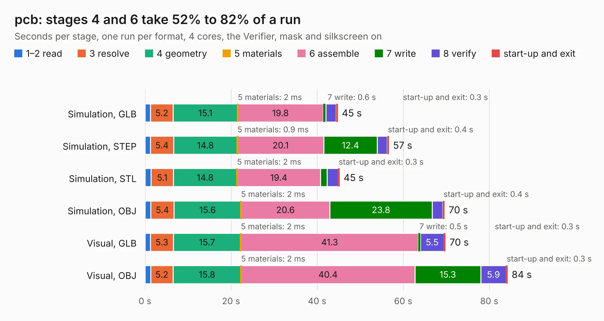

# 3104. pcb

Board 3,104 of the 3,111 of [Corpus Testing](../Corpus-Testing.md), on [Corpus Page 29](../CorpusTestingPages/Corpus-Testing-29.md#3104-pcb).

| Mode and format | 1–2 read | 3 resolve | 4 geometry | 5 materials | 6 assemble | 7 write | 8 verify | start-up and exit | Total |
|---|---:|---:|---:|---:|---:|---:|---:|---:|---:|
| Simulation, GLB | 1.3 | 5.2 | 15.1 | 2&nbsp;ms | 19.8 | 0.6 | 2.4 | 0.3 | 44.7 |
| Simulation, STEP | 1.3 | 5.4 | 14.8 | 0.9&nbsp;ms | 20.1 | 12.4 | 2.3 | 0.4 | 56.6 |
| Simulation, STL | 1.4 | 5.1 | 14.8 | 2&nbsp;ms | 19.4 | 1.5 | 2.6 | 0.3 | 45.2 |
| Simulation, OBJ | 1.3 | 5.4 | 15.6 | 2&nbsp;ms | 20.6 | 23.8 | 2.5 | 0.4 | 69.6 |
| Visual, GLB | 1.3 | 5.3 | 15.7 | 2&nbsp;ms | 41.3 | 0.5 | 5.5 | 0.3 | 69.8 |
| Visual, OBJ | 1.3 | 5.2 | 15.8 | 2&nbsp;ms | 40.4 | 15.3 | 5.9 | 0.3 | 84.2 |

<table align="center"><tr><td valign="top">

| Board | Repo: [zephray/nekoink](https://github.com/zephray/nekoink) Board: `pcb.kicad_pcb` |
|---|---|
| Folder | pcb / mainboard_gen1 |
| Complexity | 441&nbsp;/&nbsp;1000 (size&nbsp;301, features&nbsp;140) |
| KESE&nbsp;features | through vias, slotted holes, custom pads, rounded, trapezoid or chamfered pads, arc tracks, filled zones, copper drawings, curved board outline, stack-up, dielectric εr and tanδ, mask and silkscreen colours |
| Tested | 9th November 2026 |
| Copper&nbsp;layers | 4 |
| File&nbsp;format | KiCad 6 (20211014) |
| Parts,&nbsp;tracks,&nbsp;vias | 231, 6,227, 606 |
| Triangles,&nbsp;simulation | 4,542,078 in 352 parts |
| Verifier | PASS in all six runs |

</td><td valign="top">

<table>
<tr><th>File type</th><th>File size</th><th>Peak memory used</th></tr>
<tr><th colspan="3" align="left">Simulation</th></tr>
<tr><td>GLB</td><td align="right">154&nbsp;MB</td><td align="right">1.4&nbsp;GB</td></tr>
<tr><td>STEP</td><td align="right">721&nbsp;MB</td><td align="right">1.8&nbsp;GB</td></tr>
<tr><td>STL</td><td align="right">227&nbsp;MB</td><td align="right">1.4&nbsp;GB</td></tr>
<tr><td>OBJ</td><td align="right">482&nbsp;MB</td><td align="right">2.9&nbsp;GB</td></tr>
<tr><th colspan="3" align="left">Visual</th></tr>
<tr><td>GLB</td><td align="right">100&nbsp;MB</td><td align="right">1.7&nbsp;GB</td></tr>
<tr><td>OBJ</td><td align="right">318&nbsp;MB</td><td align="right">2.1&nbsp;GB</td></tr>
</table>

</td></tr></table>

| Previous | Next |
|:---|---:|
| [3103. adapter](b3103b_nekoink_adapter.md) | [3105. pcb](b3105b_nekoink_pcb-mainboard-gen2_pcb.md) |
